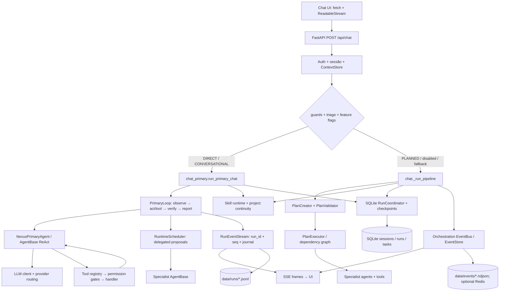

# NEXUS — Auditoria Técnica do Backend Agentic

**Escopo auditado:** `nexus-ide/backend/` e entrypoints/scripts diretamente ligados ao backend. O frontend foi consultado apenas para confirmar transporte e contrato SSE. Nenhum código de produto foi alterado.

## Critério de evidência

- **PROVEN WORKING**: comportamento observado em runtime nesta auditoria; o limite do teste fica explícito.
- **PARTIALLY WORKING**: runtime ou teste prova uma parte, mas não o contrato completo.
- **PRESENT BUT UNPROVEN**: implementação encontrada, sem prova de runtime adequada.
- **MOCKED**: comportamento observado apenas com provider, transporte ou colaborador simulado.
- **BROKEN**: cenário real executado falhou.
- **MISSING**: não foi encontrada implementação funcional no caminho auditado.
- **DEAD CODE**: módulo existe, mas não foi encontrado callsite ativo.

**Nota:** nenhum teste com modelo comercial/hosted real foi executado. O provider local Ollama não estava acessível; o backend não estava a correr nos endpoints de desenvolvimento. Os testes E2E usados abaixo empregam respostas determinísticas, mas executam o backend e ferramentas reais.

# 1. Executive Verdict

O NEXUS tem **dois backends agentic sobrepostos**, não um harness único:

1. **PRIMARY**: `POST /api/chat` → um `NexusPrimaryAgent` com loop ReAct, registry de tools, observação do projeto, verificação e eventos por run. É o caminho para pedidos `DIRECT` e `CONVERSATIONAL`.
2. **Legacy planned/mission**: planner, `PlanExecutor`, grafo de dependências, agentes especializados, retries e verificador. É o caminho padrão para pedidos `PLANNED` e missões multi-fase.

A prova de runtime confirma o fluxo principal de chat com provider guionado e ferramentas reais de ficheiros, e confirma recuperação simples após morte/restart de um processo. Não confirma qualidade de inferência com um modelo real. O teste do loop, terminal e Git passa; o teste de autonomia longa falha no seu critério de conclusão; o teste E2E principal falha 4 das 16 asserções de cenário, incluindo contaminação observada entre duas sessões concorrentes.

**Veredicto:** C — **Agentic coding assistant**, com capacidades reais mas fronteiras de autonomia e delegação inconsistentes. **Não** é um multi-agent harness fiável nem um ambiente de engenharia autónoma production-grade.

**Bloqueio de qualificação:** não havia serviço em `127.0.0.1:8001`; `127.0.0.1:8000` e Ollama em `127.0.0.1:11434` também não responderam. Não fiz chamadas a providers externos. O runtime real de modelo continua **unproven**.

# 2. Architecture Map

Mapa por subsistema, com base no código:

| Subsistema | Implementação encontrada | Observação de auditoria |
|---|---|---|
| Servidor/API | `backend/orchestrator/main.py`, routers sob `backend/orchestrator/routes/` | FastAPI, autenticação deny-by-default, SSE e um WebSocket de missões. |
| Runtime principal | `backend/runtime/primary.py`, `backend/orchestrator/routes/chat_primary.py` | Loop bounded, eventos ordenados, verificador e scheduler de propostas. |
| Runtime planeado | `backend/orchestrator/engine.py`, `plan_creator.py`, `plan_executor.py`, `dependency_graph.py` | Caminho separado do PRIMARY; executa planos em camadas com retries e concorrência. |
| Agentes/modelos | `backend/agents/`, `backend/llm/`, `config/models.yaml`, `config/model-roles.yaml` | Registry lazy; NEXUS é o agente primário; especialistas continuam registados. |
| Tools | `backend/tools/registry.py`, `backend/tools/__init__.py`, `backend/agents/base.py` | Tools auto-registadas por módulos; o modelo recebe apenas o subconjunto do agente/contrato. |
| Skills | `backend/core/skill_runtime.py`, `skill_builder.py`, `backend/tools/skills_tools.py` | Skills em Markdown; seleção lexical limitada; criação produz DRAFT, não código executável. |
| Memória/RAG | `backend/knowledge/`, `backend/memory/`, `backend/tools/embeddings.py`, `backend/swarm/rag/` | Vários stores e caminhos de retrieval; Qdrant é opcional. |
| Persistência | `backend/persistence/db.py`, `schemas.sql`, `backend/runtime/run_coordinator.py` | SQLite guarda sessões, mensagens, runs, checkpoints, side effects e tarefas. |
| Eventos/observabilidade | `backend/runtime/events.py`, `backend/orchestrator/events.py`, `backend/observability/` | Existem buses distintos; PRIMARY tem sequência por run, mas a observabilidade global não é uma única trace. |
| Workers/scheduler | `backend/tasks/autonomous_tasks.py`, lifespan de `main.py` | TaskScheduler é independente do todo do chat e arranca por configuração do lifespan. |
| Sandbox/terminal/files | `backend/sandbox/`, `backend/core/workspace*`, `backend/tools/file_api.py` | Docker é opcional; fallback de execução pode correr no host. |
| Browser/web/Git | `backend/tools/browser_automation.py`, `safe_http.py`, `web_search*.py`, `git_tools.py` | Browser Playwright opcional; web HTTP e browser não são a mesma capacidade. |
| MCP/plugins | `backend/mcp/`, `backend/tools/mcp_tools.py`, `backend/plugins/registry.py` | MCP tem callsites ativos; não foi encontrado loader ativo para `plugins/registry.py`. |

# 3. Request Lifecycle

1. A UI envia `POST /api/chat` como `fetch` + `ReadableStream`, `Accept: text/event-stream` e bearer token (`frontend/lib/api.ts:114-129`, `frontend/hooks/useAgentStream.ts:847-858`). O backend devolve `StreamingResponse` SSE (`backend/orchestrator/routes/chat.py:2584-2593,2776-2784`). O chat não usa WebSocket.
2. `chat()` autentica e resolve a sessão pertencente ao utilizador; substitui `default` por um ID derivado do utilizador; obtém `llm_client`, registry e `ContextStore` (`chat.py:2595-2632`).
3. O gerador passa por `_select_pipeline()`: valida `session_id`, deteta padrões de prompt injection, impõe o limite de mensagem e resolve comandos (`chat.py:2812-2894`).
4. `chat_primary.plan_turn()` classifica o pedido. `should_use_primary()` envia `DIRECT` e `CONVERSATIONAL` para PRIMARY; pedidos `PLANNED` permanecem no pipeline legacy por omissão (`chat_primary.py:251-276`; `chat.py:2908-2944`). Se o PRIMARY falhar antes de emitir frames, há fallback legacy; depois do primeiro frame não há replay silencioso (`chat.py:2952-2998`).
5. `run_primary_chat()` seleciona `NEXUS`, carrega histórico, skill e continuidade, constrói a request/model override, aplica allowlist e constrói `PrimaryLoop` (`chat_primary.py:1543-1648,1660-1779,1801-1847`).
6. `make_signal_stream()` cria `AgentRequest` e invoca `agent.run()`. `AgentBase` compõe prompt, schemas, chamada ao provider, parser explícito de tool-call, despacho para `execute_tool()` e resultado no próximo turno ReAct (`chat_primary.py:962-1057`; `agents/base.py:820-1070,3033-3057,3480-3726`).
7. Os eventos do AgentBase são convertidos em sinais. `PrimaryLoop` emite `TOOL_STARTED` e depois `TOOL_COMPLETED/FAILED`; o resultado regressa ao ciclo ReAct do AgentBase e fica disponível ao modelo seguinte (`chat_primary.py:491-539,1366-1386`; `primary.py:1096-1157`).
8. `PrimaryLoop.run()` executa observe → act/tool → verification → report. `runtime_event_to_stream_events()` mantém `run_id`, `seq`, `event_id`, `task_id` e serializa SSE (`primary.py:520-708`; `chat_primary.py:1188-1241,1930-1966`).
9. A resposta e o estado final são persistidos em `messages`/`session_runs`; o lifecycle durável é fechado (`chat_primary.py:1999-2023,2302-2422`). O frontend pode reconectar e pedir replay de eventos por `run_id`/`after_seq` (`frontend/hooks/useAgentStream.ts:75-92,553-567`).
10. No caminho legacy, `_run_pipeline()` faz routing, planeamento/orquestração e executa `PlanExecutor`; não passa pelo `PrimaryLoop` (`chat.py:3001+`; `orchestrator/engine.py:812-929`).

# 4. Agent Loop

**Classificação: PARTIALLY WORKING; E2E primário PROVEN com provider guionado; provider real UNPROVEN.**

`PrimaryLoop.run()` percorre fases explícitas `OBSERVE`, `ACT`, `TOOL`, `TEST`, `REPORT` (`backend/runtime/primary.py:215-220,520-708,714-844`). A observação do projeto é feita antes do primeiro token, quando há projeto e tarefa com tools (`chat_primary.py:246-248,1816-1821`). Tool calls resultam em novos sinais/eventos; o `AgentBase` executa o ReAct interior e volta a chamar o modelo com o resultado (`agents/base.py:3493-3565,3577-3726`).

Limites observados no código:

- PRIMARY permite no máximo **2 ciclos** de loop para trabalho e 1 para conversa/sem projeto por `_primary_max_cycles()`; orientação recebida em execução pode acrescentar ciclos, mas tem limite de mensagens (`primary.py:584-597`; `chat_primary.py:680-696,1836-1839`).
- O modelo recebe limite de iterações do pedido/configuração; a configuração geral do ReAct também tem teto (`chat_primary.py:1767-1773`; `agents/base.py:2758-2775`).
- Timeout por sinal do provider é configurável; valor zero desativa o timeout do `PrimaryLoop` (`chat_primary.py:699-721`; `primary.py:913-962`). Tools têm timeout próprio no registry.
- O PRIMARY tenta uma vez certos erros transitórios (`rate_limit`, `upstream_error`, `timeout`) antes de qualquer output (`primary.py:991-1008`).
- STOP é pausa cooperativa, não cancelamento imediato. O modelo driver só observa a pausa depois de receber um sinal (`primary.py:919-979`).
- Verification failed pode gerar um ciclo de recuperação, bounded pelo limite de ciclos (`primary.py:680-708`).

A verificação sem testes executados é um ponto crítico: `_verify()` representa “no tests”/“sem projeto” com `ran=False, ok=True`; `_primary_dod_results()` interpreta qualquer `ran=False` como `verification_ok` e pode marcar a definição de feito verificada (`chat_primary.py:390-397,438-447,853-865`). Isso é tolerável para conversa sem alterações, mas não prova código correto quando um projeto alterado não tem testes.

# 5. Planning

**Classificação: PARTIALLY WORKING.** Há um planner e DAG reais no legacy; o caminho primário não usa esse planner para tarefas multi-fase.

- O PRIMARY usa triage determinístico e não chama `PlanCreator` para converter automaticamente um pedido grande em DAG. A própria política deixa `PLANNED` no pipeline legacy (`chat_primary.py:251-276`).
- Legacy: `OrchestrationEngine.create_plan()` cria/valida plano e pode exigir aprovação; `execute_plan()` valida novamente e chama `PlanExecutor` (`orchestrator/engine.py:423-479,812-887`).
- `PlanExecutor` executa tarefas por camadas com dependências, semaphore `max_parallel=5`, retries por tarefa e expansão dinâmica de `spawn_task` (`orchestrator/plan_executor.py:192-233,248-401,535-605`).
- `PlanCreator` e validação exigem condições verificáveis/etapa DEBUGGER em planos suportados (`orchestrator/plan_creator.py:589-603`; `plan_validation.py:465-480`).
- A missão longa de teste executa plan → tasks → restart → resume, mas **falha no resultado final** após duas rondas de verificação (`Runtime Experiments`, cenário 5).

A separação PRIMARY/legacy é positiva para evitar overhead num pedido simples, mas defeituosa como arquitetura de execução: têm loops, tarefas, eventos, retries e regras DoD diferentes.

# 6. Todo System

**Classificação: PARTIALLY WORKING como checklist persistente; MISSING como controlador de execução.**

`todo_write`/`todo_list` gravam um JSON por sessão em `data/todos/{safe_session_id}.json`, com escrita `.tmp` + `os.replace` (`backend/tools/todo_tools.py:1-7,110-130,239-245`). A sessão é imposta pelo contexto confiável, não pelos argumentos do modelo (`agents/base.py:1086-1090`; `registry.py:1682-1699`). A UI e tools de sessão leem a mesma fonte JSON (`orchestrator/routes/sessions.py:270-354`).

Estados disponíveis no todo: `pending`, `in_progress`, `completed`, `cancelled` (`todo_tools.py:34-42`). Não há `running`, `failed` nem `blocked`. O código não liga a transição do item ao início/fim/falha de um `RuntimeTask` ou `PlanExecutor`. `PrimaryLoop` apenas converte payloads de todo em `PLAN_UPDATED` e espelha a lista no progresso do run (`runtime/primary.py:1220-1272`; `chat_primary.py:792-814`). O modelo precisa atualizar o checklist explicitamente.

Há também tabela/CRUD SQLite `todos` (`persistence/schemas.sql:445-458`; `persistence/db.py:2484-2576`), mas as rotas atuais de sessão usam o JSON. São duas representações sem uma única fonte de verdade; os CRUD SQLite não aparecem nos callsites atuais da API/todo tools.

A fila `scheduled_tasks` é outro sistema, separado, persistido em SQLite. Não é o todo do chat (`schemas.sql:464+`; `tasks/autonomous_tasks.py:62-72,337-445`).

# 7. Tools

**Classificação da arquitetura: PROVEN WORKING para o caminho de tool do PRIMARY com o provider guionado; registry completo e integrações externas: PRESENT BUT UNPROVEN.**

`backend/tools/__init__.py:16-63` enumera módulos que se registam por import; `registry.py` faz dispatch, valida schema, política de confirmação, orçamento, replay/idempotência, cache, timeout e framing de conteúdo externo (`registry.py:1636-1876,1882-1961`). O NEXUS primário expõe o conjunto definido por `NexusPrimaryAgent.supported_actions`, não todas as tools do registry (`agents/nexus_primary.py:30-85`). O modelo recebe schemas de `ToolSpec` e descrições `when_to_use`; tools indisponíveis não são anunciadas (`agents/base.py:820-850,945-1070`). O conjunto primário é relativamente estático para cada agente/request; a descoberta MCP é dinâmica, mas não há semantic search generalizado sobre todas as tools.

A tabela agrupa por família; cada nome individual abaixo vem de módulos registrados, mas a disponibilidade depende de optional dependencies/configuração. “Executável” aqui significa handler/dispatcher presente, salvo indicação; só a coluna runtime indica o que foi exercitado.

| Tool(s) | Implementada | Registada | Executável no ambiente auditado | Testada em runtime nesta auditoria | Permission / boundary | Resultado |
|---|---|---|---|---|---|---|
| `read_file`, `list_dir` | Sim | Sim | Sim | **Sim**, via `POST /api/chat` e projeto temporário | Relativas ao `project_path`; reads não pedem aprovação | **PROVEN WORKING** no caminho PRIMARY guionado. |
| `write_file` | Sim | Sim | Sim | **Sim**, via `POST /api/chat`, filesystem temporário e restart E2E | Projeto/trust/allowlist; escrita absoluta é separada e exige confirmação | **PROVEN WORKING** para criar ficheiro; edição de código completa não ficou demonstrada no cenário principal. |
| `read_multiple_files`, `search_in_files`, `read_file_absolute`, `list_dir_absolute`, `write_file_absolute`, `search_codebase`, `search_symbols`, `index_codebase`, `index_symbols`, `index_stats` | Sim | Sim | Condicional a filesystem/index | Não executadas pelo modelo nesta auditoria | Path gates; absolutos passam por blocklist; index depende de embeddings/config | **PRESENT BUT UNPROVEN**; risco de stale/index inconsistente. |
| `run_tests`, `run_lint`, `format_code`, `type_check`, `generate_tests` | Sim | Sim | Condicional a toolchain do projeto | A verificação foi fake num cenário; a missão longa usou execução real mas terminou em falha | Execução de comando limitada; verificação é chamada pelo PRIMARY após alterações | **PARTIALLY WORKING**; o gate não prova teste quando `ran=False`. |
| `run_shell`, `execute_shell`, `run_python_script`, `execute_code` | Sim | Sim | Sim; Docker é opcional | `test_shell_runner.py` executou shell local; não foi chamada através de um modelo live | `run_shell` requer confirmação em modo interativo; comandos validados; timeout mata processo; `execute_code` pode cair para subprocess host | **PARTIALLY WORKING**; isolamento varia por Docker/fallback. |
| Git: `git_operation`, `git_commit_safe`, `git_commit_all`, `git_pull`, `git_push`, `git_init`, `git_clone`, `git_status` | Sim | Sim | Sim | `test_git_tools.py` testou repositórios temporários; não foi feita operação no repo do utilizador | Subcomandos/path allowlist; commit/push e outras mutações exigem confirmação | **PARTIALLY WORKING**; teste local passou, não prova todos os caminhos auxiliares. |
| Web: `web_search`, `search_web_v2`, `fetch_url`, `fetch_content_v2`, `deep_research`, `search_github`, `search_docs`, `search_and_answer` | Sim | Sim | Condicional a provider/API/Internet | Não | `safe_http` valida URL/DNS e redirects; web é conteúdo externo e enquadrado; mutações externas exigem confirmação | **PRESENT BUT UNPROVEN** em rede real. |
| Browser: `browser_navigate`, `browser_click`, `browser_fill`, `browser_extract_text`, `browser_screenshot`, `browser_get_links`, `browser_close` | Sim | Sim, mas dependente de Playwright | **Não**: `playwright` não está instalado no `.venv` auditado | Não | A URL inicial é filtrada; redirect/subresource não é filtrado; pool só usa `session_id` | **MISSING no ambiente atual**, implementação **PRESENT BUT UNPROVEN**. |
| Todo: `todo_write`, `todo_list` | Sim | Sim | Sim | Não houve criação de todo via modelo | Escopo confiável por sessão; JSON durável | **PRESENT BUT UNPROVEN** e sem vínculo a execução real. |
| Skills: `list_skills`, `load_skill`, `discover_skill_candidates`, `build_skill`, `promote_skill`, `report_skill_outcome` | Sim | Sim | Sim | Não houve ativação via chat/runtime nesta auditoria | Criação em projeto; promoção é high-risk/aprovação | **PRESENT BUT UNPROVEN** end-to-end. |
| MCP: `mcp_list_tools`, `mcp_call_tool`, `mcp_call_readonly_tool`, `mcp_recommend_tools`, `mcp_builder`, `mcp_project_context`, `mcp_impact_analysis`, `mcp_project_status`, `mcp_sequential_thinking` | Sim | Sim | Depende de connector/process | Não | Connector deve estar habilitado e validado; read-only exige anotação live + fingerprint aprovado; generic call/builder exigem aprovação | **PRESENT BUT UNPROVEN**; o builder testa mock HTTP + handshake, não foi executado aqui. |
| Delegação: `spawn_task`, `consult_agent` | Sim | Sim | Sim, com lifecycle manager configurado | Só foi testada a recusa de proposta inválida; nenhum subagente positivo foi confirmado | SpawnPolicy, contexto/allowlist; há dois caminhos de spawn no PRIMARY | **PARTIALLY WORKING** por código; integração parent/child **unproven** e potencial duplicação. |
| Memória/knowledge: `recall_context`, `store_memory`, `remember_fact`, `recall_user_memories`, `search_knowledge`, `add_knowledge`, `get_knowledge_memory` | Sim | Sim | Condicional ao store/embeddings | Não | User/session/project scope, dados externos são enquadrados | **PRESENT BUT UNPROVEN** em sessão nova/restart. |
| Outros módulos registados | Sim | Sim por `TOOL_MODULES` | Depende de credenciais/deps | Não | Varia por ToolSpec: `api_request`, bus, cron, DB, dependency, directories, Docker, email, notification, profile, project, report, scaffold, TTS, vision | **PRESENT BUT UNPROVEN** individualmente. Nomes incluem `api_request`, `append_file`, `publish_bus_message`, `subscribe_bus_topic`, `check_context_size`, `get_budget_report`, `trim_context`, `schedule_task`, `list_tasks`, `cancel_task`, `scheduler_status`, `data_analysis`, `db_query`, `db_execute`, `db_schema`, `db_tables`, `install_dependency`, `list_dependencies`, `create_directory`, `copy_file`, `move_file`, `delete_file`, `delete_directory`, `get_file_info`, `generate_module_doc`, `docker_ps`, `docker_build`, `docker_run`, `docker_compose_up`, `docker_compose_down`, `docker_logs`, `check_inbox`, `search_emails`, `summarize_inbox`, `send_webhook`, `send_email_notification`, `show_desktop_notification`, `get_user_profile`, `update_user_preferences`, `analyze_project`, `get_project_summary`, `list_project_files`, `report_generation`, `scaffold_project`, `speak`, `tts_status`. |

**Tool feedback:** E2E PRIMARY observou `read_file`/`list_dir` a devolver resultados em sequência e o modelo devolveu resposta posterior; ferramenta inexistente retornou `tool_error` e resposta honesta. Portanto `tool → result → next model call` é **PROVEN WORKING** com provider guionado. A validação de ferramentas por registry também tem unit tests; não foi feita certificação de todos os handlers.

# 8. Tool Creation

**Classificação: PARTIALLY WORKING por MCP Builder; criação de tool Python arbitrária: MISSING.**

`mcp_builder` pede ao modelo um plano declarativo REST (1–8 operações), valida base URL e JSON Schema, escreve template de servidor fixo, manifesto/schemas/config/testes, corre contrato HTTP mockado, testes gerados e handshake MCP real, depois regista connector persistente (`backend/mcp/builder.py:392-559`; tool de alto risco em `backend/tools/mcp_tools.py:283-349`). O código executável do servidor é template controlado, não implementação Python gerada livremente. O connector é salvo em `data/mcp_connectors.json` e recarregado no próximo processo (`backend/mcp/store.py:183-261,561-578`).

Não há evidência de criação runtime de `count_python_files`, carregamento de código Python novo no registry e uso imediato/restart. A capacidade mais próxima é gerar um wrapper declarativo de API e só ativá-lo após aprovação. Os testes existentes do builder usam provider/HTTP simulados; não foram executados nesta auditoria.

# 9. Skills — Arquitetura e Discovery

**Classificação: PRESENT BUT UNPROVEN em chat real.**

`skill_runtime.py` descobre `SKILL.md` no projeto (`.opencode/skills` e `skills`) e diretórios configurados; lê metadados sem carregar todos os corpos; seleção filtra skills não-`ACTIVE`, agentes incompatíveis, tools/MCPs em falta e escolhe lexicalmente até 3 skills, dentro de orçamento aproximado de 8 KB (`backend/core/skill_runtime.py:27-31,91-115,289-317,406-454,457-585`).

`chat_primary.run_primary_chat()` seleciona skills só para tarefa com projeto e não-conversacional e injeta `_skill_context`/ativação na request (`chat_primary.py:1632-1648`). O legacy chama o mesmo seletor (`chat.py:4598-4617`). `AgentBase` insere o conteúdo como dado não confiável em mensagem user-role; a skill não aumenta ferramentas (`agents/base.py:357-377,661-670`).

Não encontrei descoberta semântica por embeddings para skills: ranking é lexical por nome/triggers/descrição/domínio. É mais eficiente que colocar todas as skills no prompt, mas não foi provado que a seleção ativa a skill correta num pedido real.

# 10. Skill Creation e Reutilização

`build_skill` usa `SkillBuilder` para criar e validar `SKILL.md` versionado em `DRAFT`; não sobrescreve uma skill existente. A seleção ignora drafts. `promote_skill` exige reason e aprovação humana ou política explícita de auto-promoção/confiança (`backend/tools/skills_tools.py:148-210,294-324`; `backend/core/skill_runtime.py:924-1002,1039-1182`). Experiências podem gerar candidates inertes; não se auto-aplicam (`skills_tools.py:213-290`).

Persistência em ficheiro permite reuso após restart por código, mas não há teste de processo separado que prove build → promote → restart → discovery → modelo → tool. O teste `backend/tests/tools/test_skill_runtime.py` verifica descoberta/build/load/seleção em filesystem temporário; não foi executado nesta auditoria nem faz uma conversa completa.

# 11. Subagents

**Classificação: PARTIALLY WORKING por implementação; parent aggregation NÃO provada.** Existem três mecanismos distintos:

1. `PrimaryLoop` acumula propostas DELEGATE e executa `RuntimeScheduler` (`runtime/primary.py:1159-1187,1274-1408`). O scheduler suporta dependências, timeouts, heartbeat e até 3 workers no PRIMARY (`runtime/scheduler.py:57-71,134-174,192-292`; `chat_primary.py:1801-1806`).
2. O ToolSpec `spawn_task` chama `AgentLifecycleManager.spawn()` para agente em background, devolve instance ID e guarda o resultado na sessão/event bus quando termina (`tools/task_spawner.py:19-214`; `core/agent_lifecycle.py:152-228`; `orchestrator/main.py:583-687`). Limites desse manager: 20 agentes globais, 5 por tipo; no spawn via tool, budget configurado até 200k tokens/7200 s. Não há limite de profundidade observado.
3. O legacy `PlanExecutor` executa especialistas por DAG e integra filhos dinâmicos no plano (`orchestrator/plan_executor.py:192-401`).

Problemas de integração PRIMARY:

- A chamada `spawn_task` é executada por `AgentBase` através do registry; ao mesmo tempo, `stream_events_to_signals()` transforma o `tool_call` em DELEGATE e `PrimaryLoop` também agenda proposta. Como o adapter não interrompe o `AgentBase` antes do handler (`chat_primary.py:491-520`; `agents/base.py:3567-3597`), o mesmo pedido pode seguir ambos os caminhos. **Static risk; positivo não testado.**
- `_make_subagent_runner()` dá ao filho apenas objective + definition-of-done, projeto, sessão e allowlist; não dá transcript, observação nem saída dos predecessores (`chat_primary.py:2078-2108`).
- `PrimaryLoop` guarda `SubagentResult.output`, mas o evento de conclusão e `RUN_COMPLETED` levam nome/status/erro, não resultado; output não é anexado a um novo turno do parent (`runtime/primary.py:1378-1390,828-843`).
- A confirmação do proposal tool no caso E2E foi uma **recusa** (`test_superagent_e2e_scenarios.py`, cenário P10); nenhum child real concluiu e retornou evidência ao parent durante esta auditoria.

# 12. Parallelism

`RuntimeScheduler` cria `asyncio.Task`s concorrentes e mantém limite `max_parallel`; dependências bloqueiam início e write/read scopes declarados serializam colisões (`runtime/scheduler.py:169-248,267-292`). `PlanExecutor` tem semaphore por camada (`plan_executor.py:308-327`). O teste unitário `test_phase3_primary_loop.py` executa callbacks simultâneos e verifica peak paralelo; correu dentro de um conjunto com 46 testes aprovados.

Isto prova concorrência assíncrona de callbacks, não agentes isolados em processos nem worktrees. As scopes são declarações fornecidas pela proposta, não uma policy passada ao handler para limitar paths efetivamente escritos; locks por ficheiro serializam alguns writes, sem merge/CAS. A experiência E2E de duas sessões concorrentes falhou: ambas as respostas e histórico de `e2e-concurrent-b` continham `RESPOSTA-CONCORRENTE-A`. Portanto a aplicação ainda não prova isolamento confiável sob concorrência.

# 13. Router e Model Routing

O registry tem NEXUS, PLANNER, ARCHITECT, RESEARCHER, CODER, REVIEWER, ANALYZER, DEBUGGER, DOCUMENTER, OPTIMIZER, REFACTOR_*, MICRO, ADVISOR, OVERSEER, GUARDIAN, TEST_RUNNER_* e outros (`backend/orchestrator/registry.py:22-87`). `NexusPrimaryAgent` usa tier `coder` por omissão e union de tools dos especialistas (`agents/nexus_primary.py:24-85`). Não há classe ROUTER no mapa: routing é política de `chat.py`/triage, e `resolve()` fallbacka para CODER se o nome não existe (`registry.py:123-132`).

`AgentBase.resolve_model_id()` honra `_model_override`; `stream_llm()` tenta o modelo da role e fallback configurado (`agents/base.py:332-351,1302-1317`). Factory reconhece providers locais/cloud e `MultiLLMManager` escolhe provider/fallback por health, prioridade e política free-only (`llm/factory.py`; `multi_llm_manager.py:409-431,514-628,639-715`). O catálogo de modelos é cacheado em ficheiro com TTL de 600 s (`llm/model_catalog.py:51-53,703-749`).

No cenário explícito de modelo, os IDs observados incluíram duas chamadas ao solicitado e uma chamada a `deepseek-v4-pro` por pedido. Isso pode ser fallback/subcall, mas a asserção de “todas as chamadas usam o modelo escolhido” falhou; o runtime observado não demonstra routing estrito. Não foi chamado modelo real.

# 14. Memory

Há quatro níveis, sem um único contrato de retenção:

- `ContextStore`: histórico/scratchpad em memória por processo; mensagens são recarregadas de SQLite quando não estão no processo, mas scratchpad perde-se no restart (`orchestrator/context_manager.py:50-67,95-164`).
- `agent_states`: SQLite por agente/sessão/projeto e tiers (`core/agent_state.py:125-163,197-218`).
- `MemoryStore`/`PersistentMemoryStore`: memória semântica, user/session/project scope, embeddings e ranking; a implementação persistente carrega rows SQLite ao iniciar (`knowledge/memory.py:283-400,523-573`; `persistent_memory.py:162-209`).
- Project memory/continuity e `AgentStateStore` são outros stores; shared memory é SQLite whiteboard.

A recuperação semântica, cross-session fact e persistência após restart não foram exercitadas nesta auditoria. Há um defeito estático: a evicção de capacidade remove item do índice em memória, não da tabela; re-inicialização pode carregar outra vez o row removido (`memory.py:267-272,523-548`; `persistent_memory.py:162-179,232-250`).

# 15. Context Management

O AgentBase inclui histórico, projeto, memórias e skill como blocos separados; conteúdo não confiável é delimitado e colocado em user-role. Ajusta mensagens ao token window e remove histórico antigo; resultados de tools têm orçamento de caracteres (default 6000) (`agents/base.py:357-377,1146-1211,2432-2487`). Project continuity é compactada e limitações do runtime colocam histórico e todo compacto no prompt (`chat_primary.py:542-609`).

E2E PRIMARY leu um ficheiro de 240k caracteres; o maior prompt observado foi 30.293 caracteres. Isto prova truncation/budget para aquele caso, não prova retenção de factos críticos em conversa longa. O cenário de cinco turnos na mesma sessão entregou e guardou 5/5 respostas; não é o teste de “facto na sessão A, pergunta na sessão B após restart”.

# 16. RAG

Encontrados indexers e retrievers distintos: `tools/embeddings.py` mantém index JSON de chunks/código e procura lexical + embeddings; `knowledge/memory.py` faz recuperação semântica/keyword; `swarm/rag/retriever.py` usa BM25 + cosine em memória; Qdrant é opcional (`knowledge/qdrant_backend.py`). Essas estruturas não são um RAG único, e não encontrei prova de que o caminho normal de chat indexa/retrieve de Qdrant.

Não executámos indexação/restart/search/citations. `search_web`/`deep_research` podem carregar fontes, mas a presença de `source`/line ranges não prova que o texto final cite cada afirmação.

# 17. Filesystem e Edit Engine

O caminho `file_api.py` resolve paths relativos por `Path.resolve()` e exige que fiquem sob `project_path`; absolutos passam por blocklist global. Writes bloqueiam extensões executáveis e usam lock relativo por ficheiro; o wrapper `file_ops.write_file` verifica trust quando o projeto está registado, grava proposed change e snapshot (`tools/file_api.py:52-81,93-120,187-252`; `tools/file_ops.py:67-135`).

Não há um patch/diff/AST tool de edição no conjunto primário mostrado: `write_file` substitui o conteúdo do ficheiro. O snapshot cria rollback evidence, mas não há CAS/versão otimista na escrita; falha do snapshot é warning e não bloqueia a escrita. Absolute writes não partilham o mesmo lock relativo.

Runtime: `read_file`/`list_dir` leram projeto temporário, `write_file` criou ficheiro real num projeto temporário que sobreviveu ao restart, e a tabela de eventos mostrou resultados. Não foi testada edição de um ficheiro de código seguida por teste bem-sucedido no PRIMARY.

# 18. Terminal Executor

`run_shell` usa `WorkspaceManager.execute_shell`, valida comando/cwd, executa com subprocess e devolve stdout, stderr, exit code e duração. Timeout local mata process tree no Windows com `taskkill /F /T`; timeout dá exit code 124 e `timed_out=True` (`tools/shell_runner.py:46-70`; `core/workspace_shell.py:48-143`). A env do child herda `os.environ` e remove apenas `JWT_SECRET`, `SECRET_KEY` e nomes terminados `_API_KEY` (`workspace_shell.py:82-88`), insuficiente como isolamento de secrets.

`test_shell_runner.py` foi incluído nos 46 testes aprovados e exercita echo, bloqueio, versão e timeout no handler. Além disso, chamei `execute_tool("run_shell", ...)` diretamente pelo registry, com aprovação explícita e DB temporária: `python --version` retornou exit 0, stdout não vazio e stderr vazio; `git status` retornou exit 0, stdout não vazio e stderr vazio; `python -m pip show __nexus_audit_missing_package__` retornou exit 1 e stderr não vazio. O conteúdo do `git status` não foi copiado para o relatório. Estes comandos passaram pelo registry/handler real, mas não foram escolhidos por um modelo nem enviados via endpoint HTTP. O caminho `/api/terminal/execute` filtra `DangerousCommandDetector` e `_validate_shell_command` (`orchestrator/routes/terminal.py:19-60`). Não testámos streaming de processo longo/PID.

# 19. Browser / Web Research

Browser real usa Playwright e uma pool in-memory por `session_id`. Playwright **não está instalado** no `.venv` auditado; `main.py` só monta `/api/browser` se o import funcionar (`pyproject.toml:75-84`; `orchestrator/main.py:61-67,1015-1017`). Logo Browser é MISSING no ambiente executado.

O gate inicial do URL aceita só HTTP(S)/porta padrão e recusa credenciais/hosts privados, mas o próprio módulo documenta que redirects e subresources não passam por um socket gate; a chave da pool não inclui user/tenant (`tools/browser_automation.py:6-17,60-66,189-224`). Isto deixa risco SSRF e cookie/page leakage cross-user. Não acedemos a sites externos.

`web_search`/`fetch_url` usam HTTP e `safe_http`, não browser. As proteções SSRF têm testes com transportes simulados; web real, citations e credenciais não foram testados.

# 20. Git

`git_tools.git_operation` chama Git por argv, com allowlist de subcomandos e timeout; operações de commit/push/pull e mutações têm confirmation gate. Existem helpers separados em `core/workspace.py`, logo não assumimos que todos herdaram o mesmo validator (`tools/git_tools.py:23-122,125-183`; `core/workspace.py:70-183`).

`test_git_tools.py` correu dentro do conjunto de 46 testes aprovados e usa repositórios temporários. Não houve commit/destructive operation no repositório alvo. Nenhum teste desta auditoria chamou `git status` através do endpoint de terminal/agent.

# 21. Persistence

| Estado | Store | Sobrevive restart? | Evidência/limite |
|---|---|---|---|
| Sessions/messages/tool metadata/session runs | SQLite `data/nexus.db` | Sim | `persistence/schemas.sql:87-217`; `ContextStore.reload_from_db()` recarrega mensagens. |
| Run coordinator, DoD, budgets, progress | SQLite `run_state` | Sim | `schemas.sql:505-543`; `run_coordinator.py:602-861`. |
| Checkpoints | SQLite `run_checkpoints` | Sim | restore muda estado para `RECOVERING`, não executa sozinho (`run_coordinator.py:828-861`). |
| Side-effect ledger | SQLite `run_side_effects` | Sim | UNIQUE `(run_id,idempotency_key)`; E2E de restart simples não duplicou o write (`schemas.sql:564-580`; teste run-resume). |
| Chat todo | JSON por sessão em `data/todos/` | Sim | Escrito atomicamente; não é SQLite e não agenda trabalho. |
| Scheduled tasks | SQLite `scheduled_tasks` | Sim | Recovery quarentena tarefas interrompidas; `NEXUS_TASKS_RESUME_PENDING` default false (`tasks/autonomous_tasks.py:337-445`). |
| Skill files/MCP connectors | Filesystem/JSON | Sim por código | Não foi feito teste de restart para skill ou MCP. |
| ContextStore scratchpads, event queues, active child instances, spans | Memória de processo | Não | Há algumas vias de replay/persistência, mas não para todos os objetos. |

# 22. Error Recovery, Retries, Self-Correction e DoD

- PRIMARY: um retry transitório de provider antes do primeiro output; circuito de falha de tool por sessão; até dois ciclos de verificação para work (`primary.py:991-1008,680-708`; `registry.py:1709-1729`).
- Legacy `PlanExecutor` tem retries por tarefa e timeouts; `TaskScheduler` tem states/retry/requeue independentes (`plan_executor.py:605-943`; `tasks/autonomous_tasks.py:938-1084`).
- `RunWatchdog` varre a cada 30s, heartbeat stale 300s, run máximo default 3600s, repeated tool threshold 3; `PAUSE/FAIL/RECOVER` são aplicados, estratégia/replan é devolvida ao orchestrator (`run_watchdog.py:97-143,848-906`). O watchdog altera estado durable, mas não prova que interrompe o coroutine vivo.
- Crash recovery simples: E2E real de dois processos/HTTP local passa após `SIGKILL`, lista recovering, restore checkpoint e reenvio da mesma mensagem; side effect não é duplicado. A API `/runs/{run_id}/resume` apenas restaura e devolve checkpoint; declara que não reexecuta (`orchestrator/routes/meta.py:382-433`). A missão longa, com plano, falha após restart na verificação final.
- DoD primary exige resposta e “verification sem falhas”, mas `ran=False` passa (`chat_primary.py:844-873`). Um projeto sem testes pode concluir sem evidência de teste. Mission/PlanExecutor tem gate mais robusto, mas o E2E longo observado falhou.

# 23. Event Bus e Observability

PRIMARY `RunEventStream` atribui sequence sem `await`, bufferiza, permite replay e grava journal JSONL (`runtime/events.py:193-315,322-362,397-405`). O envelope de SSE contém `run_id`, `seq`, `event_id`, `task_id` (`chat_primary.py:1188-1241`). O E2E confirmou replay de 15 eventos após resposta truncada, com sequência e `replayed`.

Há também `OrchestrationEventBus`, `observability.events`, `observability.event_bus`, Redis bus e `EventStore`. Alguns listeners são process-local, queues cheias descartam eventos; replay no bus legacy não tem offset/dedupe universal (`orchestrator/events.py`; `observability/event_bus.py:377-470`; `observability/tracing.py:43-107`). Traces/spans não formam um único trace durável.

A identidade do run está fragmentada: `run_primary_chat()` cria `run-<uuid>` local, mas `RunLifecycle.begin()` pode gerar/adotar outro ID; o PRIMARY usa o local nos eventos/session_runs e o lifecycle ID no budget/checkpoint/side-effect context (`chat_primary.py:1563-1592,1816-1819,1859,1999-2006`; `runtime/primary.py:1838-1923`). Isso impede reconstruir uma trace completa de maneira confiável.

# 24. Security e Human-in-the-Loop

| Superfície | Evidência estática | Risco/estado |
|---|---|---|
| Auth | `DenyByDefaultMiddleware`, CORS, auth e rate limit ligados ao app (`orchestrator/main.py:934-981,1013+`) | Bom desenho; route contract tests existem, não executados nesta auditoria. |
| Aprovação de tools | Registry calcula confirmação antes do cache; argumento `confirm=true` do modelo não conta; só flag server-side aprova (`tools/registry.py:1749-1789`) | Safe read/edit/destructive são diferenciados; confirmação interativa pode aguardar user. |
| Allowlist | AgentBase filtra schemas/calls por `_allowed_tools` (`agents/base.py:769-784,3033-3057`) | `registry.execute_tool(...allowed_tools=...)` não rejeita diretamente pela allowlist; bypass direto deve ser eliminado/restrito (`registry.py:1636-1649`). |
| Paths | Relativos são confinados ao projeto; absolutos usam blocklist global (`file_api.py:52-81,93-120,187-252`) | Symlink/race/CAS não foram testados; absolute writer tem fronteira distinta. |
| Shell | Command/cwd validation; subprocess `shell=True`; timeout local mata árvore | Env child é denylist incompleta (`workspace_shell.py:82-100,117-136`). |
| Browser | URL inicial protegida, redirects/subresources fora do gate, pool por session ID | SSRF e isolamento cross-user são riscos altos; Playwright ausente. |
| Prompt injection | User input tem guard regex; output de web/arquivo/shell/MCP é framed como dado e parser só executa delimitadores (`tools/sanitizer.py:1-12,107-186`; `agents/base.py:1652-1667`) | Defesa em camadas, não imunidade; não foi feita attack test live. |
| Checkpoint/rollback | Run checkpoints e snapshots pré-write existem | Snapshot não equivale a rollback automático; não foi provado restore do ficheiro após teste falhar. |
| Kill switch | `/chat/{run_id}/stop`, `/cancel/{request_id}`, abort agent/mission/task e timeouts de subprocess existem | STOP é pausa; cancellation do provider/children pode não ser transitiva. |

# 25. Runtime Experiments

| Experiência | Resultado observado | O que prova | O que não prova |
|---|---|---|---|
| Health probes | `127.0.0.1:8001/health` recusado; `:8000` e Ollama `:11434` sem resposta | Não havia instância de desenvolvimento/Ollama disponível | Não diz se uma cloud provider poderia funcionar; não tentámos chamadas externas. |
| `backend/tests/test_superagent_e2e_scenarios.py` | **FAIL**: 12/16 cenários passaram; 4 asserções falharam. API real em TestClient, filesystem real em tmp, provider por `httpx.MockTransport`. | Tool-call → leitura/listagem → resultados → resposta; erro de tool; replay de eventos; sessões concorrentes; 5 turnos; limites de contexto | Não usa modelo real; verificador P3 foi monkeypatched; não prova tool writer em produção. |
| Multi-tool | Eventos com resultados `read_file` e `list_dir` na ordem esperada | Tool chaining e feedback voltam ao modelo guionado | Não prova reasoning do modelo real. |
| Falha de tool | `read_file` missing → `tool_error`; resposta reconhece erro | Erro não desapareceu no stream | Não prova retries/recovery de provider. |
| Concorrência de sessões | `e2e-concurrent-b` recebeu e persistiu `RESPOSTA-CONCORRENTE-A` em vez de B | **Falha observada de isolamento** em dois pedidos paralelos | Root cause ainda não isolada; não prova leak entre utilizadores diferentes. |
| Router/model explicit | Requests qwen/llama geraram também uma chamada `deepseek-v4-pro`; a asserção de modelo único falhou | Há fallback/subcall extra no path | Não prova que o output final foi produzido pelo modelo errado; purpose da terceira chamada precisa de trace. |
| Leitura simples/custo | 3 provider calls onde teste esperava 2 | Há custo/inferência extra no cenário | Não prova latência de modelo real. |
| Sem projeto | Código injeta “Não há projeto ativo” e `_allowed_tools=()`; asserção procurava frase literal “sem projeto selecionado” e falhou, mas não encontrou PROJECT STATE do repo | Policy fail-closed visível; falha da asserção é wording stale | Não é evidência de acesso a ficheiros do NEXUS. |
| `backend/tests/integration/test_run_resume_e2e.py` | **PASS**: 2 testes, 250.46s. Real processo Uvicorn, servidor local Ollama-protocol guionado, DB/projeto em tmp, `SIGKILL`, restart e retry | Persistência de checkpoint, recovery state, restore explícito, idempotência do write e ausência de fork do run_state | Modelo é determinístico, não hosted; o cliente reenvia chat após restore. |
| Terminal tools pelo registry | **PROVEN WORKING para os três comandos seguros/falha**: `python --version` exit 0; `git status` exit 0; `pip show` de pacote inexistente exit 1, com stderr | Execução via `execute_tool` → registry → `run_shell` → subprocess no repo autorizado | Não foi chamada por um modelo; stdout de `git status` não foi exposto no relatório; timeout foi provado pelo teste do handler. |
| `test_autonomy_mission_long.py` | **FAIL** após restart: estado final `failed`, `Verification exhausted 2/2 round(s) with 4 unresolved issue(s)` | Uvicorn subprocess + provider local guionado + planner/tasks/checkpoints/side-effect ledger; path de recuperação não completou a missão | Não prova falha com um LLM real; o output evidencia um cenário de integração determinístico falhado. |
| Skill/tool/agent combined | Não executado como uma conversa nova. | — | Continua **UNPROVEN**. |
| Browser | `playwright_installed=False` no venv | Disponibilidade real deste ambiente | Nenhum browser runtime. |

**Persistência produzida pelos testes:** a execução do app escreveu/atualizou stores persistentes fora dos `basetemp`: `nexus-ide/data/events/events-*.ndjson`, `nexus-ide/data/model_catalog_cache.json` e `data/trace_lake.db` mostraram timestamps/size atualizados após os testes. Os quatro diretórios `nexus-agentic-audit-pytest-*` em Temp foram removidos. Os stores persistentes ficaram intactos: não havia snapshot de bytes pré-teste e apagar/reescrever logs ou cache poderia remover dados do utilizador. Não foram alterados ficheiros de código.

# 26. Broken / Mocked / Missing

| Capacidade | Classificação | Evidência / fronteira |
|---|---|---|
| Chat → PRIMARY → real file tools → result → resposta | **PROVEN WORKING**, condicionado a provider guionado | E2E `test_superagent` executou `read_file`/`list_dir`; write/restart provado no E2E de run resume. |
| Provider real / hosted model | **PRESENT BUT UNPROVEN** | Sem servidor local e sem chamada externa. |
| PRIMARY multi-step code repair | **PARTIALLY WORKING / BROKEN no E2E de missão longa** | O PRIMARY tem loop; missão longa legacy terminou failed na verificação. |
| Planning DAG legacy | **PARTIALLY WORKING** | Código e restart path existem; cenário de missão completa falhou. |
| Todo ligado ao scheduler de execução | **MISSING** | JSON todo é contexto/UX, não fonte do grafo executável. |
| Tool registry e schemas | **PROVEN WORKING no subset usado; restante PRESENT BUT UNPROVEN** | Registry/dispatch real em E2E; catálogo >100 por código/testes, não todos exercidos. |
| Arbitrary Python tool creation | **MISSING** | MCP Builder gera REST MCP declarativo, não implementação arbitrária. |
| MCP Builder | **PRESENT BUT UNPROVEN nesta auditoria** | Builder/testes existentes usam fake provider/mock HTTP; não executado. |
| Skill discovery/selection | **PRESENT BUT UNPROVEN em chat runtime** | Source implementa seleção; sem nova sessão com skill ativa. |
| Skill authoring/reuse | **PARTIALLY WORKING por código** | DRAFT, aprovação e ficheiro persistente; restart/runtime não provados. |
| Primary subagent spawn/aggregate | **PARTIALLY WORKING / UNPROVEN** | Um pedido inválido foi corretamente recusado; não houve spawn positivo nem parent merge. |
| Concurrent session isolation | **BROKEN no E2E executado** | Sessão B recebeu output A. |
| Browser automation | **MISSING neste ambiente** | Playwright não instalado; import condicional deixa router fora. |
| Git local operations | **PARTIALLY WORKING** | Testes em repo temporário passaram; sem commit no alvo. |
| Checkpoint/restart simples | **PROVEN WORKING com provider guionado** | E2E real de dois processos passa após reenvio explícito da mensagem. |
| Crash resume automático | **MISSING** | `/runs/{id}/resume` devolve checkpoint e não agenda reexecução. |
| Plugin registry genérico | **DEAD CODE / UNPROVEN** | Existe em `backend/plugins/registry.py`; não foi encontrado loader/callsite no startup/backend. |
| Event replay PRIMARY | **PROVEN WORKING com scripted provider** | E2E recuperou 15 eventos após truncation. |
| Production-ready security | **MISSING** | Browser SSRF/session key, shell env, registry allowlist boundary e concurrency precisam de correção/prova. |

# 27. Scorecard

A nota avalia maturidade funcional observada, não volume de classes/tabelas. 90+ exigiria provas e fiabilidade production-grade; nenhum domínio atinge esse limiar.

| Área | Nota | Evidência resumida |
|---|---:|---|
| Agent Loop | 68/100 | Observe/act/tool/verify/report real; bounded; provider real indisponível. |
| Planning | 54/100 | Planner e DAG legacy existem; PRIMARY não absorve multi-fase; missão longa falhou. |
| Todo System | 30/100 | Persistente, mas não controla execução e não tem estados exigidos. |
| Tool Architecture | 76/100 | Registry/schema/validation/permissions robustos no core; muitas ferramentas sem prova individual. |
| Tool Execution | 75/100 | Filesystem tool loop e error feedback E2E; resto parcial. |
| Tool Creation | 48/100 | MCP wrapper declarativo com aprovação; sem código arbitrário nem teste runtime. |
| Skills | 52/100 | Discovery/selection/active status implementados, sem E2E de ativação. |
| Skill Creation | 48/100 | Builder de DRAFT e promoção; sem reuso numa nova sessão real. |
| Subagents | 42/100 | Scheduler e lifecycle manager reais por código; sem spawn positivo E2E e sem parent merge. |
| Parallelism | 61/100 | Scheduler assíncrono e unit tests; sessions concorrentes devolveram resposta trocada. |
| Agent Delegation | 39/100 | Múltiplos caminhos, não unificados; saída não reentra no parent. |
| Model Routing | 55/100 | Fallbacks e overrides existem; override test teve dispatch adicional e nenhum provider real. |
| Memory | 56/100 | SQLite e semantic memory existem; eviction inconsistente e restart retrieval não provado. |
| Context Management | 67/100 | Budget/truncation e 240k→30k chars comprovados; critical fact retention não provada. |
| RAG | 43/100 | Indexers/retrievers múltiplos; nenhuma consulta/citation E2E nesta auditoria. |
| Filesystem | 78/100 | Leitura/listagem/escrita real em tmp; path gates e locks parciais. |
| Terminal | 63/100 | Handler shell e timeouts testados; env security e API path não certificados. |
| Browser | 18/100 | Playwright não instalado; residual SSRF/cross-session. |
| Git | 66/100 | Testes em repositório temporário passaram; sem execução por modelo. |
| Error Recovery | 61/100 | Tool/provider recovery primitives e restart simples; missão longa falha. |
| Self Correction | 48/100 | Loop de verificação existe; teste de missão não chega a conclusão. |
| Verification | 55/100 | Executa quando há alteração; `ran=False` pode passar DoD. |
| Persistence | 76/100 | SQLite/checkpoints e run resume simples; IDs de run fragmentados. |
| Crash Recovery | 64/100 | Um run simples recupera após kill; não retoma automaticamente e missão falhou. |
| Observability | 68/100 | Eventos PRIMARY ordenados e replay; stores múltiplos e correlação dividida. |
| Security | 50/100 | Auth, approval, path/HTTP gates; browser/shell/allowlist gaps importantes. |
| Long-running Autonomy | 27/100 | Durable state/mission scaffolding existe; sem autonomia de horas comprovada. |

# 28. P0 / P1 / P2

## P0 — bloqueios de qualificação

- **Nenhum defeito de código P0 foi isolado com prova suficiente para afirmar execução remota arbitrária.**
- **P0 de aceitação:** não é possível certificar o pedido central com um provider real neste ambiente; não havia backend/LLM ativo. O teste de missão longa com provider determinístico falhou e o teste de isolamento concorrente também falhou. O NEXUS não deve ser declarado production-ready com essa evidência.

## P1 — autonomia/correctness/segurança

1. Resposta/histórico de uma sessão aparece noutra sob concorrência.
2. Parent não recebe/integra saída de subagent; há dois caminhos potenciais de spawn.
3. Um run visível pode ter IDs diferentes no event stream e RunCoordinator; early provider error pode deixar lifecycle/ContextVar sem cleanup.
4. Todo não controla execução e não consegue representar failed/blocked/running.
5. No-tests/verification skipped pode ser marcado como DoD PASS.
6. Crash recovery requer reenvio do pedido; missão longa falhou no gate final.
7. Browser compartilha pool por session ID e não controla redirects/subresources; Playwright não está disponível.
8. Processo shell herda variáveis de ambiente além da denylist pequena.
9. Allowlist depende do AgentBase; registry não a impõe diretamente para todos os callers.
10. Write scopes de subagents são declarações, não fronteiras efetivamente aplicadas ao path de cada tool.
11. Ferramentas/retries/limites dependem de dois runtimes divergentes.

## P2 — previsibilidade/manutenção/custo

- Duas stores todo (JSON e SQLite), múltiplos event buses e múltiplas implementações de memória/RAG.
- Custo de inferência superior ao esperado no read-only E2E; routing adicional de modelo não explicado no trace.
- Catálogo de tools inteiro não é descoberto dinamicamente por relevância; o primary expõe um conjunto fixo por agente.
- Plugin registry sem loader ativo; browser opcional; MCP/skill tests não cobrem processo separado.
- Performance real de startup, first token, DB/event overhead e browser não foi medida.

# 29. Top 20 Problems

| # | Severidade | Ficheiro/função | Causa | Impacto | Evidência | Solução recomendada |
|---:|---|---|---|---|---|---|
| 1 | P1 | `backend/tests/e2e_audit_scenarios.py:371-435` / session context | **[INFERENCE]** A causa exata não foi isolada; duas requests concorrentes para sessões diferentes devolveram a resposta A em ambas | Resposta/histórico contaminado entre sessões | Runtime: `e2e-concurrent-b` guardou `RESPOSTA-CONCORRENTE-A` | Reproduzir com trace de prompt/correlation; isolar todo o estado mutável por request/session e bloquear writes cross-session. |
| 2 | P1 | `backend/runtime/primary.py:1274-1408`; `chat_primary.py:2078-2108` | Subagent output é guardado localmente, não reintroduzido ao modelo parent; completion event só traz status | Parent não consegue sintetizar evidência dos filhos nem verificar os seus ficheiros | Source; nenhum spawn positivo E2E | Um único protocolo `tool_result(subagent_id, output, files, errors)` de volta ao parent, seguido de synthesis + verification. |
| 3 | P1 | `chat_primary.py:491-520`; `agents/base.py:3567-3597`; `tools/task_spawner.py:135-210` | `spawn_task` é executado pelo AgentBase e também convertido em proposta para o scheduler PRIMARY | Potencial duplicação de child work, custo e writes concorrentes | Dois call paths estáticos; o cenário E2E só testou spawn negado | Definir um único owner de spawn; adaptar evento sem permitir que handler execute em duplicado. |
| 4 | P1 | `chat_primary.py:1563-1592,1816-1819,1859,1999-2006` | Run local da timeline difere do `RunLifecycle.begin()` criado/adotado | Checkpoints/budget/side effects e SSE/session history não compartilham uma chave única | Source; run-resume cobre apenas linha `run_state` | Criar/adotar um ID canónico antes do primeiro evento e usá-lo em todas as tabelas, contextvars e streams. |
| 5 | P1 | `chat_primary.py:1572-1607` | Provider error retorna antes do bloco `finally` de cleanup | Lifecycle pode ficar RUNNING e run ContextVar não ser resetado | Source control-flow | Abranger seleção de provider no mesmo `try/finally`; fechar lifecycle com FAILED e resetar context token em todo retorno. |
| 6 | P1 | `chat_primary.py:251-276`; `chat.py:2812-2998` | PRIMARY e planner legacy têm ownership de classes diferentes | Multi-fase usa outro runtime; budgets, events, verification e delegation divergem | Source; missão longa falhou | Unificar ambas as lanes sob um orchestrator/task graph; manter adapters de policy, não dois loops paralelos. |
| 7 | P1 | `todo_tools.py:34-42,269-406`; `runtime/primary.py:1220-1272` | Todo é JSON persistente apresentado ao modelo/UI, não o scheduler | `pending→in_progress→completed` não segue execução real; faltam failed/blocked | Source; nenhuma transição automática observada | Tornar task graph a fonte de verdade e derivar todo/UI; ligar cada item a `task_id`/run e transicionar via scheduler. |
| 8 | P1 | `chat_primary.py:390-397,438-447,853-865` | `ran=False` é tratado como verification PASS na DoD | Mudança de código sem testes/no project/no tests pode terminar verde sem medição | Source; E2E P3 fake verifier não cobre no-tests DoD | Diferenciar `NOT_APPLICABLE`, `NOT_RUN` e `PASS`; exigir evidência para código alterado. |
| 9 | P1 | `orchestrator/routes/meta.py:382-433`; `main.py:181-191` | Resume apenas restaura e devolve checkpoint; não lança worker | Run parado precisa de intervenção/reenvio; não retoma horas autonomamente | Source; E2E run-resume faz `POST resume` e depois novo `chat` | Endpoint deve enfileirar/resumir a partir do checkpoint com idempotência e status visível. |
| 10 | P1 | `runtime/primary.py:919-979,1362-1377` | STOP é verificado depois do próximo signal; `_delegate` pode aguardar runner em `finally` | Provider/child pode continuar bloqueado após stop/cancel | Source, sem blocked-provider child E2E | Propagar cancellation token para provider, scheduler, filhos e subprocess; cancelar runner antes de await. |
| 11 | P1 | `backend/tools/browser_automation.py:6-17,60-66,189-224` | Só URL inicial é filtrada; pool usa session_id sem user/tenant | SSRF via redirect/subresource e possível cookie/page sharing | Source; Playwright ausente no runtime auditado | Interceptar todas as requests/redireções com public-address policy; chave composta por user+session; teste local seguro. |
| 12 | P1 | `backend/core/workspace_shell.py:82-88` | Shell child herda todo `os.environ`, removendo apenas alguns nomes | Segredos fora da denylist podem ser lidos por processo iniciado pelo agente | Source | Environment allowlist por tool; passar só PATH/toolchain e variáveis explicitamente aprovadas. |
| 13 | P1 | `backend/tools/registry.py:1636-1649,1858-1876` | `allowed_tools` não é rejeitada centralmente antes do handler | Chamadores que não passem pelo AgentBase podem escapar do contrato de allowlist | Source | Validar allowlist na fronteira única `execute_tool`, com identidade de caller e testes de bypass. |
| 14 | P1 | `runtime/scheduler.py:267-292`; `chat_primary.py:2084-2100`; `tools/file_api.py:244-252` | Write scopes declaradas não são aplicadas a cada tool path; locks serializam, não fazem merge/CAS | Escritas concorrentes podem ser serializadas e a segunda sobrescrever a primeira sem conflito explícito | Source | Injetar scope no tool dispatcher e impor; adicionar version/hash compare antes de write. |
| 15 | P1 | `backend/knowledge/memory.py:267-272,523-548`; `persistent_memory.py:162-179` | Evicção de memória não remove row SQLite | Restart pode ressuscitar memória evictada e exceder limite | Static audit do store | Fazer evicção e delete persistente na mesma transação; testar capacidade + restart. |
| 16 | P1 | `backend/tests/integration/test_autonomy_mission_long.py:781`; `PlanExecutor` verification | **[INFERENCE]** A reconciliação/verification não fechou quatro tarefas; causa exata não isolada | A missão completa recuperada termina `failed` após 2/2 rondas e 4 unresolved tasks | Runtime: assertion final observou `stop_reason` com lista concreta de tarefas | Isolar a primeira tarefa que permanece aberta e manter o E2E de processo real a passar. |
| 17 | P1 | `backend/tests/e2e_audit_scenarios.py:371-435` | Harness concorrente detetou output A na sessão B; causa ainda não isolada | Não se pode confiar em chats simultâneos ou isolamento de contexto | Runtime result no teste PRIMARY | Capturar `session_id/run_id/model/prompt hash` por chamada sem logar conteúdo sensível; regressão com provider marcador. |
| 18 | P2 | `backend/tools/todo_tools.py`; `persistence/db.py:2484-2576`; `schemas.sql:445-458` | JSON é a store atual, mas SQL table/CRUD continua | Migração, relatórios e APIs podem ler store diferente | Source/callsites | Remover a representação inativa ou migrar tudo para uma tabela/API canónica. |
| 19 | P2 | `backend/observability/`, `backend/orchestrator/events.py`, `backend/runtime/events.py` | Múltiplos event buses, replay semantics e correlação diferentes | Trace não é reconstruível consistentemente em todas as lanes | Source; E2E replay só cobre PRIMARY | Consolidar envelope `(run_id, seq, event_id, parent_run_id)` e offsets/dedupe. |
| 20 | P2 | `backend/plugins/registry.py:80-102,213-263` | Registry/loader existe, mas não há callsite de startup encontrado | “Plugins” aparecem como capacidade de arquitetura, sem runtime operativo | Static search no backend | Integrar com allowlist/sandbox/approval e teste, ou remover da superfície de produto. |

# 30. Top 20 Improvements

| # | Alteração | Retorno | Pré-requisito/aceitação |
|---:|---|---|---|
| 1 | Resolver o cross-session answer mix-up | Corrige o defeito de correctness mais direto | Duas sessões concorrentes recebem e persistem somente o marcador correto. |
| 2 | Canonicalizar `run_id` entre lifecycle, SSE, session_runs, tools e budgets | Trace e idempotência reproduzíveis | Uma única chave em todos os stores após retry/restart. |
| 3 | Fechar lifecycle/context em todos os early returns do provider selection | Evita runs zumbi e ContextVar leak | Provider unavailable termina FAILED e limpa o contexto. |
| 4 | Unificar `spawn_task` e scheduler dispatch | Evita duplicação de agentes | Um pedido gera exatamente um child, com output/error associado. |
| 5 | Devolver output/arquivos/erros de child ao parent e forçar synthesis/verifier | Permite agregação real | Parent vê resultados antes de produzir resposta final. |
| 6 | Unificar PRIMARY e PlanExecutor num orchestrator só | Elimina divergência entre chat e mission | Mesmo graph/event/DoD/retry path para requests simples e grandes. |
| 7 | Tornar task graph canónico; derive `todo` UI da execução | Todo deixa de ser visual | Estados pending/running/completed/failed/blocked/cancelled seguem `task_id`. |
| 8 | DoD exige evidência real quando há code change | Remove falso verde | `ran=False` não passa verification para código alterado. |
| 9 | Implementar resume que reativa worker do checkpoint | Autonomia após restart | Restart E2E conclui sem reenvio manual do prompt. |
| 10 | Cancelamento transitivo | Kill switch confiável | Cancel request termina provider, child tasks e process tree dentro de limite. |
| 11 | Enforce scope/allowlist no registry e no filesystem | Segurança por capability, não por prompt | Caller proibido não consegue chamar handler; path fora do scope é bloqueado. |
| 12 | Browser tenant isolation e network interception | Fecha SSRF/cookie leakage | Redirect/subresources para IP privado bloqueados; contexts separados por user. |
| 13 | Shell environment allowlist | Evita secrets via herança | Teste prova variáveis não autorizadas ausentes no subprocess. |
| 14 | Corrigir memory eviction transacional | Memória respeita limite após restart | DB count e in-memory count permanecem abaixo do limite após reboot. |
| 15 | Unificar event/trace IDs e persistência | Run reconstruível ponta-a-ponta | Uma trace contém router/model/tool/subagent/result com ordenação e replay. |
| 16 | Separar model override de fallback explícito e auditar cada call purpose | Confirma modelo escolhido e custo | Teste diferencia inferência principal, fallback e advisor; custo por turn explicado. |
| 17 | Tool discovery on-demand com budget e relevância | Reduz prompt/context e confusão | Seleciona tools relevantes sem expor centenas ao modelo. |
| 18 | E2E skill build→approve→new session→activation→tool | Prova aprendizagem/reuso | Skill DRAFT não executa; ACTIVE carrega no prompt e workflow executa após restart. |
| 19 | E2E MCP com servidor HTTP local real + novo processo | Prova ferramenta criada persistente | Schema/handshake/call/result usam transporte socket em sandbox e reload. |
| 20 | Isolar todos os stores de teste e documentar runtime smoke com provider local | Evita poluição e permite release gate | Nenhum teste escreve `data/` do developer; smoke inclui provider real, custo limitado e cleanup. |

# 31. Comparação com a Arquitetura Ideal

| Camada ideal | Estado real | Diferença e avaliação |
|---|---|---|
| User Request / Intent Parser | `POST /api/chat` + guards + triage determinístico | Positivo: pedido simples não paga planner. Defeito: triage e `ExecutionMode` legacy/PRIMARY divergem. |
| Planner | `PlanCreator` no legacy; PRIMARY usa loop sem planner | Defeituoso: não há um planner único nem automatic plan→task graph no caminho preferido. |
| Task Graph / Todo | DAG legacy, scheduler tasks, JSON todo e `RuntimeScheduler` separados | Defeituoso: múltiplas fontes de estado; todo não controla run. |
| Orchestrator | `PrimaryLoop`, `OrchestrationEngine`, `MetaOrchestrator`, `TaskScheduler` | Defeituoso: ownership e retries distintos; subagent output não volta ao parent primário. |
| Agent Router | Deterministic triage + agent selection legacy; NEXUS único no primary | Parcialmente positivo; “ROUTER” não é agente especializado ativo no registry. |
| Agents | NEXUS + especialistas com prompts/actions/model keys | Presente; specialization por actions/prompt existe, mas integração e output schema variam. |
| Tool Registry | Registry central com schemas e gates | Positivo; modelo recebe conjunto estático por agente; dispatcher não impõe tudo centralmente. |
| Skill Registry | Filesystem + lexical selection + DRAFT/ACTIVE | Bom desenho limitado; sem E2E de ativação/reuso. |
| Memory | SQLite + in-process stores + project continuity + RAG indexes | Persistência existe; fragmentação, eviction e user/session isolation precisam de prova. |
| Context Manager | Token-fit, truncation, context store, continuity summaries | Parcial; scratchpad em memória e multi-run/restart fact retention não provados. |
| Event Bus | PRIMARY ordered stream/journal + vários buses legacy | PRIMARY forte, sistema total inconsistente. |
| Observability | Structured logs, run rows, checkpoints, event journal, metrics | Evidência distribuída; IDs não canónicos impedem reconstrução perfeita. |

A principal diferença positiva é evitar delegação e planeamento obrigatórios para cada pergunta. A diferença defeituosa é manter esse “single primary loop” separado do verdadeiro planner/DAG legacy: o request routing muda a semântica de todo, verification, retry, cancellation e recovery.

# 32. Recommended Implementation Order

1. **P0 release gate:** corrigir/isolar sessões concorrentes e adicionar E2E que falha antes da correção; manter provider guionado e tool writes em tmp.
2. **P1 identity/cleanup:** unificar run IDs e cobrir provider-unavailable early returns com lifecycle finalizado.
3. **P1 safety:** enforce tool allowlist no dispatcher; environment allowlist do shell; browser tenant key e intercept de redirects/subresources.
4. **P1 execution truth:** fazer DoD exigir verification medida quando há alteração; não converter no-tests em PASS.
5. **P1 orchestration:** escolher um owner de subagent spawn, devolver resultado ao parent, ligar child changed-files a verification e cancellation.
6. **P1 planning/todo:** converter plan para DAG/todo único; mapear estados de execução; persistir dependências e results.
7. **P1 recovery:** `/resume` deve acordar run a partir do checkpoint, sem repetir efeitos e sem pedir reenvio manual.
8. **P1 reliability:** resolver falha do `test_autonomy_mission_long` e manter processo-kill/resume E2E aprovado.
9. **P2 persistence:** corrigir eviction de memory; unificar JSON/SQLite todos e os event stores.
10. **P2 observability:** um `run_id` trace com parent/child IDs, tool/model spans, sequência, provider/model, status, duration, error e replay deduplicado.
11. **P2 context/tool efficiency:** tool discovery relevante/dinâmica, budget de outputs e contexto, custo por chamada explícito.
12. **P2 skills/MCP:** lifecycle E2E em processo novo; teste real via HTTP local controlado, sem APIs externas.
13. **P2 plugins/browser:** integrar `PluginRegistry` com permissions/sandbox ou retirar a superfície; só ativar browser depois dos hardening gates.
14. **Release certification:** executar smoke com provider real escolhido pelo operador, teste de tool chain e mission restart, sem mocks; medir first token/tool latency e validar stores isolados.

# 33. Final Verdict

## Hoje, o NEXUS é

**C. Agentic coding assistant.** Tem ReAct real, tools reais, verificação e um planner/execução multiagente legacy. Não é D: a delegação no PRIMARY tem dois caminhos, o parent não agrega resultados e sessões concorrentes misturaram output. Não é E: o cenário de missão longa falhou e não há prova com modelo de produção.

## Consegue trabalhar autonomamente durante horas?

**NO.** PRIMARY tem ciclos limitados; as missões duráveis precisam de intervenção/reenvio depois do crash, e o E2E longo terminou `failed` por verificação esgotada.

## Consegue criar e reutilizar tools autonomamente?

**PARTIALLY.** MCP Builder produz connector REST declarativo e persistente após aprovação; não cria/instala uma implementação Python arbitrária nem foi demonstrado num novo processo.

## Consegue criar e reutilizar skills?

**PARTIALLY.** Gera `SKILL.md` DRAFT, valida, exige promoção/approval e o seletor pode reutilizar ACTIVE; não houve prova chat→skill→nova sessão/restart.

## Todo list controla realmente a execução?

**NO.** É JSON persistente e injetado no prompt; não controla TaskScheduler/PlanExecutor nem representa `running/failed/blocked`.

## Subagentes são reais?

**PARTIALLY.** Há `AgentLifecycleManager`, `RuntimeScheduler` e `PlanExecutor`; a auditoria executou apenas recusa de spawn, não uma delegação positiva completa.

## Subagentes trabalham realmente em paralelo?

**PARTIALLY.** `asyncio.create_task`, semaphore e teste de concorrência entre callbacks provam concorrência assíncrona; não foi provada execução paralela de dois especialistas reais. Duas sessões reais de teste concorrente devolveram output trocado.

## O parent agent agrega corretamente o trabalho dos filhos?

**NO.** `SubagentResult.output` fica no outcome; eventos finais levam status, não o texto, e não existe novo turno do parent com os resultados.

## Recupera corretamente de erros?

**PARTIALLY.** Run simples recupera checkpoint/idempotência depois de kill; missão longa não completou, e `/resume` não reativa trabalho sozinho.

## Mantém contexto suficiente em tarefas longas?

**PARTIALLY.** Há token fitting, truncation, project continuity, histories em SQLite e teste de cinco turnos; scratchpads são process-local e não há prova de recuperação de factos críticos após restart.

## Está pronto para trabalho profissional autónomo?

**NO.** A falha concorrente é observada, a missão longa falhou, o DoD pode passar sem verificação executada, browser está indisponível/inseguro e o caminho real de provider não foi testado.

## Resposta à pergunta fundamental

O backend tem boa parte dos blocos: API, tool registry, ReAct, DAG, checkpoints, persistência, subprocess e skills/MCP. **Ainda não demonstra** uma execução única, autónoma, consistente, verificável e segura de ponta a ponta para “analisa tudo, planeia, divide, corrige, testa e continua até terminar”. A evidência de runtime mostra uma cadeia real de tools e recuperação simples, mas também um output cross-session e uma missão multi-etapas que terminou FAILED. Não é seguro assumir trabalho autónomo prolongado sem supervisão.
