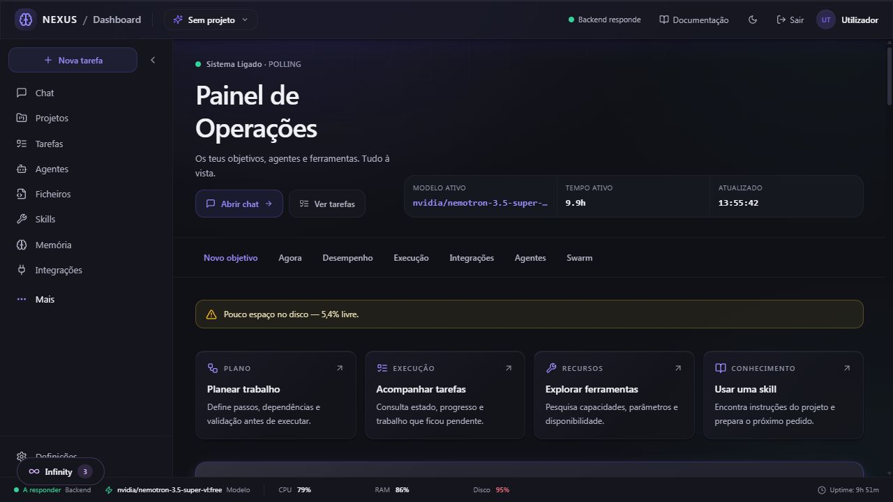
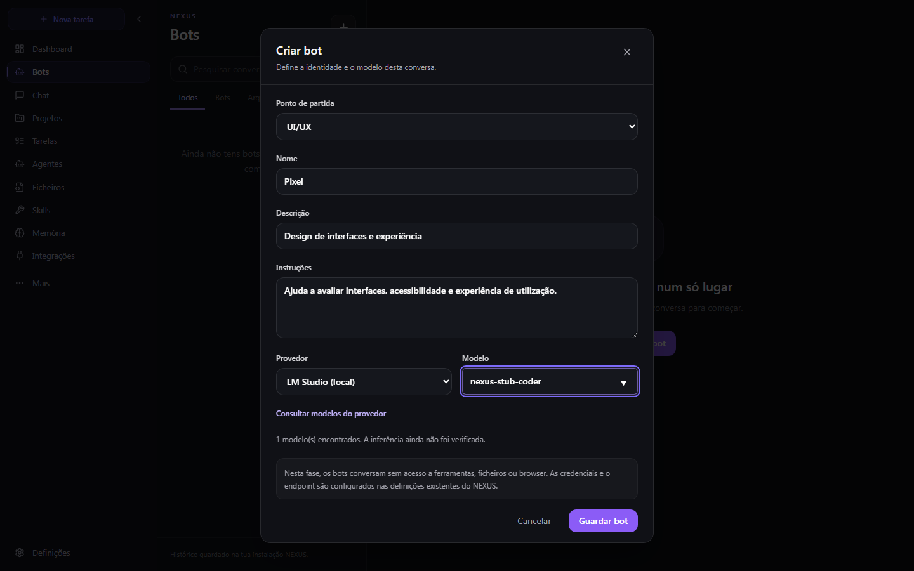
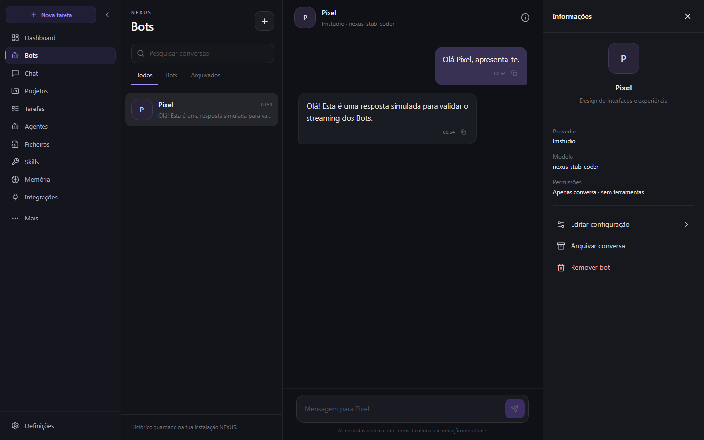
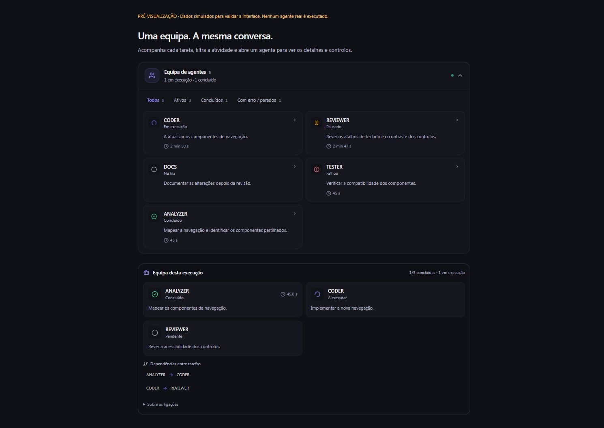

# NEXUS IDE

### Um espaço para desenvolver com IA, acompanhar tarefas e explorar agentes.

O NEXUS IDE junta chat, projetos, ferramentas e modelos de IA numa interface local. Podes conversar com um modelo, configurar bots com instruções próprias e acompanhar a atividade das tuas tarefas a partir do mesmo sítio.

    

[Ver a interface](#a-interface) · [Começar](#começar) · [Modelos e agentes](#modelos-bots-e-agentes) · [Arquitetura](#arquitetura) · [Testes](#testes-e-verificação)



*Painel de operações numa captura de outubro de 2026. Os valores e o estado apresentados pertencem a essa sessão.*

## O que podes explorar

| Área | Para que serve |
| --- | --- |
| **Chat** | Conversar com a IA, acompanhar respostas e consultar atividade, contexto e tarefas da sessão. |
| **Bots** | Criar assistentes com nome, instruções, fornecedor e modelo próprios; organizar conversas individuais e de grupo. |
| **Projetos e ficheiros** | Trabalhar com o contexto de um projeto e aceder às áreas de ficheiros disponíveis na interface. |
| **Tarefas e agentes** | Acompanhar trabalho, estados e atividade reportada durante as execuções. |
| **Skills, memória e integrações** | Explorar instruções reutilizáveis, contexto persistente e integrações configuradas. |
| **Modelos** | Configurar fornecedores locais ou externos, conforme os serviços e credenciais disponíveis. |

> **Estado do projeto:** o NEXUS está em desenvolvimento. A disponibilidade de modelos, ferramentas e integrações depende da configuração e dos serviços em execução. Uma interface ou um teste isolado não garante autonomia prolongada nem prontidão para produção.

## A interface

### Bots com identidade própria

Define as instruções e escolhe o fornecedor e o modelo para cada conversa. A captura mostra a configuração de um bot num ambiente de teste; o modelo apresentado é simulado.



Na área de bots podes voltar às conversas e consultar a configuração. Nesta captura, a resposta também é simulada para testar a interface e o streaming.



### Acompanhar uma equipa de agentes

Uma vista de atividade pode apresentar agentes, tarefas, estados e dependências. A imagem seguinte é uma **pré-visualização com dados simulados**, não uma demonstração de agentes reais em execução.



## Começar

### Requisitos

- Python **3.12 ou superior** e Node.js; o frontend declara **pnpm 10.34.9**.
- Git e acesso ao fornecedor de modelos escolhido. Para modelos locais, instala e inicia o serviço correspondente, como Ollama ou LM Studio.
- Credenciais apenas se escolheres um fornecedor externo. Nunca publiques o teu ficheiro `.env` ou as tuas chaves.

### Instalação local no Windows

No PowerShell, a partir da pasta onde queres guardar o projeto:

```powershell
git clone https://github.com/serafimbanana4480-stack/projeto-ia-aula.git
cd projeto-ia-aula/nexus-ide
python -m venv .venv
.\.venv\Scripts\python.exe -m pip install -e .
Copy-Item .env.example .env
cd frontend
corepack enable
corepack prepare pnpm@10.34.9 --activate
pnpm install --frozen-lockfile
```

Edita `nexus-ide/.env` de acordo com o teu ambiente e fornecedor. Consulta as opções em [.env.example](nexus-ide/.env.example) antes de iniciar.

**Terminal 1 — backend**, a partir de `nexus-ide/`:

```powershell
.\.venv\Scripts\python.exe -m uvicorn backend.orchestrator.main:app --host 127.0.0.1 --port 8000
```

**Terminal 2 — frontend**, a partir de `nexus-ide/frontend/`:

```powershell
$env:NEXT_PUBLIC_API_URL = 'http://127.0.0.1:8000'
pnpm run dev
```

Abre [localhost:3000](http://localhost:3000). A documentação da API fica em [localhost:8000/docs](http://localhost:8000/docs) e a verificação básica do backend em [localhost:8000/health](http://localhost:8000/health). Se uma porta já estiver ocupada, verifica primeiro que processo a está a usar.

> O script `INICIAR_NEXUS.bat` na raiz contém um caminho específico desta máquina. Para uma instalação noutro computador, usa os comandos manuais acima ou adapta o caminho antes de o executar.

### Primeiros passos

1. Inicia o backend e o frontend e entra na interface.
2. Configura um fornecedor e confirma que o modelo escolhido está disponível.
3. Abre o chat ou cria um bot com instruções adequadas à tarefa.
4. Começa com um pedido pequeno e verifica a resposta e a atividade apresentada.
5. Revê alterações e resultados antes de os aplicares ao teu projeto.

## Modelos, bots e agentes

O backend inclui integrações para fornecedores locais e cloud, incluindo Ollama, LM Studio, OpenRouter e OpenAI. **Um fornecedor aparecer na interface não significa que esteja ligado ou que a inferência tenha sido verificada.** Quando usas um fornecedor externo, os dados enviados no pedido saem da tua máquina e ficam sujeitos às condições desse serviço.

Os bots permitem configurar conversas com instruções próprias. O runtime principal e os restantes componentes de agentes e orquestração têm responsabilidades diferentes; a seleção de um modo ou a apresentação de uma equipa não prova que vários agentes independentes tenham trabalhado numa execução concreta. Consulta os eventos e os relatórios da execução para perceber o que aconteceu.

## Arquitetura

```text
Browser
  └── frontend/          Next.js, React, TypeScript e Zustand
        └── backend/     FastAPI
              ├── runtime/       execução e eventos do runtime principal
              ├── orchestrator/ rotas e orquestração
              ├── agents/       agentes e papéis
              ├── llm/          fornecedores de modelos
              ├── tools/        ferramentas disponíveis
              ├── persistence/  SQLite e esquema
              └── knowledge/    memória e conhecimento
```

O código principal está em [`nexus-ide/`](nexus-ide/). A documentação e os relatórios de auditoria estão em [`nexus-ide/docs/`](nexus-ide/docs/) e [`docs/`](docs/). Os eventos do chat são um contrato entre frontend e backend; `backend/persistence/schemas.sql` é a referência do esquema de persistência.

## Testes e verificação

Executa os testes do backend a partir de `nexus-ide/`:

```powershell
.\.venv\Scripts\python.exe -m pytest backend/tests -q
```

Para verificar o frontend, a partir de `nexus-ide/frontend/`:

```powershell
pnpm run type-check
pnpm run lint
pnpm run test
```

Os resultados dependem da versão e do ambiente em uso. Para testar uma integração real, confirma também a configuração, a ligação ao fornecedor e o resultado de uma execução completa; testes com dados simulados têm um alcance diferente.

## Mais informação

- [Guia do projeto](nexus-ide/README.md) e [documentação em português](nexus-ide/README_PT.md) — documentação adicional, que pode conter detalhes históricos.
- [Guia de arranque](nexus-ide/STARTUP.md) — referência adicional; verifica caminhos específicos da máquina.
- [Instruções para contribuir](nexus-ide/CONTRIBUTING.md).
- [Auditorias e evidências](nexus-ide/docs/auditorias/).

---

**NEXUS IDE** · Um projeto em evolução para experimentar desenvolvimento assistido por IA.
