# NEXUS IDE

### Um espaço local para conversar com modelos, configurar bots e acompanhar trabalho num projeto.

O NEXUS IDE junta chat, bots com perfis próprios, grupos, projetos, ferramentas e modelos numa interface web. O frontend usa Next.js e React; o backend usa FastAPI e guarda os dados locais em SQLite.

[Galeria](#galeria) · [Funcionalidades](#funcionalidades) · [Começar](#começar) · [Arquitetura](#arquitetura) · [Verificação](#verificação)

    

> **Estado do projeto:** em desenvolvimento. A interface, a configuração de um provider e um teste isolado não provam, por si só, que a inferência, as ferramentas ou uma execução completa estejam operacionais no teu ambiente.

## Galeria

Estas capturas mostram a interface atual com dados de demonstração fornecidos por um fixture local. Não foi contactado nenhum provider de modelos; as imagens servem para mostrar os ecrãs e os estados da aplicação, não resultados de inferência real.

### Dashboard e chat

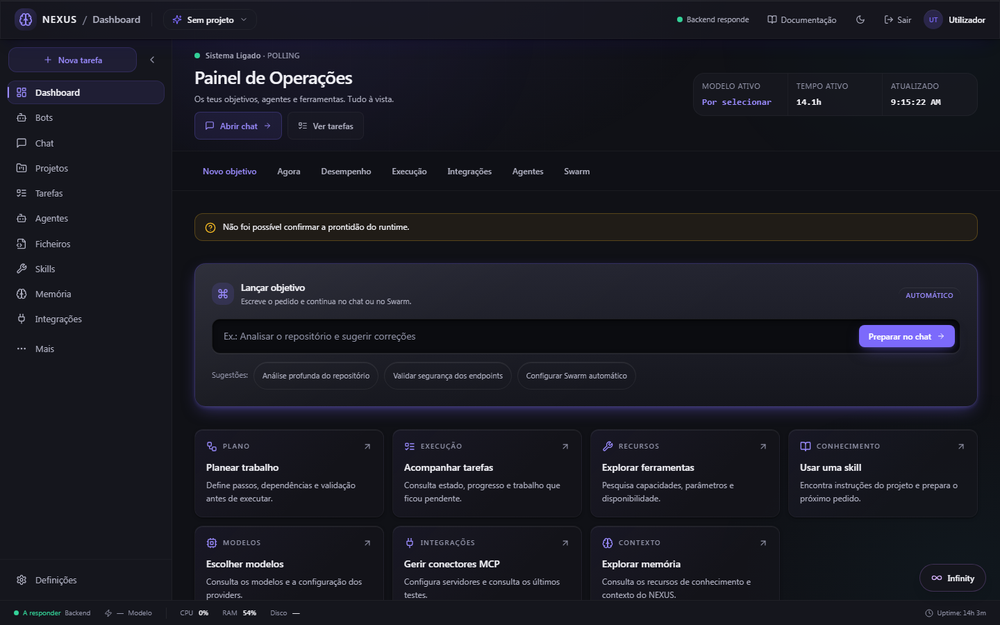

*O fixture não devolve a verificação de prontidão, e o dashboard apresenta esse estado como não confirmado.*

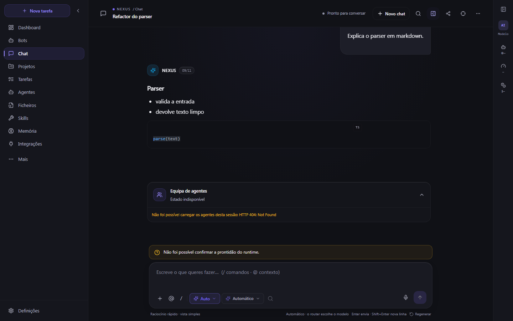

*Conversa de exemplo com Markdown e código. Como o fixture não implementa a rota de agentes desta sessão, a interface mostra HTTP 404.*

### Bots

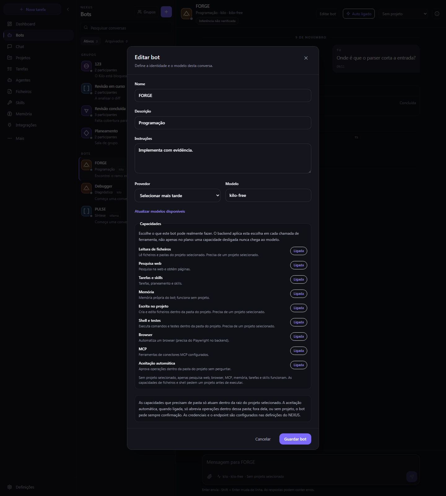

*O editor mostra as capacidades configuráveis e avisa quando ficheiros ou shell precisam de um projeto selecionado.*

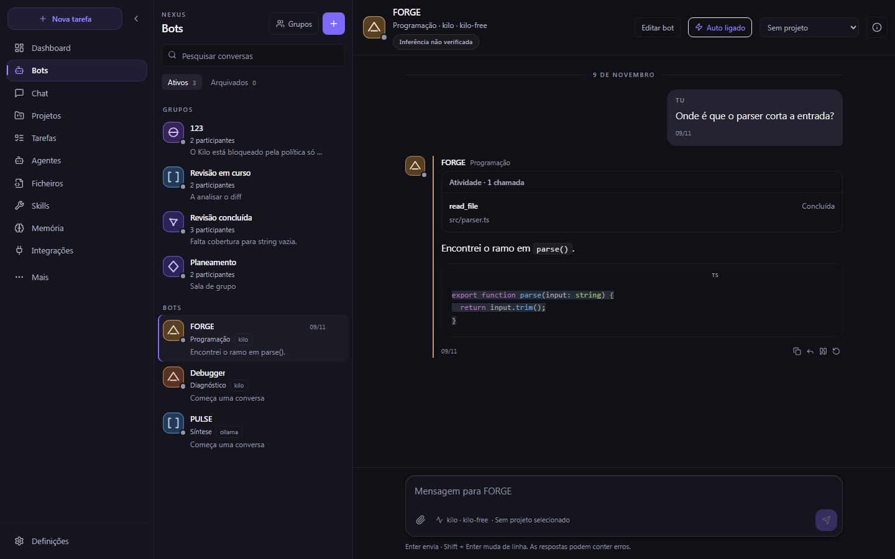

*Conversa de exemplo e atividade de ferramenta. O provider e o modelo apresentados não foram usados para gerar uma resposta.*

### Grupos

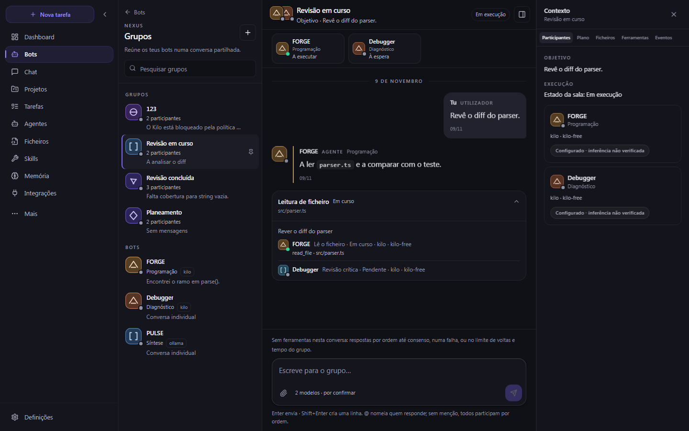

*Estado de uma execução de exemplo, com participantes e painel de contexto.*

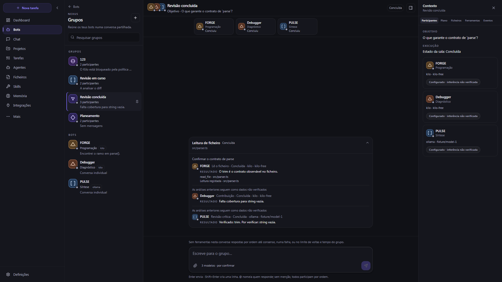

*Exemplo de passagem entre bots e revisão final. As conclusões são dados do fixture.*

<details>
<summary>Mais ecrãs: incidentes, contexto, projetos, tarefas, definições, editor e telemóvel</summary>

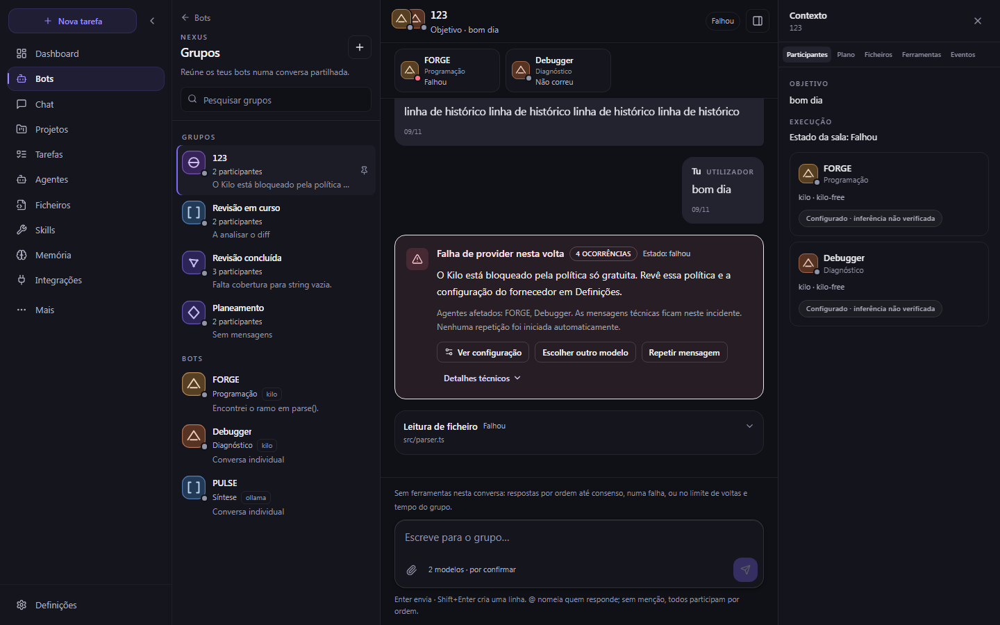

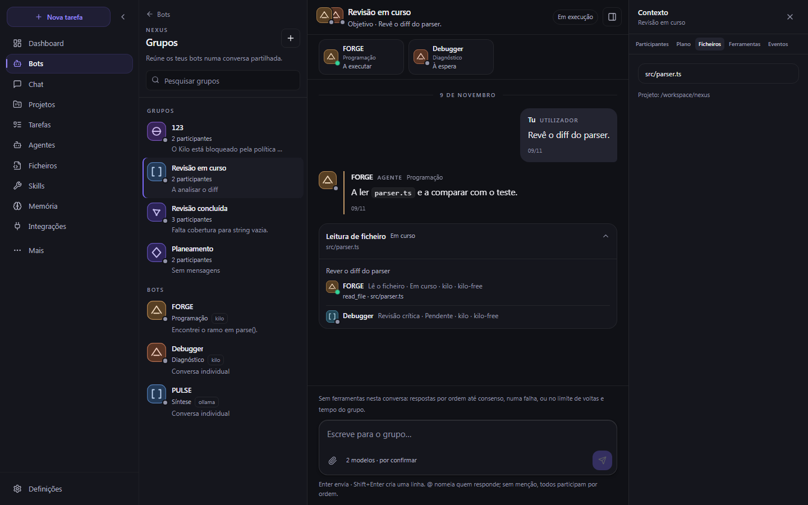

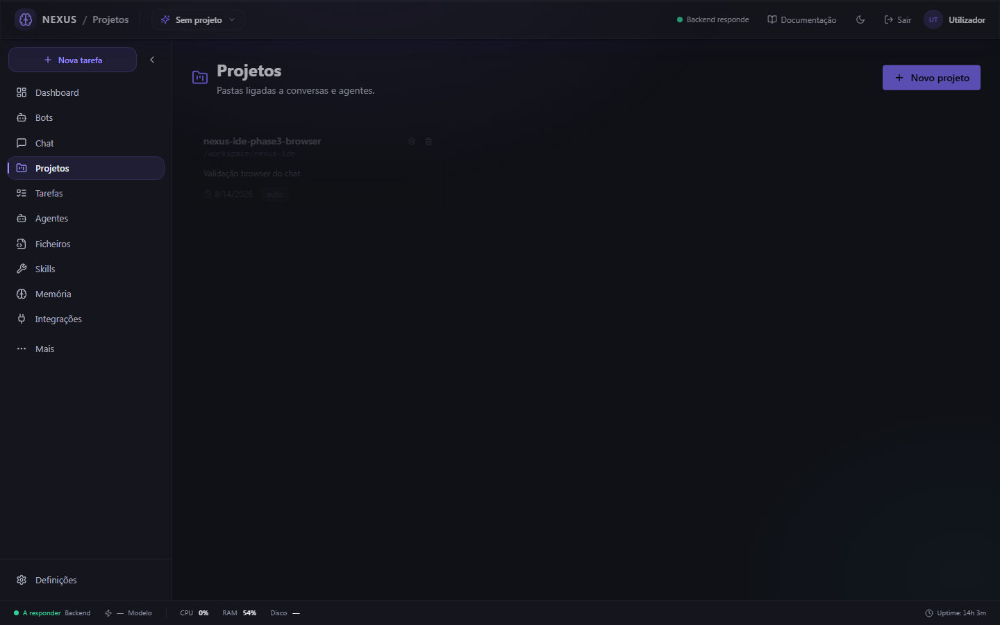

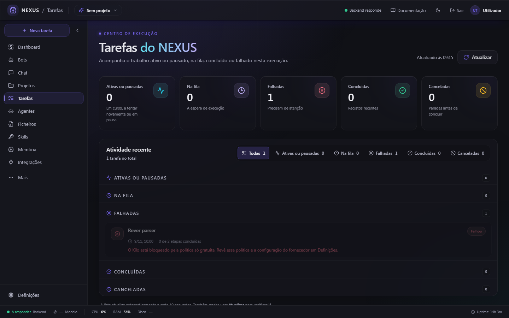

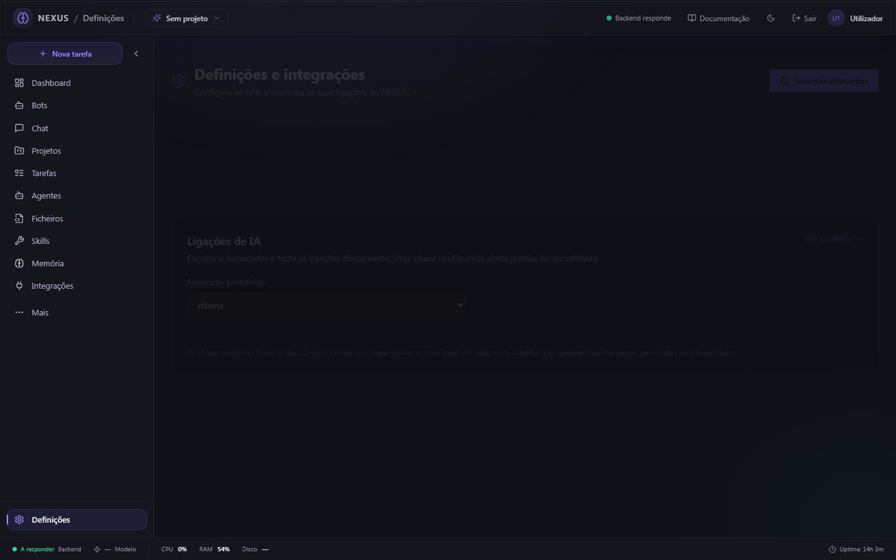

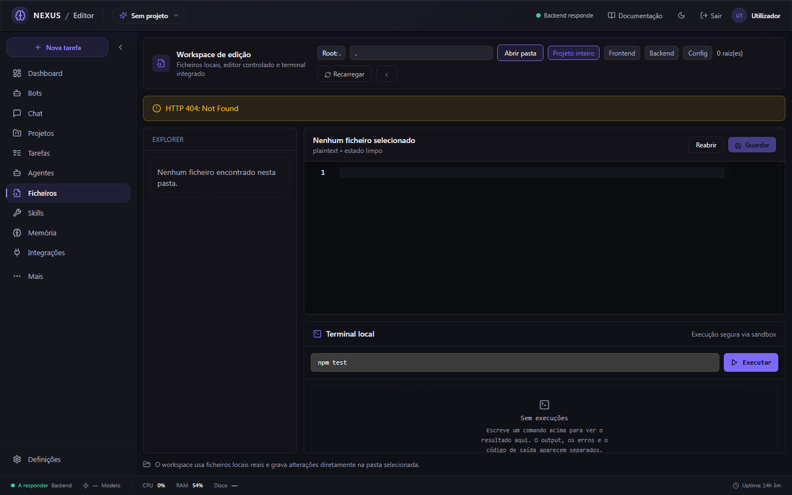

*O fixture não fornece a árvore de ficheiros; a captura mostra o erro e o estado vazio apresentados pela interface.*

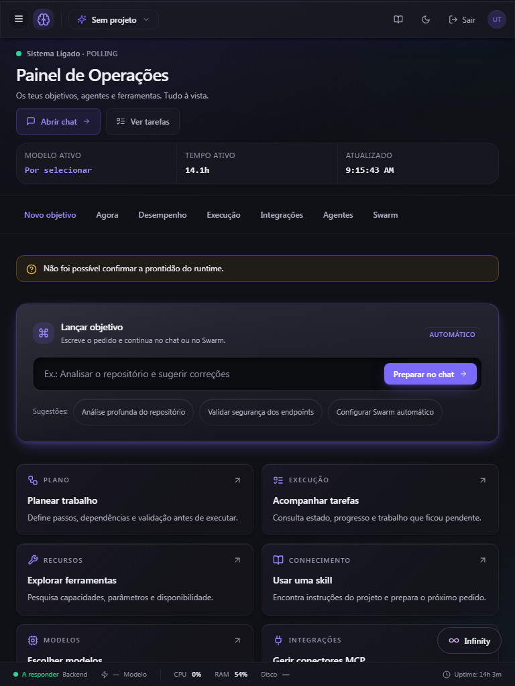

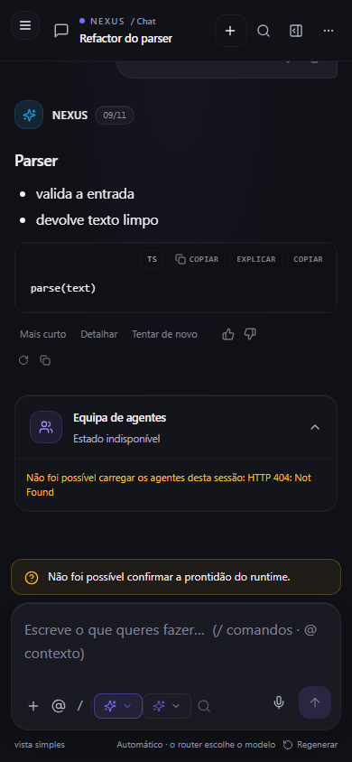

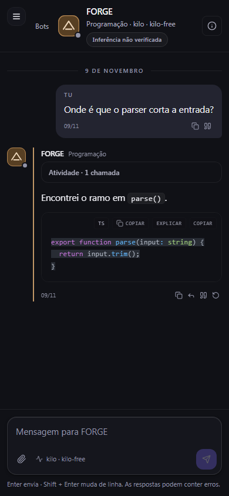

</details>

## Funcionalidades

| Área | O que podes fazer |
| --- | --- |
| **Chat** | Conversar com o runtime principal, acompanhar mensagens e consultar o contexto da sessão. |
| **Bots** | Manter perfis e conversas individuais; escolher provider, modelo e capacidades do bot. |
| **Grupos** | Conversar por turnos ou iniciar uma execução separada sobre um ficheiro, com as passagens registadas. |
| **Projetos e ficheiros** | Associar conversas a uma pasta e usar as superfícies de projetos, editor e terminal. |
| **Tarefas e dashboard** | Consultar atividade e estados apresentados pela API, incluindo quando algo está indisponível ou por confirmar. |
| **Modelos e integrações** | Consultar providers, modelos e conectores configurados. A presença de um item no catálogo não confirma uma ligação. |
| **Skills e memória** | Consultar instruções reutilizáveis e recursos de contexto expostos pela aplicação. |

As capacidades de ficheiros e shell dos bots dependem de um projeto selecionado. Sem uma pasta autorizada, o backend recusa essas operações; as permissões configuradas no perfil são aplicadas quando cada ferramenta é chamada.

## Começar

### Requisitos

- Python **3.12+**
- Node.js e **pnpm 10.34.9**
- Git
- Um provider local ou credenciais de um provider externo, apenas se quiseres testar inferência real

### Instalação no Windows

No PowerShell:

```powershell
git clone https://github.com/serafimbanana4480-stack/projeto-ia-aula.git
cd projeto-ia-aula/nexus-ide

python -m venv .venv
.\.venv\Scripts\python.exe -m pip install -e .
Copy-Item .env.example .env

cd frontend
corepack enable
corepack prepare pnpm@10.34.9 --activate
pnpm install --frozen-lockfile
```

Edita `nexus-ide/.env` com a configuração do teu ambiente. Não publiques `.env`, tokens ou chaves.

### Arrancar a aplicação

Abre dois terminais. O backend deve correr a partir de `nexus-ide/`, sem `--reload`:

```powershell
.\.venv\Scripts\python.exe -m uvicorn backend.orchestrator.main:app --host 127.0.0.1 --port 8000
```

No segundo terminal, a partir de `nexus-ide/frontend/`:

```powershell
$env:NEXT_PUBLIC_API_URL = "http://127.0.0.1:8000"
pnpm run dev -- --hostname 127.0.0.1 --port 3000
```

Abre [http://127.0.0.1:3000](http://127.0.0.1:3000). A API fica em [http://127.0.0.1:8000/docs](http://127.0.0.1:8000/docs) e o health check em [http://127.0.0.1:8000/health](http://127.0.0.1:8000/health).

Se uma porta já estiver ocupada, confirma primeiro que processo a está a usar. O script `INICIAR_NEXUS.bat` na raiz contém um caminho específico desta máquina; para um clone novo, usa os comandos acima ou adapta esse caminho.

## Limites que convém conhecer

- A conversa de grupo responde por uma ordem definida e não tem ferramentas. A execução com ficheiro é outro fluxo, também sequencial; as análises anteriores são registadas como não verificadas.
- Um provider ou modelo apresentado na interface não significa que a ligação esteja ativa nem que tenha ocorrido inferência.
- A disponibilidade de browser, MCP, modelos e serviços externos depende da configuração e das dependências instaladas.
- O projeto está em desenvolvimento; confirma o resultado de cada execução antes de o aplicares ao teu código.

## Arquitetura

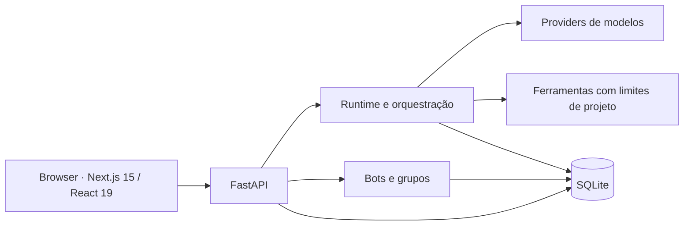

O código principal está em [`nexus-ide/`](nexus-ide/). O esquema de persistência de referência está em [`nexus-ide/backend/persistence/schemas.sql`](nexus-ide/backend/persistence/schemas.sql).

## Verificação

Backend, a partir de `nexus-ide/`:

```powershell
.\.venv\Scripts\python.exe -m pytest backend/tests -q
```

Frontend, a partir de `nexus-ide/frontend/`:

```powershell
pnpm run type-check
pnpm run lint
pnpm run test
```

Para regenerar as capturas do README com o fixture local, a partir de `nexus-ide/frontend/`:

```powershell
$env:README_SHOTS_DIR = "../../docs/screenshots"
pnpm exec playwright test e2e/overhaul/readme-shots.spec.ts --config playwright.overhaul.config.ts
```

Este fluxo de capturas usa dados de demonstração e não contacta providers de modelos.

## Mais informação

- [Código da aplicação](nexus-ide/)
- [Auditorias do projeto](nexus-ide/docs/auditorias/)
- [Interface e capturas](docs/screenshots/)
