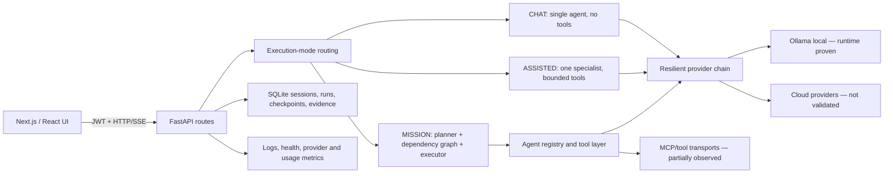

# Nexus IDE — Auditoria integrada de conclusão

Data da evidência: 2026-08-13  
Âmbito: orchestrator, planeamento, máquina de estados, persistência, recuperação, providers, browser/tool transport, autenticação, observabilidade, frontend e testes.

## Veredito

O Nexus IDE está **pronto para desenvolvimento local controlado**, com o backend e o frontend funcionais, persistência durável, rotas autenticadas, routing explícito e uma suite ampla de regressão. **Não está pronto para produção, autonomia desatendida ou para alegar integração completa com fornecedores externos.**

“Pronto” neste relatório significa que os fluxos indicados foram demonstrados pelas provas descritas; não significa ausência absoluta de falhas.

| Cenário | Veredito | Condição |
|---|---|---|
| Desenvolvimento local assistido | PRONTO COM CONDIÇÕES | Serviços autónomos de fundo desligados, disco monitorizado e Ollama disponível |
| Chat local single-agent | PRONTO COM CONDIÇÕES | Respostas limitadas pelo modelo são agora marcadas como incompletas |
| Planeamento e execução de missão | PARCIAL | Contratos e regressões passaram; não houve prova longa de autonomia desatendida nesta fase final |
| Produção multiutilizador | NÃO PRONTO | Credenciais/segredos, seed administrativo, capacidade, segurança e operação não foram validados em produção |
| Autonomia desatendida | NÃO PRONTO | Loops default-on e checkpoints Git exigem controlo operacional adicional |
| Providers cloud e MCP externos | NÃO VALIDADO | Sem credenciais/quota e sem execução externa end-to-end nesta auditoria |

## Snapshot de runtime validado

- Backend FastAPI: `127.0.0.1:8001`, `/api/ready` respondeu HTTP 200.
- Frontend Next.js: `127.0.0.1:3001`, processo existente preservado.
- Ollama: `127.0.0.1:11434`, resposta real observada através do chat.
- Estado do disco no readiness: `warning`, 5,99% livre, `write_blocked=false`; o limiar crítico configurado é 5%.
- Todos os 11 serviços de fundo foram explicitamente desativados no backend de auditoria.
- `/health/deep` sem token devolveu 401, confirmando a proteção do endpoint.
- A base SQLite executou migrações e recuperou uma execução de auditoria deixada em `running`, marcando-a `interrupted` no arranque seguinte.
- O `HEAD` permaneceu estável durante a prova real final e durante a suite backend final depois da correção de isolamento de pytest.

## Arquitetura observada



### Componentes principais

- `frontend/`: Next.js 15, React 19, Zustand, React Query, chat SSE, dashboard, editor, Mission Control e vistas de providers/MCP.
- `backend/orchestrator/routes/chat.py`: contrato SSE, classificação CHAT/ASSISTED/MISSION, routing, checkpoints e persistência terminal.
- `backend/orchestrator/plan_creator.py`: geração e validação fail-closed de planos; continuação segura é explícita.
- `backend/orchestrator/plan_executor.py` e `dependency_graph.py`: execução por dependências, retries e transições guardadas.
- `backend/llm/factory.py`: seleção resiliente de provider, fallback e observabilidade do provider efetivamente utilizado.
- `backend/persistence/db.py`: SQLite, migrações, sessões, mensagens, runs e recuperação de runs interrompidos.
- `backend/observability/`: logs estruturados, health, métricas e estado de providers.
- `backend/tools/`: Ollama, scanning, workspace, embeddings e transportes de ferramentas.

## Fluxos de execução

| Modo | Comportamento validado | Limite |
|---|---|---|
| CHAT | Um agente, resposta direta, sem ferramentas; contexto de projeto explicitamente pedido pode usar bootstrap inerte e limitado | Não cria/atualiza memória do projeto |
| ASSISTED | Um especialista, orçamento de ferramentas limitado e requisito de evidência | Não é prova de autonomia completa |
| MISSION | Plano estruturado, dependências, waves, checkpoints e verificação | Execução longa com falha de processo não foi repetida em runtime nesta conclusão |
| Swarm | Apenas quando explicitamente solicitado/selecionado | Não é acionado automaticamente por um chat simples |

Perguntas informativas permanecem no caminho rápido. Pedidos com ações, validação e múltiplas fases são promovidos para ASSISTED ou MISSION. O routing foi coberto por testes e os prompts reais desta auditoria permaneceram single-agent.

## Máquina de estados e progresso

### Tarefas do plano

Transições relevantes confirmadas:

`PENDING → READY → RUNNING → RETRYING → RUNNING → COMPLETED`

A correção essencial é a reentrada explícita `RETRYING → RUNNING` antes da segunda tentativa poder terminar. A regressão direta percorre a cadeia completa e impede o antigo erro `RETRYING → COMPLETED`.

Dependências falhadas bloqueiam trabalho a jusante; tarefas independentes podem ser executadas na mesma wave. O progresso do plano deriva de tarefas concluídas, bloqueadas e ativas, em vez de um contador cosmético.

### Runs e streaming

Estados persistidos relevantes: `routing`, `running`, `retrying`, `cancelled`, `interrupted`, `completed` e fases específicas como `planning_blocked`, `stream_timeout` e `provider_output_truncated`.

Estados de produto como `PAUSED`, `ANALYZING`, `TESTING` e `READY` aparecem em subsistemas ou UI, mas não foram todos demonstrados como uma única máquina canónica end-to-end. Essa unificação permanece **parcial**.

## P0 fechado: saída truncada apresentada como sucesso

### Falha original

O chat local limitava o fallback direto a 256 tokens. O Ollama terminava com `done_reason=length`, mas o cliente descartava essa razão. O SSE emitia `done` e a run era persistida como concluída apesar da frase terminar a meio.

### Correção

- O cliente Ollama guarda e expõe `last_finish_reason`.
- O chat reconhece razões de limite (`length`, `max_tokens`, `max_output_tokens`, `token_limit`).
- O SSE emite um evento `progress` com `level=warning` e `reason=provider_token_limit`.
- A métrica do provider inclui `finish_reason` e `complete=false`.
- A resposta persistida inclui um aviso explícito.
- A run termina como `interrupted`, fase `provider_output_truncated`.
- O provider e modelo efetivamente utilizados são persistidos.

### Prova real final

Prompt: `Para que serve este projeto?`

- HTTP 200; duração 46,91 s.
- Eventos: `routing`, `agent_started`, `token`, `progress`, `metric`, `agent_finished`, `done`.
- Zero eventos `error`; um evento `done`.
- Provider real: `ollama`.
- Modelo: `hf.co/zaakirio/Ornith-1.0-9B-uncensored-GGUF:Q4_K_M`.
- Uso medido pelo provider: 256 tokens de saída, `source=provider`.
- `finish_reason=length`, `complete=false`.
- Persistência: `status=interrupted`, `execution_state=interrupted`, `phase=provider_output_truncated`.
- `HEAD` antes/depois: `f92191988407461cbec21226baa3402159eb57db`, sem alteração durante o pedido.

Isto prova apresentação honesta da truncagem; não prova que o modelo consiga completar qualquer resposta dentro do orçamento.

## Recuperação e persistência

### Concluído

- Runs, mensagens, usage, provider/model, checkpoints e erro terminal são duráveis em SQLite.
- Uma run anterior ativa da mesma sessão é interrompida quando nasce uma nova run.
- O arranque recupera runs stale em `running` e marca-as `interrupted`.
- Cancelamento, timeout, resposta vazia e erro de provider têm caminhos terminais distintos.
- A truncagem por limite do provider passou a ser um terminal incompleto explícito.
- Migrações Alembic já não removem handlers de logging do processo embebido.

### Parcial

- A recuperação após restart foi observada para uma run stale criada pela própria auditoria.
- Testes cobrem persistência e recovery races.
- Não foi executada nesta fase uma missão longa, terminada à força a meio de uma ferramenta mutável e retomada exatamente do último passo.

### Não validado

- Recuperação distribuída entre múltiplas instâncias.
- Consistência sob falha simultânea de DB, provider e processo.
- Retoma idempotente de integrações externas com efeitos laterais.

## Observabilidade

### Concluído

- Logs estruturados continuam depois das migrações Alembic.
- `/api/providers/status` expõe saúde/latência observada; `/api/providers/runtime` expõe catálogo e política. As rotas são distintas.
- O widget não apresenta 100% quando o provider está indisponível ou sem medição.
- O dashboard devolve `health_score=null` sem amostras, em vez de inventar saúde.
- A métrica do chat usa tokens reportados pelo provider quando disponíveis e separa estimativas de contexto.
- A identidade do provider real atravessa o wrapper resiliente.
- Disk pressure é exposto em readiness e não executa limpeza destrutiva automaticamente.

### Parcial

- O OpenAPI continua a emitir avisos de `operationId` duplicado em rotas legadas de usage, topology e workflows.
- A suite final termina com aviso de duas tarefas pendentes do `AgentLifecycleManager` no teardown. Os 108 testes passaram e o `HEAD` ficou estável, mas o cleanup assíncrono não está totalmente fechado.
- Redis estava inacessível no runtime; o sistema continuou sem cache conforme desenhado.

## Browser e frontend

### Evidência visual obtida

- `audit/browser-2026-08-13/01-chat-empty.png`
- `audit/browser-2026-08-13/02-dashboard.png`

A captura inicial do dashboard tornou visível a contradição “provider indisponível” com 100%. A correção foi depois validada por testes do componente e pela API de runtime.

### Estado final

- 18 ficheiros Vitest, 72 testes: todos passaram.
- TypeScript: `tsc --noEmit` passou.
- Next.js 15: build de produção passou, 37 páginas geradas.
- Os avisos/build errors de hooks e acessibilidade tratados nesta auditoria não reapareceram.

### Limite

O browser escolhido pelo utilizador entrou numa página interna de erro Chromium e bloqueou nova navegação. Não foi usado Playwright nem outro browser. Portanto, a inspeção visual pós-restart, console e network finais permanecem **parciais**, apesar da cobertura de componente/API/build.

## Autenticação e segurança

### Concluído

- Endpoints protegidos rejeitam ausência de JWT; `/health/deep` devolveu 401 sem credencial.
- Testes de API cobrem criação e uso de token local.
- Sanitização de prompt e rejeição de injeção têm regressões.
- Operações destrutivas de sessão estão separadas do GC dry-run e exigem caminho administrativo explícito.

### Bloqueios para produção

- Uma base nova ainda pode criar o utilizador administrativo de desenvolvimento `admin@nexus-ide.com` com password conhecida; a própria aplicação avisa para alterar em produção.
- SSO/OIDC, rotação de segredos, rate limits distribuídos, TLS/reverse proxy, auditoria multiutilizador e hardening de deployment não foram validados.
- Nenhuma credencial real foi criada, alterada ou testada nesta auditoria.

## Incidente operacional: checkpoints Git autónomos

Durante a auditoria, ciclos já iniciados do `AutonomousImprovementOrchestrator` executaram checkpoints `auto: pre-0-proposals cycle` com `git add -A`, agregando alterações pendentes. Os commits foram preservados; não foi reescrito histórico nem descartado trabalho.

A causa de recorrência durante pytest foi identificada: fixtures com `TestClient` iniciavam o lifespan real e serviços autónomos default-on. O fixture global agora define `NEXUS_BACKGROUND_SERVICES=off` e desativa individualmente os 11 serviços. Prova depois da correção:

- 24 testes de lifecycle/chat/rotas passaram com `HEAD` estável.
- A suite backend final de 108 testes passou com `HEAD` estável.

Risco residual: fora de pytest, os serviços continuam default-on se o operador não os desativar. Para auditorias, manutenção e operação controlada, usar explicitamente:

```text
NEXUS_BACKGROUND_SERVICES=off
NEXUS_ENABLE_BACKGROUND_WORKERS=false
NEXUS_ENABLE_DASHBOARD_AGENT=false
NEXUS_ENABLE_GUARDIAN_AGENT=false
NEXUS_ENABLE_AUTO_CORRECTION=false
NEXUS_ENABLE_EXEC_ENGINE=false
NEXUS_ENABLE_CONTINUOUS_IMPROVEMENT=false
NEXUS_ENABLE_SELF_IMPROVEMENT=false
NEXUS_ENABLE_SELF_HEALING=false
NEXUS_ENABLE_AI_ORCHESTRATOR=false
NEXUS_ENABLE_AUTO_TRIGGER=false
NEXUS_ENABLE_SESSION_GC=false
```

Uma configuração de produção deve ainda separar checkpoints do worktree do utilizador e nunca executar `git add -A` sem um escopo explícito.

## Correções consolidadas nesta auditoria

1. Planeamento inválido/malformado passa a falhar fechado; continuação segura é explícita.
2. Progresso e bloqueio de dependências refletem o grafo real.
3. Retry reentra em `RUNNING` antes de completar/falhar.
4. Routing distingue CHAT, ASSISTED, MISSION e swarm explícito.
5. CHAT single-agent preserva apenas contexto inerte e limitado quando o projeto é referido.
6. CHAT não cria memória de projeto nem usa ferramentas.
7. Provider real, modelo, latência e uso medido atravessam o wrapper resiliente.
8. Health probe de providers não deixa um cloud lento esconder um local saudável.
9. Rotas de status operacional e catálogo/política deixaram de colidir.
10. Widget de provider e health score deixaram de inventar 100%/saúde.
11. Saída truncada é aviso + `complete=false` + run `interrupted`.
12. Resposta vazia e stream interrompido não são sucesso.
13. Migrações preservam logging do processo.
14. Embeddings têm fallback lexical determinístico quando o modelo não existe.
15. Scanner aplica exclusões e limites; disk pressure é fail-closed sem cleanup automático.
16. GC de sessão separa dry-run de mutação administrativa.
17. Frontend corrigiu hooks, acessibilidade e apresentação honesta de métricas.
18. Pytest desativa serviços autónomos e deixou de poder commitar o worktree.

## Evidência de testes

Os números abaixo pertencem a comandos diferentes e sobrepõem-se; não devem ser somados como total único.

- Suite final backend delimitada: **108 passed** em 67,25 s; `HEAD` estável.
- Prova de isolamento/lifecycle: **24 passed**; `HEAD` estável.
- Regressão P0 Ollama + endpoint: **29 passed**.
- Regressões chat/routing P0: **42 passed**.
- Orchestrator completo por shards numa fase anterior: **612 passed** (92 + 162 + 130 + 228). O comando monolítico excedeu 304 s; os shards substituem essa execução, não escondem o timeout.
- API/middleware/persistência/contracts/config: **115 passed, 2 skipped**.
- Core: **233 passed, 4 skipped**.
- Observabilidade: **64 passed**.
- Integração/experience: **124 passed**.
- Tools: **235 passed**.
- Frontend: **18 ficheiros, 72 testes**, type-check e build de 37 páginas.

Consultar `NEXUS_TEST_MATRIX.md` para a matriz detalhada.

## Integrações externas e limites honestos

| Integração | Estado | Evidência/limite |
|---|---|---|
| Ollama local | VALIDADO | Chat real, tokens e `finish_reason` medidos |
| OpenRouter | NÃO VALIDADO/INDISPONÍVEL | Modelo free não confirmado e nenhuma quota válida demonstrada |
| Outros clouds | NÃO VALIDADO | Sem credenciais nem chamadas reais |
| MCP | PARCIAL | 3 configurados, 2 health checks saudáveis e 1 erro numa leitura anterior; nenhuma ferramenta externa end-to-end foi executada |
| Redis | DEGRADADO | Inacessível; fallback sem cache funcionou |
| Embeddings externos | NÃO VALIDADO | `sentence-transformers` ausente; fallback determinístico usado |
| Browser/tool transport | PARCIAL | Duas capturas; sessão final bloqueada por erro interno do browser |

Não existe evidência para pontuar “autonomia”, “qualidade do modelo” ou “integração de fornecedor” numericamente. Esses valores permanecem **não medidos**.

## Registo terminal

### Concluído

- P0 de truncagem fechado com teste e runtime real.
- Retry state e apresentação honesta de métricas cobertos por regressão.
- Backend, frontend, persistência, auth negativa, provider local e recovery stale validados.
- Documentação e matriz de testes criadas.
- Serviços activos preservados; backend reiniciado apenas após verificar PID/owner.

### Parcial

- Browser visual/console/network pós-restart.
- Cleanup assíncrono de duas tarefas no teardown.
- Estado canónico único para todos os rótulos de UI/subsistemas.
- Retoma de missão longa depois de process kill.

### Não validado/bloqueado externamente

- Providers cloud, quotas e credenciais.
- Ferramentas MCP externas end-to-end.
- Produção, TLS, SSO, carga, multi-instância e segurança operacional completa.
- Autonomia desatendida e claims de qualidade.

