# NEXUS IDE

A local IDE for working with AI: a main chat, bots with their own identity, and groups where several bots read a file, hand work over, and record what each one did.

[Português](README_PT.md) · [Português, at the repository root](../README.md)

   

[Features](#features) · [Gallery](#gallery) · [Architecture](#architecture) · [Start](#start) · [Tests](#tests) · [Limitations](#limitations)

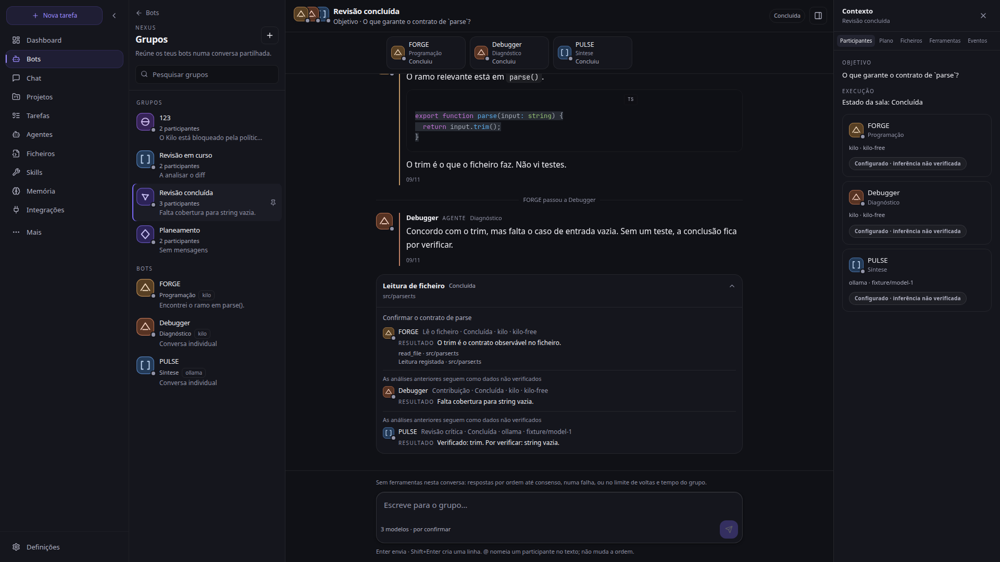

*Group “Revisão concluída” at 1920×1080. Local fixture data: no paid provider was contacted.*

## Features

The primary nav lists the surfaces that exist today. Anything the API does not return is shown as unavailable or not confirmed, never as healthy.

| Area | Route | What it does |
| --- | --- | --- |
| **Chat** | `/` | Main conversation with markdown, code, a composer, and the session context panel. |
| **Bot groups** | `/bots` | Several bots in one room. Replies go in order. Identical errors in the same turn collapse into one incident. |
| **File run** | `/bots` | A separate request with a file path. The first participant reads, the middle ones contribute, the last does the critical review. Handoffs are stored. |
| **Bots** | `/bots` | One-to-one chats, with a generated mark, role, provider, model, and tool activity. |
| **Dashboard** | `/dashboard` | Operations panel: shortcuts, the active model, and runtime readiness when the API confirms it. |
| **Projects** | `/projects` | Folders attached to conversations. |
| **Tasks** | `/dashboard/tasks` | Queue, failures, and completed work. Steps are a list; the API does not send a parent/child tree. |
| **Files** | `/editor` | Monaco editor and a local terminal, on a folder you choose. |
| **Skills** | `/tools` | Tools and reusable instructions exposed by the API. |
| **Memory** | `/nexus` | Knowledge and context resources. |
| **Integrations** | `/mcp` | MCP connections. A configured connector is not shown as healthy without a measurement. |
| **Models** | `/models` | Model and provider catalog. Inference stays “not verified” until the API says otherwise. |
| **Agents / SWARM** | `/swarm` | Agent surface. Opening it is not evidence that several agents ran. |
| **Search and scraping** | `/search`, `/scraping` | Web search and collection, depending on keys and the configured service. |
| **Documents** | `/documents` | Documents stored by the app. |
| **Approvals** | `/nexus/hitl` | Items waiting for a human decision. |
| **Settings** | `/settings` | Default provider and keys. Saving a key does not validate the connection. |

## Gallery

Shots of the current UI, taken with the fixture server in `frontend/e2e/overhaul/fixture-server.mjs` and the Next dev server. No call was made to Ollama, OpenRouter, Kilo, OpenAI, or any other paid provider. Where the fixture does not implement the route, the picture shows the real failure state.

### Desktop

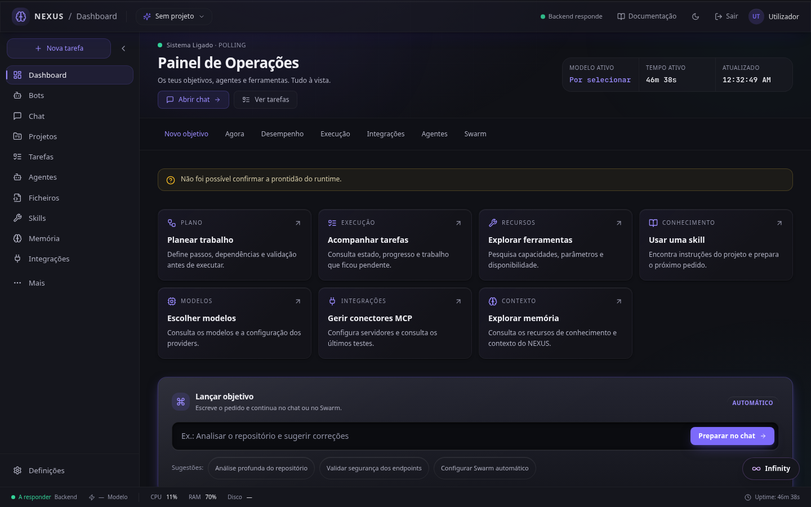

*Dashboard at 1440×900. Without `/api/ready` in the fixture, the banner says readiness was not confirmed.*

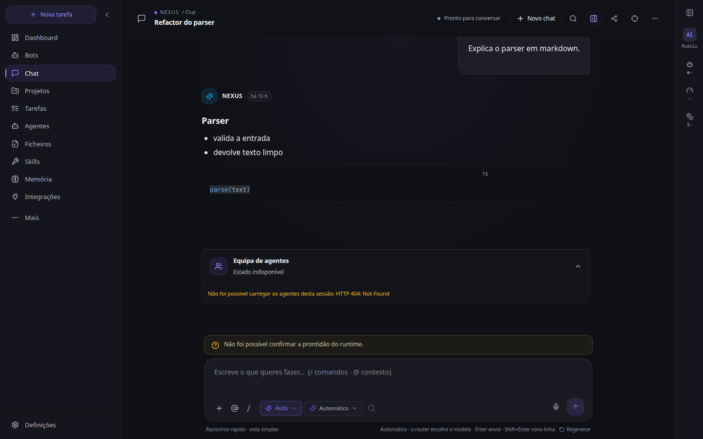

*Chat. Markdown and the code block come from the fixture session. That session’s agents have no fixture route, so the card reports HTTP 404.*

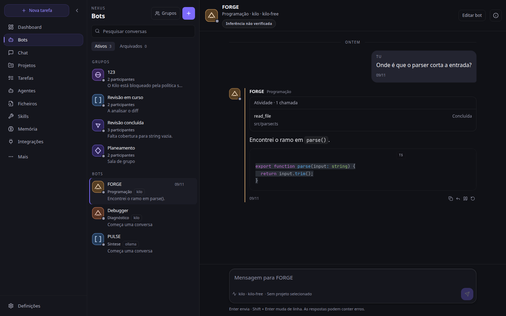

*Single bot. The mark is generated from the identity, not initials. Model state is “Inferência não verificada”.*

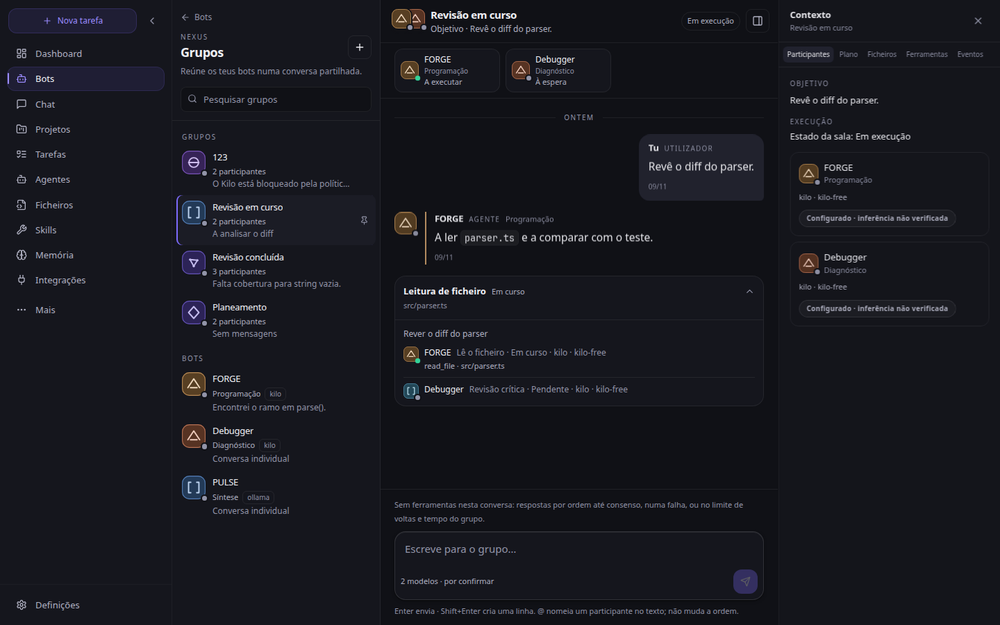

*Run in progress. The strip shows who is executing and who is waiting. The card groups the read of `src/parser.ts`.*

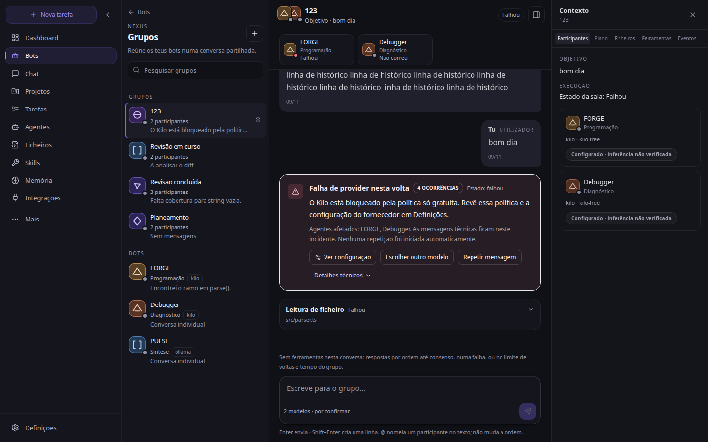

*Four errors with the same text in the same turn become one incident. Nothing is retried automatically.*

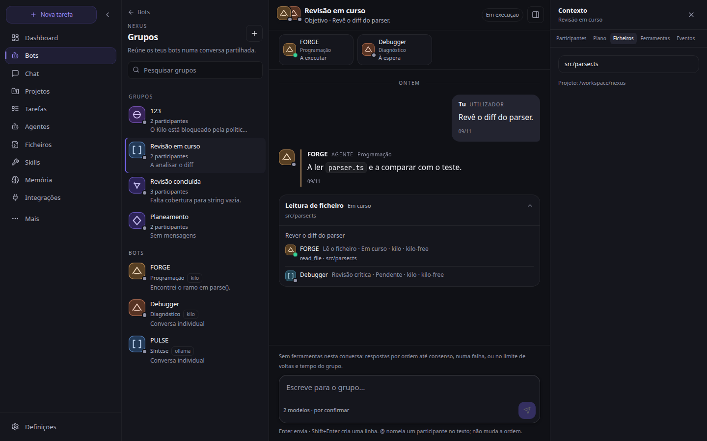

*Group context: Participantes, Plano, Ficheiros, Ferramentas, Eventos. Below 1440 px it opens as a drawer.*

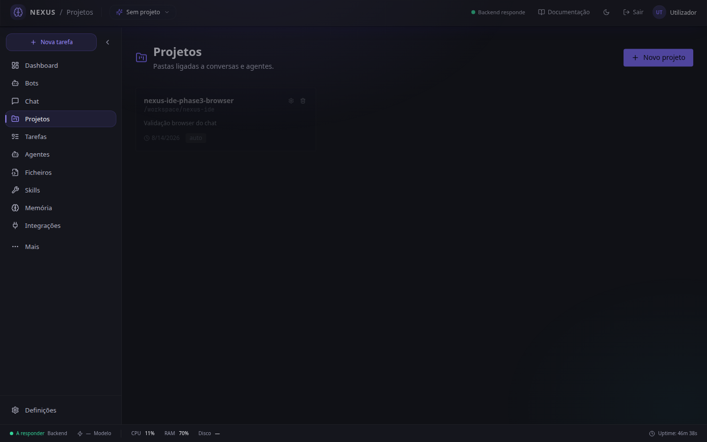

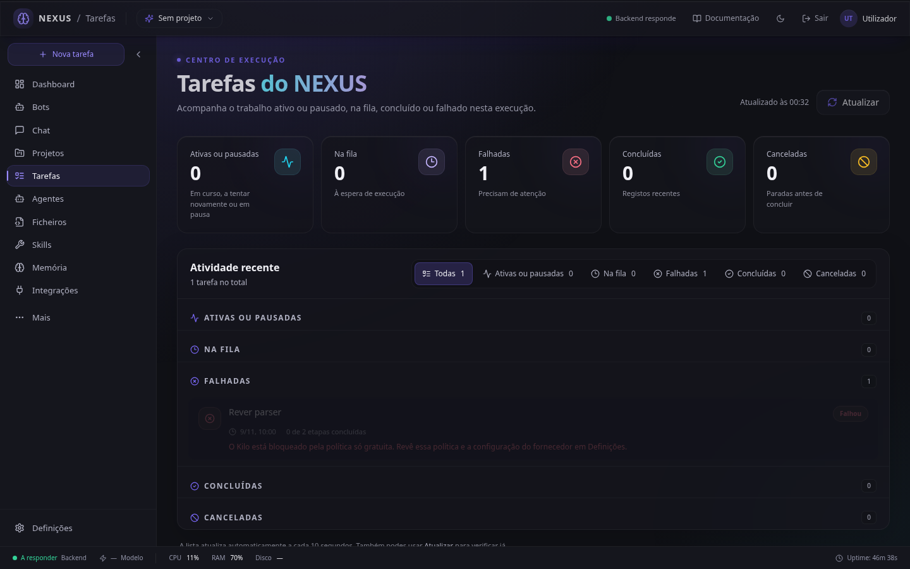

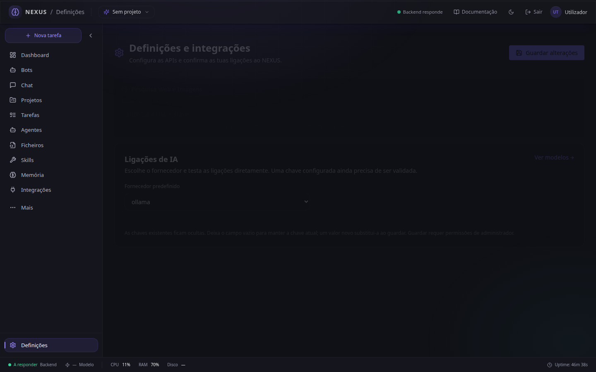

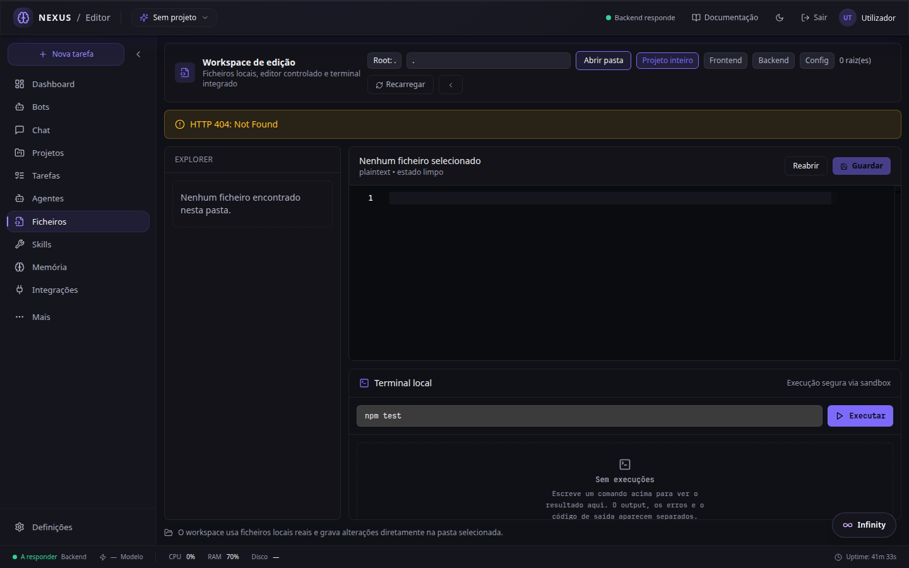

*Editor. No folder is open, and the fixture does not serve the file tree, so the page shows 404 and “Nenhum ficheiro encontrado”.*

### Tablet and phone

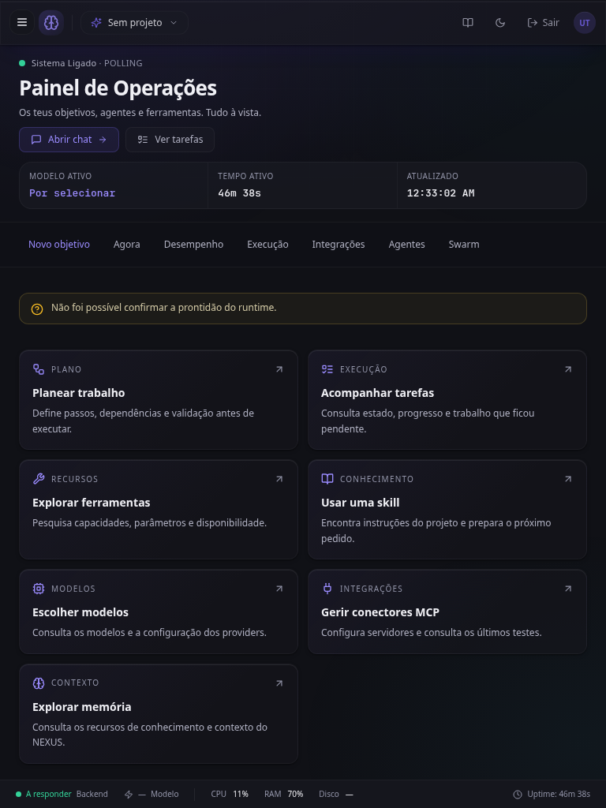

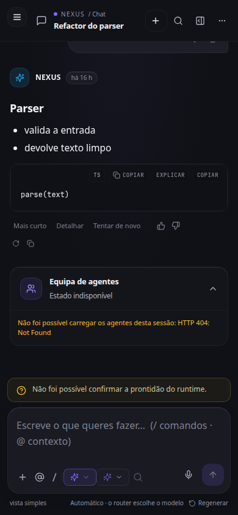

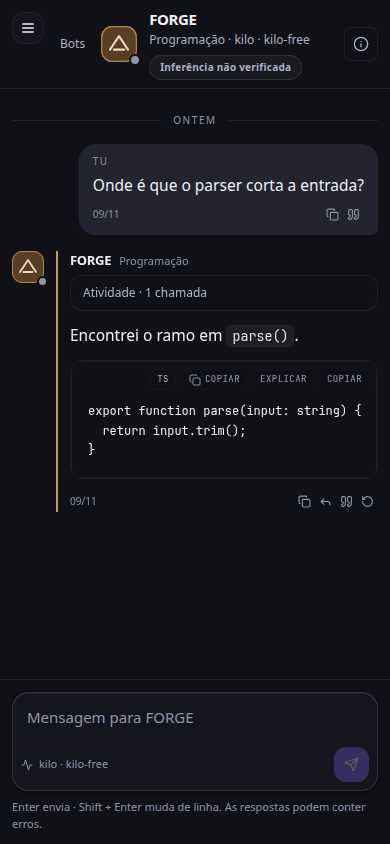

*Below 1024 px the primary navigation is a drawer. On a phone, the bot list and the conversation take the screen one at a time.*

## Architecture

The browser talks to a FastAPI backend. Chat and group rooms stream over SSE. The persistence reference is SQLite, described in `backend/persistence/schemas.sql`.

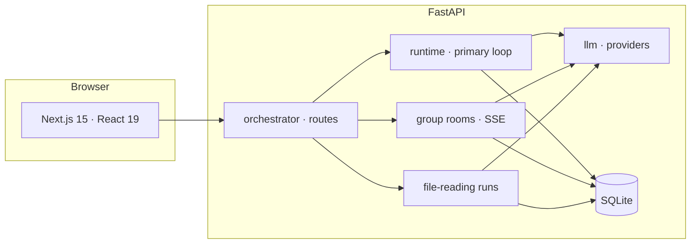

A group conversation is not the same thing as a file-reading run.

- In the **conversation**, participants reply in order until consensus, one failure, or the turn and time limit. That conversation has no tools. Equivalent errors between two user messages collapse into one incident, with a count, the agents, and the technical text underneath. Resending is an explicit action.
- In a **file run**, the request carries `message`, `file_path`, and `project_path`. The first bot reads the file, the middle ones contribute, and the last does the critical review. Each handoff stores `trust: analysis_unverified`: the previous analysis is input, not a verified fact.
- For a **single bot**, the session uses the runtime stream (`useAgentStream`). Tool calls the stream emits show up in a card. Private reasoning from the stream is not rendered.

A listed provider, or a saved key, does not mean inference was measured.

## Start

You need Python 3.12 or newer, Node.js, and pnpm 10.34.9 (the frontend `packageManager`). Git. A local provider (Ollama or LM Studio) or an external key only if you actually want inference. The screenshots in this README do not need a key.

There are two port profiles. `.env.example` and `../INICIAR_NEXUS.bat` use **8000** and **3000**. On this machine those ports may belong to another project; the local profile `start-nexus.bat` uses **8001** and **3001**.

### Windows, `INICIAR_NEXUS.bat`

The script lives at the repository root. Before running it on another computer, edit `RAIZ`: it currently points at `C:\Users\rodri\Desktop\nexus`. It expects `.venv`, `frontend\node_modules`, and `.env`. If port 8000 or 3000 is already listening, the script exits and does not kill the other process.

`start-nexus.bat` is the other shortcut. It also has a path fixed to this machine, and it starts the backend on 8001 and the frontend on 3001, without `--reload`. `start-nexus-dev.bat` limits reload to `backend/`. A reload over the whole tree restarts the process when an agent writes a `.py` file and drops the in-memory session state.

### Manual start

From `nexus-ide/`:

```powershell
python -m venv .venv
.\.venv\Scripts\python.exe -m pip install -e .
Copy-Item .env.example .env
cd frontend
corepack enable
corepack prepare pnpm@10.34.9 --activate
pnpm install --frozen-lockfile
```

On macOS or Linux the virtualenv Python is `.venv/bin/python` and the copy is `cp .env.example .env`.

Local profile, when 8000 and 3000 are taken. Backend terminal, in `nexus-ide/`, **without** `--reload`:

```powershell
$env:BACKEND_HOST = "127.0.0.1"
$env:ALLOWED_ORIGINS = "http://127.0.0.1:3001,http://localhost:3001"
.\.venv\Scripts\python.exe -m uvicorn backend.orchestrator.main:app --host 127.0.0.1 --port 8001
```

Frontend terminal, in `nexus-ide/frontend/`:

```powershell
$env:NEXT_PUBLIC_API_URL = "http://127.0.0.1:8001"
pnpm run dev -- --hostname 127.0.0.1 --port 3001
```

Open [http://127.0.0.1:3001](http://127.0.0.1:3001). API health: [http://127.0.0.1:8001/health](http://127.0.0.1:8001/health). Interactive docs: [http://127.0.0.1:8001/docs](http://127.0.0.1:8001/docs).

For the 8000/3000 profile, use port 8000, `NEXT_PUBLIC_API_URL=http://127.0.0.1:8000`, and `pnpm run dev` (port 3000 by default). Put `http://localhost:3000` and `http://127.0.0.1:3000` in `ALLOWED_ORIGINS`.

## Configuration

Copy `.env.example` to `.env`. Do not commit `.env`. The names below are the ones in the example; values stay on your machine. The frontend reads `NEXT_PUBLIC_API_URL` from `frontend/.env.local` (see `frontend/.env.example`).

| Group | Keys |
| --- | --- |
| Environment | `ENVIRONMENT`, `DEBUG`, `LOG_LEVEL`, `BACKEND_HOST`, `BACKEND_PORT` |
| Provider | `LLM_PROVIDER`, `NEXUS_FREE_ONLY`, `NEXUS_PROVIDER_VALIDATION_TTL_SECONDS`, `NEXUS_MAX_PROVIDER_LATENCY_MS`, `NEXUS_NATIVE_TOOL_CALLING` |
| Spend caps | `NEXUS_DAILY_BUDGET_USD`, `NEXUS_PER_RUN_BUDGET_USD`, `NEXUS_UNKNOWN_PRICE_USD_PER_1M_INPUT`, `NEXUS_UNKNOWN_PRICE_USD_PER_1M_OUTPUT` |
| OpenCode Go | `OPENCODE_GO_API_KEY`, `OPENCODE_GO_BASE_URL` |
| Local | `NEXUS_ENABLE_OLLAMA`, `OLLAMA_HOST`, `OLLAMA_DASHBOARD_HOST`, `LMSTUDIO_HOST`, `LMSTUDIO_API_KEY`, `LMSTUDIO_DEFAULT_MODEL`, `LMSTUDIO_FAST_MODEL`, `LMSTUDIO_CODER_MODEL`, `LMSTUDIO_READ_TIMEOUT` |
| Experimental | `AIRLLM_EXPERIMENTAL_ENABLED`, `LOCAL_LLM_DEVICE`, `LOCAL_LLM_COMPRESSION`, `LOCAL_LLM_DASHBOARD_DEVICE` |
| Other providers | `OPENAI_API_KEY`, `DEEPSEEK_API_KEY`, `KIMI_API_KEY`, `GROQ_API_KEY`, `ANTHROPIC_API_KEY`, `GEMINI_API_KEY`, `OPENROUTER_API_KEY` (commented out in the example) |
| Network and data | `REDIS_URL`, `REDIS_DB`, `REDIS_PASSWORD`, `DATABASE_URL`, `BRAVE_API_KEY` |
| Auth | `SECRET_KEY`, `JWT_SECRET`, `JWT_ALGORITHM`, `JWT_EXPIRATION_MINUTES`, `ALLOWED_ORIGINS` |
| Limits | `RATE_LIMIT_ENABLED`, `RATE_LIMIT_REQUESTS_PER_MINUTE` |
| Frontend | `NEXT_PUBLIC_API_URL`, `NEXT_PUBLIC_CHAT_STREAM_TIMEOUT_MS`, `NEXT_PUBLIC_DEBUG` |
| Observability | `OTEL_EXPORTER_OTLP_ENDPOINT`, `PROMETHEUS_PORT`, `ENABLE_TRACING`, `ENABLE_METRICS` |
| Autonomy, off by default | `AUTO_COMMIT_ENABLED`, `AUTO_COMMIT_STRATEGY`, `AUTO_COMMIT_MODEL`, `NEXUS_AUTO_APPLY`, `NEXUS_AUTO_APPLY_DRY_RUN`, `NEXUS_SELF_HEAL_MAX_PER_HOUR`, `NEXUS_PROPOSAL_TEST_CMD`, `NEXUS_AUTONOMOUS_STEP_TIMEOUT`, `NEXUS_REACT_MAX_ITERATIONS`, `NEXUS_REASONING_VISIBILITY` |

Redis is optional. If it is not running, rate limiting and the event bus stay in memory and log the connection failure.

## Tests

Frontend, from `frontend/`:

```powershell
pnpm run type-check
pnpm run lint
pnpm run test
pnpm exec playwright test -c playwright.overhaul.config.ts
```

`pnpm run test` is Vitest. The overhaul Playwright run starts the fixture on port 8765 and Next on 3010; it does not contact providers. The screenshots in this README come from `e2e/overhaul/readme-shots.spec.ts` when `README_SHOTS_DIR` points at `docs/screenshots` in the repository root.

Backend, from `nexus-ide/`, with the virtualenv active:

```powershell
python -m pytest backend/tests -q
```

`make test-backend` calls the same pytest with coverage and a 5% floor. The full suite is long; `.github/workflows/ci.yml` shards it and only runs on `main` and `develop`. Ruff and mypy enter that CI through a ratchet (`tools/ci/check_quality_ratchet.py`), not as a clean `ruff check`: an accepted baseline of findings already exists.

On this machine, `tsc`, the frontend lint, Vitest, `next build`, and the overhaul Playwright suite (including the screenshot spec) were confirmed. The backend pytest suite was not re-run here: this environment has no project virtualenv.

## Structure

```text
../INICIAR_NEXUS.bat       Windows shortcut, ports 8000 and 3000
../docs/screenshots/       screenshots in this README
backend/                   FastAPI: orchestrator, runtime, agents, llm, tools, persistence
frontend/                  Next.js, components, Vitest, and Playwright
docs/                      audits and operating notes
config/                    agent prompts and configuration
pyproject.toml             Python package and pytest
start-nexus.bat            local profile, 8001 / 3001
CONTRIBUTING.md            contribution guide; parts of it are historical
```

What runs is this directory. `archive/` is history and is not imported.

## Limitations

Taken from the 9 November 2026 UI overhaul and from what the API actually exposes.

- The group conversation does not receive tools or a plan. Only the file-reading run carries `tool_call`, `tool_result`, and `handoff`.
- There is no “coordinator” or “decision” message type. None is drawn.
- `@` in the composer and the Reply button insert the name into the draft. They do not change who answers.
- The bot composer does not upload attachments. A file path exists only on the durable run.
- Pins and unread state live in `localStorage`.
- Private reasoning from the stream is not shown.
- The dashboard was not rewritten. It stays dense, and without `/api/ready` readiness stays unconfirmed.
- Tasks are not a tree. Memory, PDF, database, models, and mission control did not get their own visual pass.
- The Monaco worker warns `Can't resolve <dynamic>`. The screen still opens.
- The model catalog grows 80 entries at a time.
- There is no `LICENSE` file at the repository root or in this directory. This README does not grant a license.

## Contributing

Short path: branch from the line you are working on, run the commands in [Tests](#tests), and open a pull request that says what changed in the UI and the API. [CONTRIBUTING.md](CONTRIBUTING.md) is the bilingual guide; several `make` targets there assume Docker and an older layout. When they disagree, the commands on this page win.

Do not commit `.env`, keys, or `data/`.

## License

The repository does not include a `LICENSE` file. Until one exists, this README does not grant a license to use the code.
