# NEXUS IDE

IDE local para trabalhar com IA: um chat principal, bots com identidade própria e grupos em que vários bots leem, passam trabalho e registam o que cada um fez.

[English](README.md) · [Português, na raiz do repositório](../README.md)

   

[Funcionalidades](#funcionalidades) · [Galeria](#galeria) · [Arquitetura](#arquitetura) · [Começar](#começar) · [Testes](#testes) · [Limitações](#limitações)

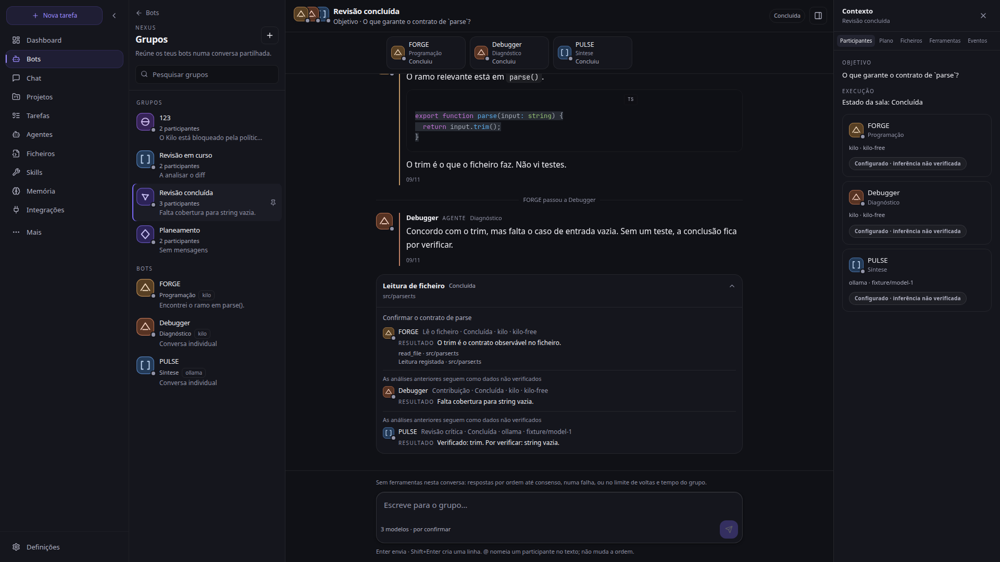

*Grupo «Revisão concluída» a 1920×1080. Dados do fixture local: nenhum provider pago foi contactado.*

## Funcionalidades

A barra principal liga as superfícies que existem hoje. O que a API não devolve aparece como indisponível ou por confirmar, não como saudável.

| Área | Rota | O que faz |
| --- | --- | --- |
| **Chat** | `/` | Conversa principal com markdown, código, compositor e painel de contexto da sessão. |
| **Grupos de bots** | `/bots` | Vários bots na mesma sala. A conversa segue por ordem. Erros iguais na mesma volta agrupam-se num incidente. |
| **Execução com ficheiro** | `/bots` | Pedido separado, com caminho de ficheiro. O primeiro participante lê, os do meio contribuem, o último faz a revisão crítica. As passagens ficam no registo. |
| **Bots** | `/bots` | Conversas individuais, com marca própria, papel, provider, modelo e atividade de ferramentas. |
| **Dashboard** | `/dashboard` | Painel de operações: atalhos, modelo ativo e prontidão do runtime quando a API a confirma. |
| **Projetos** | `/projects` | Pastas ligadas às conversas. |
| **Tarefas** | `/dashboard/tasks` | Fila, falhas e concluídas. As etapas vêm em lista; a API não traz árvore de pais e filhos. |
| **Ficheiros** | `/editor` | Editor Monaco e terminal local, sobre uma pasta escolhida. |
| **Skills** | `/tools` | Ferramentas e instruções reutilizáveis expostas pela API. |
| **Memória** | `/nexus` | Recursos de conhecimento e contexto do NEXUS. |
| **Integrações** | `/mcp` | Ligações MCP. Um conector configurado não é apresentado como saudável sem medição. |
| **Modelos** | `/models` | Catálogo de modelos e providers. A inferência fica «não verificada» até a API dizer o contrário. |
| **Agentes / SWARM** | `/swarm` | Superfície de agentes. Não é, por si, prova de que vários agentes correram. |
| **Pesquisa e recolha** | `/search`, `/scraping` | Pesquisa e recolha web, conforme as chaves e o serviço configurados. |
| **Documentos** | `/documents` | Documentos guardados pela aplicação. |
| **Aprovações** | `/nexus/hitl` | Fila do que espera uma decisão humana. |
| **Definições** | `/settings` | Provider predefinido e chaves. Guardar uma chave não valida a ligação. |

## Galeria

Capturas do estado atual, tiradas com o servidor de fixture em `frontend/e2e/overhaul/fixture-server.mjs` e o Next de desenvolvimento. Não houve chamada a Ollama, OpenRouter, Kilo, OpenAI nem a outro provider pago. Onde o fixture não implementa a rota, a imagem mostra a falha real da interface.

### Desktop

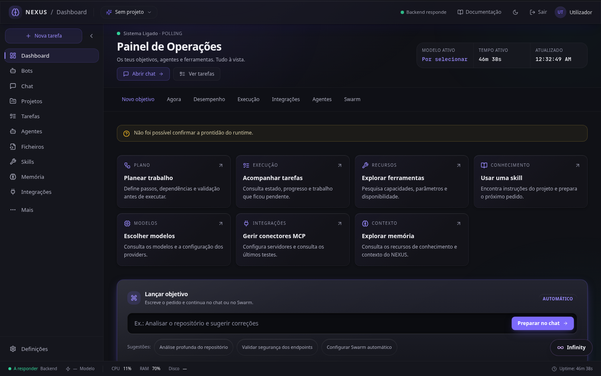

*Dashboard a 1440×900. Sem `/api/ready` no fixture, a faixa diz que a prontidão não foi confirmada.*

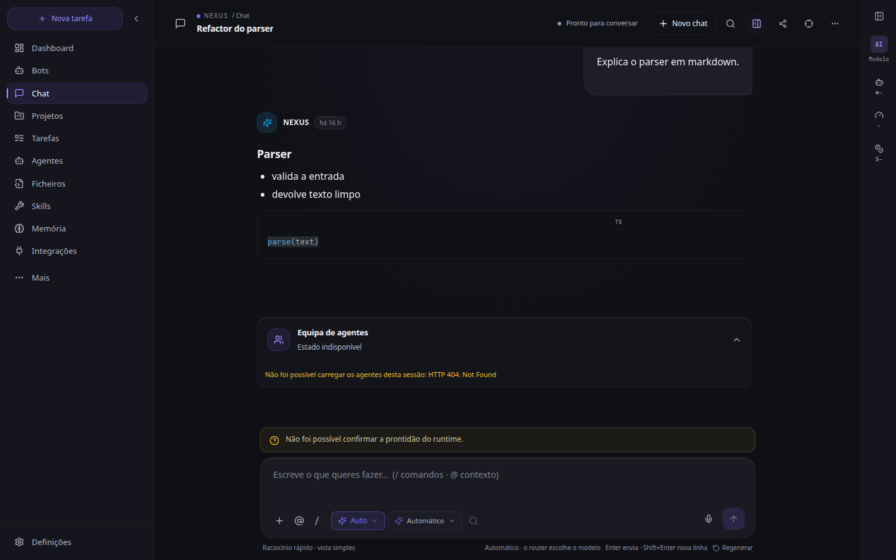

*Chat. O markdown e o bloco de código vêm da sessão de fixture. Os agentes dessa sessão não têm rota no fixture, por isso o cartão diz HTTP 404.*

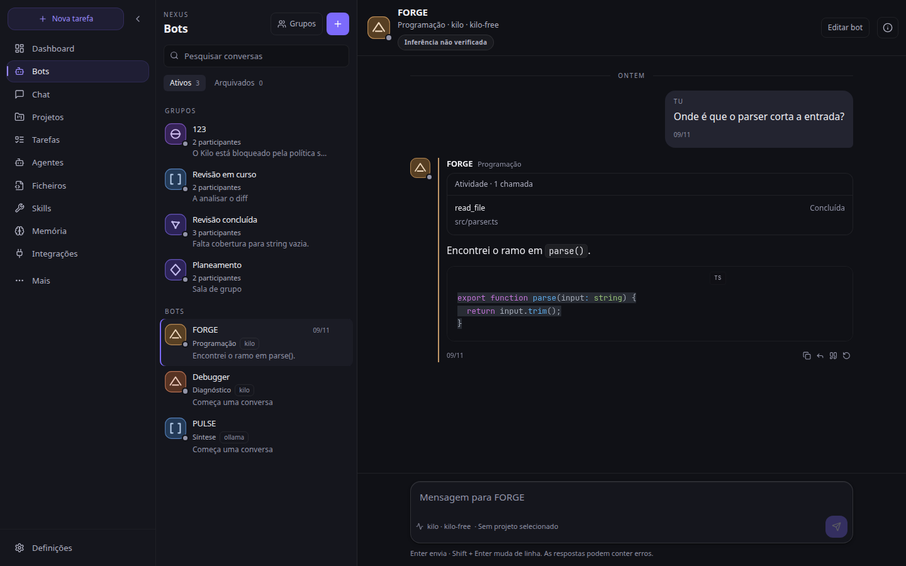

*Bot individual. A marca é gerada a partir da identidade, não são iniciais. O estado do modelo é «Inferência não verificada».*

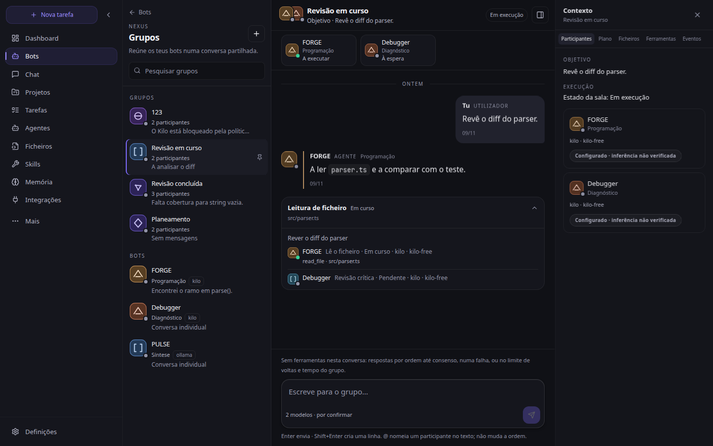

*Execução em curso. A faixa diz quem está a executar e quem está à espera. O cartão agrupa a leitura de `src/parser.ts`.*

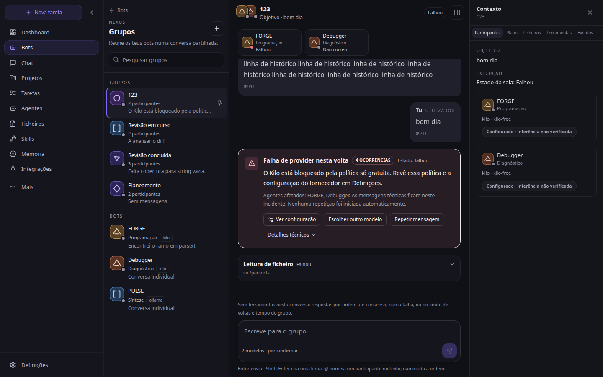

*Quatro erros com o mesmo texto na mesma volta ficam num incidente. Não há repetição automática.*

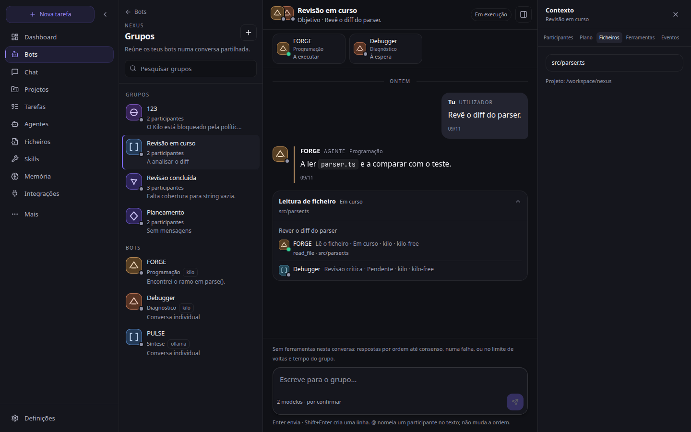

*Contexto do grupo: Participantes, Plano, Ficheiros, Ferramentas e Eventos. Abaixo de 1440 px abre em gaveta.*

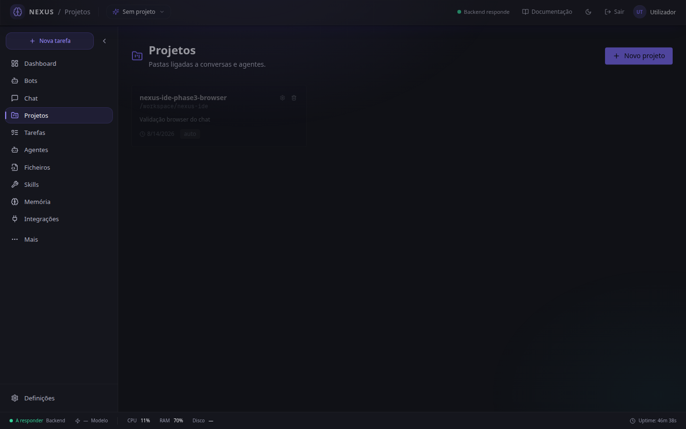

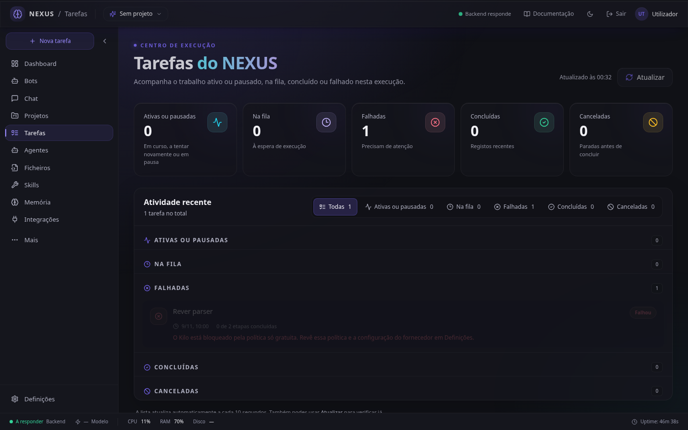

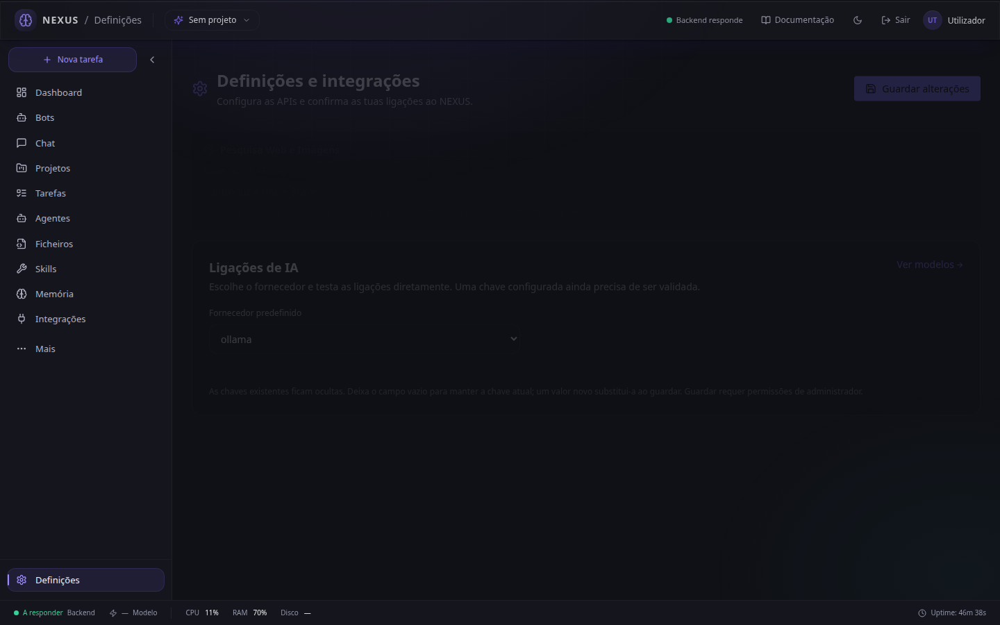

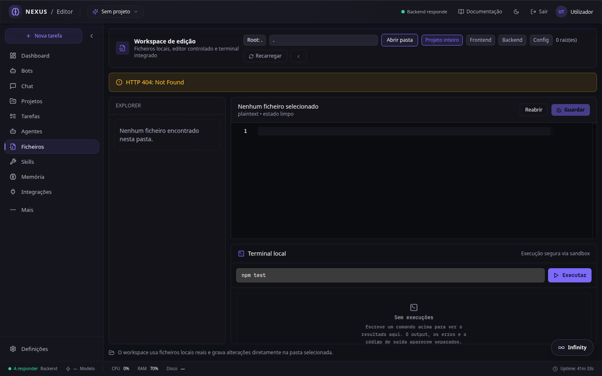

*Editor. Sem pasta, e sem a árvore de ficheiros no fixture, a página mostra 404 e «Nenhum ficheiro encontrado».*

### Tablet e telemóvel

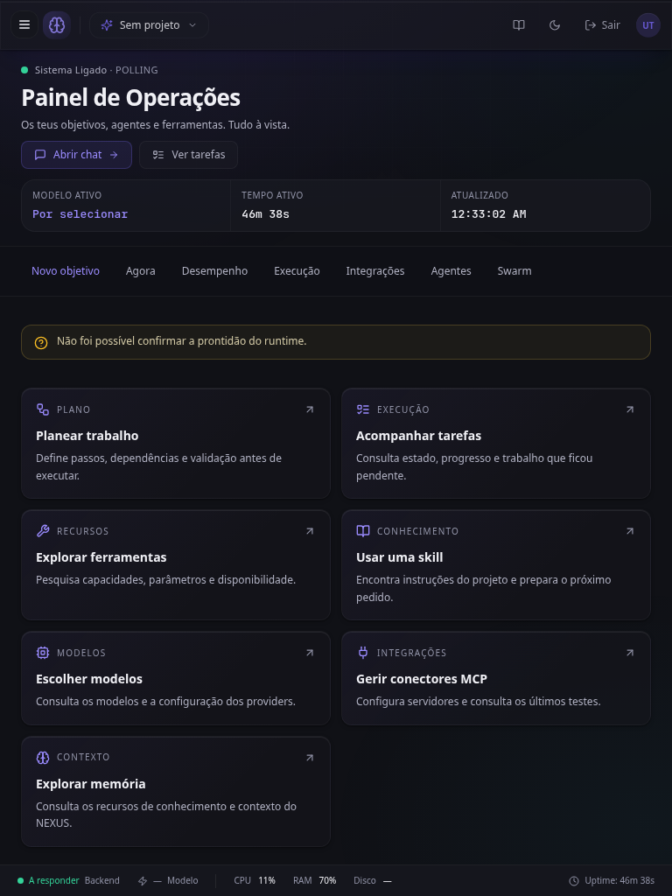

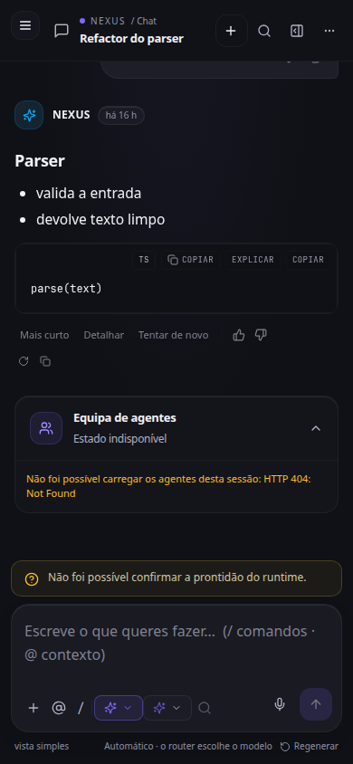

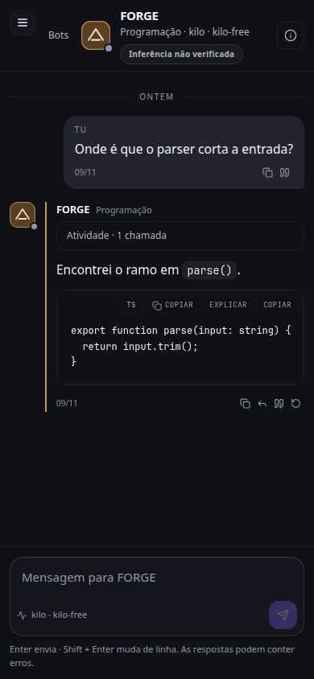

*Abaixo de 1024 px a navegação principal é uma gaveta. No telemóvel, a lista de bots e a conversa ocupam o ecrã à vez.*

## Arquitetura

O browser fala com um backend FastAPI. O chat e as salas de grupo recebem a resposta por SSE. A persistência de referência é SQLite, descrita em `backend/persistence/schemas.sql`.

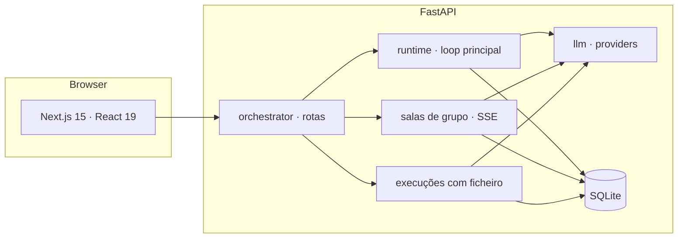

Uma sala de grupo não é o mesmo que uma execução com ficheiro.

- Na **conversa**, os participantes respondem por ordem até consenso, até uma falha, ou até ao limite de voltas e de tempo. Esta conversa não tem ferramentas. Erros equivalentes entre duas mensagens do utilizador juntam-se num incidente, com contagem, agentes e o texto técnico por baixo. Repetir a mensagem é uma ação explícita.
- Na **execução com ficheiro**, o pedido leva `message`, `file_path` e `project_path`. O primeiro bot lê o ficheiro, os intermédios contribuem e o último faz a revisão crítica. Cada passagem guarda `trust: analysis_unverified`: a análise anterior entra como dado, não como facto verificado.
- No **bot individual**, a sessão usa o stream do runtime (`useAgentStream`). As chamadas de ferramenta que o stream emite aparecem num cartão. O raciocínio privado do stream não é mostrado.

Um provider listado, ou uma chave guardada, não significa que a inferência tenha sido medida.

## Começar

Precisas de Python 3.12 ou superior, Node.js e pnpm 10.34.9 (o `packageManager` do frontend). Git. Um provider local (Ollama ou LM Studio) ou uma chave de um provider externo, se quiseres mesmo inferência. As capturas deste README não precisam de chave.

Há dois perfis de portas. O `.env.example` e o `INICIAR_NEXUS.bat` usam **8000** e **3000**. Nesta máquina essas portas podem estar ocupadas por outro projeto; o perfil local `start-nexus.bat` usa **8001** e **3001**.

### Windows, `INICIAR_NEXUS.bat`

O script está na raiz do repositório (`../INICIAR_NEXUS.bat`). Antes de o correres noutro computador, edita `RAIZ`: hoje aponta para `C:\Users\rodri\Desktop\nexus`. Confirma `.venv`, `frontend\node_modules` e `.env`. Se a porta 8000 ou 3000 já estiver à escuta, o script sai e não mata o processo que a ocupa.

`start-nexus.bat` é o outro atalho, também com caminho fixo desta máquina, e arranca o backend em 8001 e o frontend em 3001, sem `--reload`. `start-nexus-dev.bat` limita o reload à pasta `backend/`. O reload sobre a árvore inteira reinicia o processo quando um agente grava um `.py` e perde o estado da sessão em memória.

### Arranque manual

A partir desta pasta:

```powershell
python -m venv .venv
.\.venv\Scripts\python.exe -m pip install -e .
Copy-Item .env.example .env
cd frontend
corepack enable
corepack prepare pnpm@10.34.9 --activate
pnpm install --frozen-lockfile
```

Em macOS ou Linux, o Python do virtualenv é `.venv/bin/python` e a cópia do ambiente é `cp .env.example .env`.

Perfil local, quando 8000 e 3000 estão ocupadas. Terminal do backend, nesta pasta, **sem** `--reload`:

```powershell
$env:BACKEND_HOST = "127.0.0.1"
$env:ALLOWED_ORIGINS = "http://127.0.0.1:3001,http://localhost:3001"
.\.venv\Scripts\python.exe -m uvicorn backend.orchestrator.main:app --host 127.0.0.1 --port 8001
```

Terminal do frontend, em `frontend/`:

```powershell
$env:NEXT_PUBLIC_API_URL = "http://127.0.0.1:8001"
pnpm run dev -- --hostname 127.0.0.1 --port 3001
```

Abre [http://127.0.0.1:3001](http://127.0.0.1:3001). Saúde da API: [http://127.0.0.1:8001/health](http://127.0.0.1:8001/health). Documentação interativa: [http://127.0.0.1:8001/docs](http://127.0.0.1:8001/docs).

Para o perfil 8000/3000, usa a porta 8000 no uvicorn, `NEXT_PUBLIC_API_URL=http://127.0.0.1:8000` e `pnpm run dev` (porta 3000 por omissão). Inclui `http://localhost:3000` e `http://127.0.0.1:3000` em `ALLOWED_ORIGINS`.

## Configuração

Copia `.env.example` para `.env`. Não commits o `.env`. Os nomes abaixo são os do exemplo; os valores ficam só na tua máquina. O frontend lê `NEXT_PUBLIC_API_URL` de `frontend/.env.local` (vê `frontend/.env.example`).

| Grupo | Chaves |
| --- | --- |
| Ambiente | `ENVIRONMENT`, `DEBUG`, `LOG_LEVEL`, `BACKEND_HOST`, `BACKEND_PORT` |
| Provider | `LLM_PROVIDER`, `NEXUS_FREE_ONLY`, `NEXUS_PROVIDER_VALIDATION_TTL_SECONDS`, `NEXUS_MAX_PROVIDER_LATENCY_MS`, `NEXUS_NATIVE_TOOL_CALLING` |
| Teto de gasto | `NEXUS_DAILY_BUDGET_USD`, `NEXUS_PER_RUN_BUDGET_USD`, `NEXUS_UNKNOWN_PRICE_USD_PER_1M_INPUT`, `NEXUS_UNKNOWN_PRICE_USD_PER_1M_OUTPUT` |
| OpenCode Go | `OPENCODE_GO_API_KEY`, `OPENCODE_GO_BASE_URL` |
| Local | `NEXUS_ENABLE_OLLAMA`, `OLLAMA_HOST`, `OLLAMA_DASHBOARD_HOST`, `LMSTUDIO_HOST`, `LMSTUDIO_API_KEY`, `LMSTUDIO_DEFAULT_MODEL`, `LMSTUDIO_FAST_MODEL`, `LMSTUDIO_CODER_MODEL`, `LMSTUDIO_READ_TIMEOUT` |
| Experimental | `AIRLLM_EXPERIMENTAL_ENABLED`, `LOCAL_LLM_DEVICE`, `LOCAL_LLM_COMPRESSION`, `LOCAL_LLM_DASHBOARD_DEVICE` |
| Outros providers | `OPENAI_API_KEY`, `DEEPSEEK_API_KEY`, `KIMI_API_KEY`, `GROQ_API_KEY`, `ANTHROPIC_API_KEY`, `GEMINI_API_KEY`, `OPENROUTER_API_KEY` (comentadas no exemplo) |
| Rede e dados | `REDIS_URL`, `REDIS_DB`, `REDIS_PASSWORD`, `DATABASE_URL`, `BRAVE_API_KEY` |
| Auth | `SECRET_KEY`, `JWT_SECRET`, `JWT_ALGORITHM`, `JWT_EXPIRATION_MINUTES`, `ALLOWED_ORIGINS` |
| Limites | `RATE_LIMIT_ENABLED`, `RATE_LIMIT_REQUESTS_PER_MINUTE` |
| Frontend | `NEXT_PUBLIC_API_URL`, `NEXT_PUBLIC_CHAT_STREAM_TIMEOUT_MS`, `NEXT_PUBLIC_DEBUG` |
| Observabilidade | `OTEL_EXPORTER_OTLP_ENDPOINT`, `PROMETHEUS_PORT`, `ENABLE_TRACING`, `ENABLE_METRICS` |
| Autonomia, desligada por omissão | `AUTO_COMMIT_ENABLED`, `AUTO_COMMIT_STRATEGY`, `AUTO_COMMIT_MODEL`, `NEXUS_AUTO_APPLY`, `NEXUS_AUTO_APPLY_DRY_RUN`, `NEXUS_SELF_HEAL_MAX_PER_HOUR`, `NEXUS_PROPOSAL_TEST_CMD`, `NEXUS_AUTONOMOUS_STEP_TIMEOUT`, `NEXUS_REACT_MAX_ITERATIONS`, `NEXUS_REASONING_VISIBILITY` |

Redis é opcional. Se não estiver a correr, o limite de pedidos e o barramento de eventos seguem em memória e registam a falha de ligação.

## Testes

Frontend, a partir de `frontend/`:

```powershell
pnpm run type-check
pnpm run lint
pnpm run test
pnpm exec playwright test -c playwright.overhaul.config.ts
```

`pnpm run test` é Vitest. O Playwright de overhaul sobe o fixture na porta 8765 e o Next na 3010; não contacta providers. As capturas deste README saem de `e2e/overhaul/readme-shots.spec.ts` quando `README_SHOTS_DIR` aponta para `../docs/screenshots`.

Backend, a partir desta pasta, com o virtualenv ativo:

```powershell
python -m pytest backend/tests -q
```

`make test-backend` chama o mesmo pytest com cobertura e um mínimo de 5%. A suíte completa é longa; o workflow em `.github/workflows/ci.yml` parte-a por pastas e só corre em `main` e `develop`. Ruff e mypy entram nesse CI por um ratchet (`tools/ci/check_quality_ratchet.py`), não como `ruff check` limpo: há uma base de achados já aceite.

Nesta máquina confirmaram-se `tsc`, o lint do frontend, o Vitest, `next build` e o Playwright de overhaul, incluindo o spec das capturas. O pytest do backend não foi repetido aqui: não há virtualenv do projeto neste ambiente.

## Estrutura

```text
../INICIAR_NEXUS.bat       atalho Windows, portas 8000 e 3000
../docs/screenshots/       capturas deste README
backend/                   FastAPI: orchestrator, runtime, agents, llm, tools, persistence
frontend/                  Next.js, componentes, Vitest e Playwright
docs/                      auditorias e notas de operação
config/                    prompts e configuração dos agentes
pyproject.toml             pacote Python e pytest
start-nexus.bat            perfil local 8001 / 3001
CONTRIBUTING.md            guia de contribuição, em parte histórico
```

O código que corre é esta pasta. `archive/` é histórico e não entra no import.

## Limitações

Retiradas do overhaul de 9 de novembro de 2026 e do que a API expõe hoje.

- A conversa de grupo não recebe ferramentas nem um plano. Só a execução com ficheiro traz `tool_call`, `tool_result` e `handoff`.
- Não há tipo de mensagem «coordenador» nem «decisão». Não são desenhados.
- `@` no compositor e o botão Responder inserem o nome no rascunho. Não mudam a ordem de resposta.
- O compositor dos bots não envia anexos. O caminho de ficheiro existe na execução durável.
- Pins e não-lidas ficam em `localStorage`.
- O raciocínio privado do stream não é mostrado.
- O dashboard não foi reescrito. Continua denso, e sem `/api/ready` a prontidão fica por confirmar.
- As tarefas não têm árvore. Memória, PDF, base de dados, modelos e mission control não tiveram uma passagem visual própria.
- O worker do Monaco avisa `Can't resolve <dynamic>`. O ecrã abre na mesma.
- O catálogo de modelos cresce de 80 em 80.
- Não há ficheiro `LICENSE` na raiz do repositório nem nesta pasta. Este README não concede uma licença.

## Contribuir

O fluxo curto: branch a partir da linha em que estás a trabalhar, comandos da secção [Testes](#testes), e um pull request com o que mudou na interface e na API. [CONTRIBUTING.md](CONTRIBUTING.md) tem a versão bilingue; vários atalhos `make` desse texto assumem Docker e um layout antigo. Em caso de divergência, valem os comandos desta página.

Não commits `.env`, chaves, nem `data/`.

## Licença

O repositório não inclui um ficheiro `LICENSE`. Até existir um, não há uma licença de uso declarada por este README.
