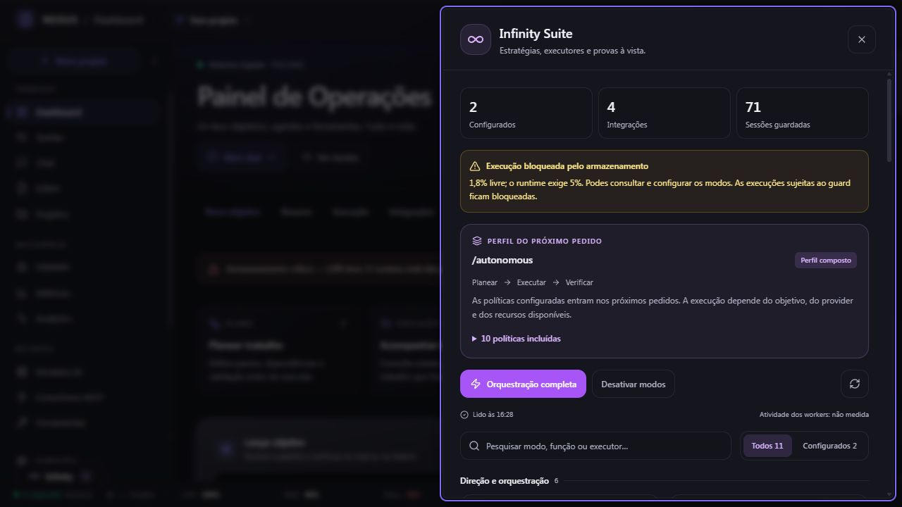
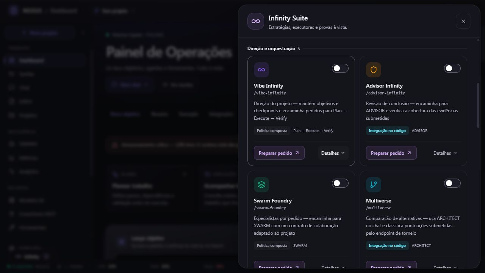
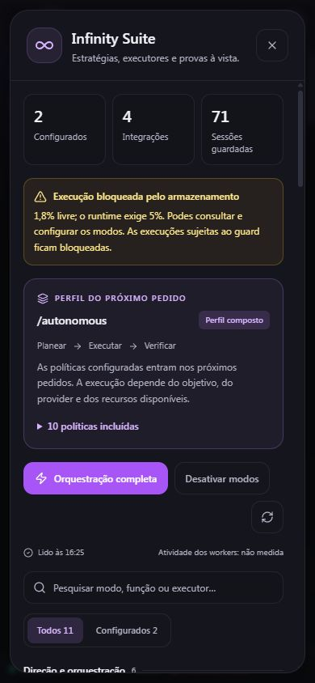

# Infinity Suite — funcionamento, correções e validação

Data: 2026-10-05. Checkout: `C:\Users\rodri\Desktop\nexus\nexus-ide`, branch `main`, com alterações do utilizador já presentes. Auditoria inicial às 16:45, Europe/Lisbon; adendas de implementação/reverificação até às 22:14, Europe/Lisbon.

## Veredicto

**IMPLEMENTADO / TESTADO:** catálogo e políticas dos 11 modos, resolução de comandos explícitos, composição do perfil, persistência/recuperação, endpoints, avaliadores estáticos de Advisor/Multiverse/Sentinel, comandos Vibe no chat e Terminal, e integração dos modos com as duas rotas de chat (legacy e PRIMARY). Os contratos `tools_enabled` configurados passam agora para os agentes; o Sentinel ativo também põe um gate antes de ferramentas e propaga as restrições para subagentes/tarefas delegadas. A bateria mais recente passou 27 testes focados; Ruff (I001/F821), import da rota legacy e `git diff --check` também passaram.

**MEDIDO NO BROWSER:** ativação e desativação do Forge com confirmação do backend; sincronização entre as duas interfaces; histórico preservado; os três formulários; transferência do comando para o chat; pesquisa e filtro; Escape e restituição do foco; apresentação móvel a 390 × 844 sem overflow horizontal do documento.

**BLOCKED / NOT_VALIDATED:** execução autónoma completa com provider real. Às 22:14, Europe/Lisbon, não havia listener nas portas 8000, 8001, 18002, 3000 ou 3002; C: tinha 25.314.254.848 bytes livres (~2,48%), abaixo do gate crítico de 5%. Não arranquei serviços nem executei missão real. A API isolada anterior deixou de estar disponível; o `/health` de 20:21 reportava `disk_pressure=critical` e `write_blocked=true`, e `/readyz` devolveu 404 quando testado às 20:12. Portanto a integração de código está testada, mas a execução live/produção e a qualidade real continuam sem validação.

**NOT_VALIDATED:** execução com provider real, compatibilidade dos model roles com credenciais/configuração ativas, qualidade dos workers, recuperação após reinício e cobertura exaustiva de todos os modos/ferramentas. Configuração, sessões persistidas, checkpoint ou HTTP 200 não são prova de execução nem de qualidade. O caminho explícito do Vibe e os gates foram exercitados com providers/ferramentas simulados; isso valida integração de software, não uma inferência real.

O catálogo tem 11 modos, quatro integrações declaradas no código e sete contratos compostos. A indicação de integração descreve implementação; não comprova ligação a um serviço, atividade em curso ou sucesso.

## O que cada modo faz

O comando explícito escolhe um executor existente. Configurar um modo compõe políticas para os próximos pedidos. O perfil Autonomous inclui dez contratos da suite, mesmo sem configurar individualmente os dez cartões.

| Modo | Comando / executor | Funcionamento e limite |
| --- | --- | --- |
| Vibe Infinity | `/vibe-infinity` → worker CODER predefinido; `/spawn`, `/send`, `/wait`, `/result`, `/agents`/`/workers` e `/kill` → VibeDirector | O worker predefinido persiste durante a sessão do processo e mantém histórico separado. O utilizador pode criar workers adicionais explicitamente; o chat limita o roster a cinco workers ativos por sessão. `/agents`, `/workers`, `/wait`, `/result` e `/kill` são controlos locais e não requerem provider; `/spawn` e `/send` precisam de execução do modelo. O roster/histórico não sobrevive a reinício. A ativação passiva continua em Plan → Execute → Verify. `NEXUS_VIBE_LANE=0` desativa os controlos de workers. |
| Advisor Infinity | `/advisor-infinity` → ADVISOR; `/advisor-infinity review {JSON}` → avaliador backend | O chat estruturado chama a mesma revisão estática do endpoint e regista a intervenção na sessão ativa. As referências submetidas continuam por verificar; não há PASS independente. O reviewer live observa PRIMARY quando ativado; esse caminho é distinto da ação JSON. |
| Swarm Foundry | `/swarm-foundry` → SWARM | Aplica o contrato ao sistema SWARM existente. A configuração não prova criação dinâmica de especialistas nem execução paralela bem-sucedida. |
| Multiverse | `/multiverse` → ARCHITECT; `/multiverse rank {JSON}` → avaliador backend | A ação JSON chama a classificação do endpoint para alternativas e pontuações submetidas; não constrói, executa nem mede várias implementações. |
| Evolve | `/evolve` → ANALYZER | Regista percursos e pede análise de padrões. Não treina pesos nem aplica automaticamente novas regras ao sistema. |
| Autonomous | `/autonomous` → Plan → Execute → Verify | Estratégia composta com contratos de direção, qualidade, realidade e segurança. Depende do pedido, do projeto, do provider e dos guards. |
| Forge | `/forge` → CODER | Contrato de construção com requisitos de arquitetura, testes e documentação. Os requisitos do prompt não comprovam uma entrega validada. |
| Proof | `/proof` → ADVISOR | Exige referências e artefactos para conclusões. Ativar o modo não executa testes nem valida automaticamente os artefactos. |
| Reality Lab | `/reality-lab` → TEST_RUNNER_E2E | Pede cenários adversos e validação de instalação. A configuração não comprova execução em ambiente limpo. |
| Archaeologist | `/archaeologist` → ANALYZER | Orienta a leitura de módulos, dependências e diferenças entre documentação e código. Um relatório de arquitetura precisa de provas do pedido concreto. |
| Sentinel | `/sentinel` → NEXUS com política Sentinel; `/sentinel gate {JSON}` → avaliador backend | A ação JSON chama a verificação estática com risco submetido. Quando Sentinel está armado no chat, o registry avalia a ferramenta antes de executar e pode exigir aprovação; o gate restringe o caminho do projeto. Não é sandbox nem proteção universal fora das chamadas de chat cobertas. |

## O que o chat realmente aciona

- As subações JSON explícitas `/advisor-infinity review`, `/multiverse rank` e `/sentinel gate` chamam os avaliadores backend correspondentes dentro do chat. Um comando simples, como `/multiverse`, continua a selecionar ARCHITECT; sintaxe JSON malformada é rejeitada sem pedir ao LLM que invente um resultado. Além disso, Sentinel armado (por `/sentinel`, `/autonomous` ou política ativa) verifica chamadas a ferramentas antes do handler, aplica a classificação de risco e exige aprovação quando necessário.
- Os `tools_enabled` concretos dos modos são agora aplicados no contexto do agente tanto na rota legacy como na PRIMARY. Uma lista estrita já existente intersecta com a lista do modo; modo sem contrato concreto não ganha ferramentas por inferência. A mesma lista e a flag Sentinel são transmitidas a agentes consultados, workers/subagentes PRIMARY e tarefas delegadas.
- O Advisor live está acoplado ao PRIMARY, sujeito a `NEXUS_ADVISOR_ENABLED` e aos timeouts configurados. A ação JSON é uma revisão estática separada; não se deve confundir uma com a outra.
- Forge, Proof, Reality Lab, Archaeologist e Evolve orientam agentes existentes. O chat só pode declarar execução, prova ou gate quando a ferramenta/artefacto correspondente realmente o demonstra; prompt e nome do modo não certificam resultado.
- Swarm Foundry encaminha para SWARM; Autonomous usa Plan → Execute → Verify. Ativação passiva acrescenta contratos ao pedido seguinte e não representa automaticamente spawning de equipas.
- Vibe liga ao chat através de um worker predefinido e de comandos explícitos de gestão. Há até cinco workers ativos por sessão, mas não há spawning automático; cada worker usa o mesmo caminho de agente/provider e a simulação de testes não comprova inferência real. Roster e histórico existem só na memória do processo.
- O campo `healthy` de `/api/advanced-modes/health` mede se o catálogo está completo e todos os modos estão disponíveis; não mede provider, worker, liveness ou readiness. A interface usa `healthy=false` apenas para avisar de catálogo incompleto e apresenta o bloqueio de disco em separado. Mesmo `healthy=true` não é prova de execução.

## Problemas encontrados e corrigidos

1. **O runtime PRIMARY podia passar ao lado dos modos.** Comandos explícitos chegam agora ao adaptador que os resolve. Só um prefixo `/` seleciona essa via; mencionar um nome como “proof” no início de uma pergunta normal não o transforma em comando. Pedidos de trabalho em projeto com perfil composto chegam à estratégia autónoma. Perguntas informativas continuam no PRIMARY, com as políticas aplicadas e sem criar objetivos/checkpoints de trabalho. O contexto dos modos não alarga as ferramentas autorizadas.
2. **Dashboard e painel global tinham lógica separada.** Agora usam a mesma interface e o mesmo estado central, com catálogo, configurações e perfil atualizados na mesma leitura. Pedidos de leitura simultâneos são agregados; uma resposta antiga não pode sobrescrever uma alteração mais recente.
3. **Um POST falhado podia parecer uma ativação bem-sucedida.** As ações exigem confirmação HTTP e `success: true`. Falhas aparecem na interface; controlos mostram estado pendente e não repetem a mesma alteração enquanto está em curso. Dados desatualizados ficam identificados e as alterações são desativadas até nova leitura.
4. **Desativar alterava todo o histórico do modo.** Só sessões ACTIVE/RUNNING são desativadas. Sessões COMPLETED/FAILED são preservadas. O índice de modos configurados considera todas as sessões, em vez de perder o modo quando apenas uma delas termina.
5. **Ativar repetidamente resetava o estado e duplicava eventos.** A ativação é idempotente e mantém a sessão existente, incluindo o estado RUNNING. A escrita de JSON passa por um ficheiro temporário e substituição atómica.
6. **O Advisor aceitava palavras da própria conclusão como prova.** As palavras deixaram de contar. Provas falsas, vazias ou com formato inadequado não satisfazem categorias. Uma sessão inexistente devolve 404/BLOCKED. A confiança numérica inventada foi removida; provas submetidas continuam UNVERIFIED até validação independente.
7. **O Multiverse inflacionava resultados e inventava vencedores.** Mantém pontuações absolutas de 0 a 100, normaliza pelos pesos efetivos, exige todos os critérios ponderados e rejeita valores inválidos. A normalização evita também overflow com pesos muito grandes mas finitos. Empates, ausência de alternativas e uma única alternativa não recebem um vencedor arbitrário.
8. **O Sentinel podia indicar gate aprovado em risco 2.** Instalações/migrações e riscos superiores exigem aprovação e não passam o gate. O risco é um inteiro estrito de 0 a 4. Foram acrescentados padrões destrutivos de Windows/PowerShell; uma descrição vazia é rejeitada.
9. **Preparar um comando na dashboard podia perder o texto.** O comando é guardado no rascunho partilhado antes de navegar para o chat. O utilizador acrescenta o objetivo e decide quando enviar.
10. **As descrições e badges prometiam execução sem medições.** A interface passa a distinguir Configurado, Integração no código, Política composta, sessões guardadas e atividade não medida. Os detalhes mostram o executor, os limites e as contagens persistidas. O widget do Advisor usa totais do histórico, em vez de somar apenas as últimas cinco sessões.
11. **A navegação tinha erros de tipagem que impediam o build.** Foi corrigida a tipagem da substituição de URL no chat e removidas conversões para `string` que perdiam o tipo das rotas na barra lateral. As rotas mantêm o comportamento existente.
12. **O Vibe Director estava órfão.** `VibeDirector` e `NEXUS_VIBE_LANE` não eram chamados por nenhuma rota de chat. O comando explícito agora liga ao worker CODER, conserva histórico isolado entre mensagens, transmite a resposta pela mesma camada SSE e interrompe o worker quando o stream é cancelado. Apagar a sessão também mata os workers correspondentes. Um erro de provider já não fica preso no worker e pode ser tentado novamente. Roster e histórico são de processo; múltiplos workers só existem quando pedidos explicitamente e estão limitados pelo chat.
13. **O `/wait` do Vibe esperava por todos os workers.** O contrato declara que deve regressar na primeira conclusão, mas a implementação aguardava por todos os workers ativos e podia perder uma conclusão se o worker iniciasse logo a mensagem seguinte da fila. Agora espera pelo primeiro turno concluído, mantém conclusões ainda não consultadas entre chamadas e assinala `settled` em cada resumo. Um teste mantém um worker bloqueado enquanto outro termina e confirma que a espera regressa; outro cobre a continuação em fila.
14. **Os comandos do Terminal não chegavam ao chat.** `/spawn`, `/agents`/`/workers`, `/send`, `/wait`, `/result` e `/kill` eram reconhecidos pelo protocolo do Terminal, mas tratados como texto normal no chat. Agora partilham o parser, usam o diretor ligado ao `session_id`, distinguem o worker predefinido dos auxiliares, limitam o roster a cinco workers ativos e devolvem estado/resultados na stream do chat. `/wait` tem timeout limitado e progresso durante esperas longas; `/result` limita a saída visível. `/agents`, `/workers`, `/wait`, `/result` e `/kill` não precisam de provider; `/spawn`, `/send` e a execução do `/vibe-infinity` precisam.
15. **Os model roles do Vibe não tinham associação a provider.** Ao fixar provider no pedido, um role `fast` podia herdar um ID configurado para outro serviço e falhar. Quando o provider está fixado sem modelo explícito, o worker usa o modelo resolvido pelo agente desse pedido para ambos os tiers; um modelo explicitamente escolhido continua a ser respeitado. Testado com agente/provider simulado, não com credenciais reais.
16. **Os avaliadores de Advisor, Multiverse e Sentinel estavam desligados do chat.** Foram adicionadas subações JSON explícitas que chamam os mesmos métodos backend usados pelos endpoints; JSON inválido é rejeitado localmente. Advisor regista BLOCKED/UNVERIFIED quando não há prova verificada; Multiverse só ordena scores submetidos e marca execução como NOT_MEASURED; Sentinel usa o risco submetido e não é uma proteção de execução.
17. **O catálogo backend ainda descrevia o comportamento antigo.** `MODE_RUNTIME_STATUS` e `MODE_LIMITATIONS` diziam que o Vibe só tinha um worker, além de não mostrarem as novas subações do Advisor, Multiverse e Sentinel. As descrições do endpoint de saúde agora correspondem aos comandos reais e declaram os limites de memória, execução e prova. O teste do `/advanced-modes/health` verifica esses campos.
18. **Um worker falhado podia parecer concluído com uma resposta antiga.** O Vibe preservava o último resultado com sucesso após uma falha, mas `/wait`, `/result` e `/agents` não distinguiam esse resultado do último turno. O diretor agora mantém settlements ainda não consultados, inclusive quando já começou um turno da fila; o chat marca falhas e identifica respostas anteriores sem expor o texto bruto da exceção.
19. **A saída do NEXUS Terminal também ocultava falhas Vibe.** A tabela de workers e `/result` podiam apresentar a resposta anterior sem indicar que o último turno falhou. Agora mostram estado de falha e identificam claramente a resposta anterior, sem imprimir o texto técnico do erro.
20. **O `/wait` do Terminal aceitava argumentos inválidos silenciosamente.** Tinha um parser separado do chat: ignorava timeouts malformados e aceitava vários workers com comportamento ambíguo. Agora usa `parse_wait`, o parser partilhado que valida timeout finito entre 0,1 e 600 segundos, no máximo um worker e opções reconhecidas.
21. **Um erro SSE do `/api/chat` podia contar como sucesso no Vibe do Terminal.** O Terminal só passava o evento `error` ao renderer, deixando vazia a condição de erro da execução. O worker guardava `[NEXUS ERROR] ...` como resposta concluída. Agora o runner regista erro e, no caminho de worker, lança uma falha genérica; o detalhe do provider não entra no resultado nem no estado visível do worker.
22. **Falhas de transporte em background imprimiam a exceção bruta no Terminal.** Os retries de `_chat(display=False)` escreviam o erro de ligação na consola apesar de a execução ser silenciosa. Agora a mensagem de retry só aparece na conversa interativa; um worker continua a terminar como falhado com erro genérico.
23. **`tools_enabled` era configuração sem efeito no chat.** Os modos declaravam listas de ferramentas mas as duas rotas de chat não as aplicavam. Agora o contrato é convertido numa allowlist validada e intersectado com limites mais estritos já existentes; listas inválidas/ausentes falham fechadas. Corrigi também o nome `analyze_data` para a ferramenta registada `data_analysis` e alinhei as capacidades declaradas de Advisor/Analyzer com as ações que suportam.
24. **`/sentinel` escolhia GUARDIAN, que não é um executor de chat.** GUARDIAN é um monitor de fundo sem o contrato de execução `AgentBase`; agora Sentinel encaminha para NEXUS com o gate ativo, em vez de aparentar que a política é executada por um agente incompatível.
25. **Delegação podia perder os limites do modo e Sentinel.** `consult_agent`, subagentes PRIMARY e `spawn_task` não herdavam necessariamente as restrições do agente chamador. O registry agora injeta contexto confiável na delegação e o executor propaga allowlist e flag Sentinel; os testes cobrem esses caminhos. Isto só vale para os callsites ligados ao registry/chat identificados nesta auditoria.
26. **A classificação central de risco das ferramentas era incompleta.** Várias operações com efeitos externos/destrutivos não eram classificadas antes do handler. O gate Sentinel agora cobre classes como shell/código, operações Git, HTTP mutável, DB, email/webhook, browser e operações de ficheiros, com aprovação para risco elevado e imposição da raiz do projeto selecionado em caminhos suportados. A classificação continua a ser política de execução, não isolamento de processo/OS; ferramentas fora do chat ou chamadas sem Sentinel ativo não ficam automaticamente protegidas.

## Interface entregue

- Cartões com ícones reais, controlos dedicados e estado confirmado pelo servidor.
- Grelha de duas colunas no desktop e uma coluna em telemóvel.
- Pesquisa por modo, função e executor; filtro de modos configurados.
- Resumo de configurações, integrações declaradas e sessões guardadas.
- Perfil do próximo pedido, etapas e políticas incluídas.
- Ações de orquestração, desativação e atualização, com erros e confirmação visíveis.
- Detalhes por modo com limites, sessões, evidências registadas e checkpoints.
- Formulários para risco do Sentinel, comparação do Multiverse e revisão do Advisor.
- Modal com Escape, foco contido e foco restituído ao botão de abertura.
- Aviso de armazenamento baseado no guard real, sem baixar o limite de execução.

Capturas feitas na instância isolada, com estado confirmado pelo seu backend:







## Validação executada

| Verificação | Resultado | Alcance |
| --- | --- | --- |
| Bateria de regressão backend direcionada a Infinity e chat | 148 PASS | Nove módulos de testes: modos, comandos, API, eventos PRIMARY/legacy, Advisor, execução e raciocínio. Não usa um provider real como prova de qualidade. |
| Reverificação focada do checkout atual, nove módulos backend | 73 PASS, 90,37 s | Modos API/runtime/comandos, Advisor, ciclo de execução Infinity, parser Vibe, ações JSON e endpoint de chat. Inclui os fluxos adicionados nesta adenda; não usa provider real. |
| Reverificação após alinhar os contratos de runtime publicados pela API | 36 PASS, 43,22 s | `test_advanced_modes_api.py` e `test_advanced_modes_runtime.py`; valida que `/advanced-modes/health` publica os comandos e limites atuais de Vibe, Advisor, Multiverse e Sentinel. |
| Regressão de resultados Vibe após falha | 9 PASS, 37,48 s | Quatro testes do diretor e cinco fluxos de chat; comprova que a falha/resultado anterior se mantêm distinguíveis, que a fila não apaga o settlement e que mensagens técnicas sensíveis não aparecem ao utilizador. |
| Apresentação de falhas Vibe no NEXUS Terminal | 1 PASS, 2,08 s | A tabela de workers e `/result` identificam uma falha, mostram a resposta anterior como anterior e não mostram a exceção bruta. `py_compile` passou. As violações E501 preexistentes no resto do script foram preservadas; a área editada não tem E501.
| Parser `/wait` partilhado no NEXUS Terminal | 13 PASS, 9,08 s | Testes do parser de Terminal e da apresentação Vibe; `/wait --timeout 2.5 w-1` preserva alvo/timeout e `nan` é rejeitado sem chamar o diretor. `py_compile`, ordem de imports e E501 nas áreas editadas passaram.
| Infinity Vibe: worker, continuação, recuperação e espera | 4 PASS (incluídos acima) | POST `/api/chat` com provider simulado cobre primeira execução e continuação no mesmo worker; três testes unitários cobrem recuperação depois de falha, preservação do runner em mensagens enfileiradas e retorno da primeira espera enquanto outro worker continua ativo. Não valida execução com provider real. |
| Reverificação final dos três ficheiros de testes Infinity | 36 PASS, 31,91 s | Após os ajustes de provas malformadas, pesos muito grandes e distinção entre comando e pergunta. Estes testes estão incluídos na bateria anterior; não são 36 testes adicionais. |
| Modos aplicados ao chat e gate Sentinel antes da execução/delegação | 27 PASS, 36,48 s | `test_infinity_sentinel_tool_gate.py`, runtime e comandos de modos, mais dois casos da API PRIMARY. Exercita allowlists, fail-closed, risco/aprovação, raiz do projeto e propagação para consulta, tarefas e subagentes. Simulado; não prova chamadas live a provider. |
| Frontend | 34 PASS em sete ficheiros | Estado, falhas, concorrência de leituras, interface, três formulários, rascunho, acessibilidade e widget Advisor. |
| TypeScript | PASS | Verificação sem emissão; o build também validou tipos gerados das rotas. |
| ESLint nas superfícies alteradas | PASS | Store, componentes Infinity, painel/header, widgets, barra lateral e testes novos/alterados do Infinity. |
| Ruff no módulo, rotas e testes novos Infinity | PASS | Verificação focada; não é uma certificação de lint de todo o backend. |
| Sintaxe Python nas quatro superfícies backend alteradas | PASS | Módulo avançado, rotas avançadas e duas rotas de chat. |
| Whitespace nos ficheiros da adenda | PASS | Verificação direta sem espaços finais nos dois ficheiros backend novos e neste relatório; `git diff --check` não reportou erros nos ficheiros rastreados existentes (com avisos CRLF/LF). |
| Build Next.js de produção | PASS | Compilação, validação de tipos e geração das 37 páginas concluídas. A tentativa anterior teve uma falha transitória de leitura de `next-env.d.ts`; a repetição concluiu. |
| Browser autenticado com API real isolada | PASS nos fluxos abaixo | Valida pedidos e persistência reais nos endpoints da suite; não valida inferência nem uma missão autónoma. |

Fluxos observados no browser:

1. Forge passou de desativado a configurado; os dois painéis passaram de 2 para 3 configurações. Ao desativar, voltaram a 2, mantendo a nova sessão no histórico (70 → 71).
2. Sentinel recebeu uma instalação com risco 2 e apresentou **Aprovação necessária**, sem executar a ação.
3. Multiverse recebeu duas alternativas com pontuações 80 e 60 nos sete critérios; apresentou **Solução simples (80/100)**. Os testes cobrem também empate e entradas inválidas.
4. Advisor recebeu uma conclusão de prontidão sem referências; apresentou **Conclusão bloqueada** e a intervenção ficou registada no widget da dashboard.
5. Preparar `/forge` navegou da dashboard para o chat e manteve `/forge ` na caixa de texto. O pedido não foi enviado.
6. Pesquisa inexistente apresentou estado vazio; o filtro Configurados apresentou apenas Evolve e Autonomous.
7. Escape fechou o modal e devolveu o foco a Abrir Infinity Suite. A 390 × 844, o diálogo ficou entre x=12 e x=378; a largura do documento permaneceu 390.
8. Desativar modos passou as duas interfaces de 2 para 0 configurações, mantendo 71 sessões guardadas. Orquestração completa voltou a configurar Autonomous e o respetivo perfil; Evolve foi depois reposto. A instância de teste terminou com os dois modos iniciais configurados e 73 sessões no histórico.
9. Após o reinício apenas da API de validação, as configurações, o histórico e a intervenção do Advisor continuaram presentes. O backend habitual permaneceu em execução.

Os testes backend usam diretórios temporários para sessões, checkpoints, evidências e trajetórias. A limpeza automática de diretórios órfãos de pytest foi desativada para as baterias seguintes à medição inicial. Não se fez um teste integral de todas as funcionalidades do NEXUS, mypy de todo o backend, benchmark de modelos ou validação externa de segurança. A integração Vibe validada com Ollama simulado não prova acesso ao provider escolhido numa sessão real nem que o worker concluiu uma tarefa de projeto corretamente.

## Instância aberta e integração no runtime habitual

Na validação visual anterior, a versão completa esteve aberta em `http://localhost:3002/dashboard`, com API em `http://127.0.0.1:18002`. Usou uma cópia da base de dados e dos estados Infinity em `.cache/infinity-suite-20261005/`, com serviços de fundo desativados. As alterações feitas nessa instância de validação não configuram o estado do backend habitual. O estado atual do browser não foi revisto nesta adenda.

O frontend habitual em 3000 pode atualizar os componentes por HMR. Na reverificação às 18:36 UTC, 8000 continuava sem listener. O processo Python PID 51340 em 18002 serve a cópia isolada `.cache/infinity-suite-20261005/serve.py`, iniciada às 16:44:04 UTC e anterior às alterações backend desta adenda. `/health` respondeu 200 com `status=ok`, mas reportou `disk_pressure=critical` e `write_blocked=true`; `/readyz` não existe nesta instância (404). Não reiniciei nem interrompi processos.

O snapshot de `/health` às 18:36 UTC indica 4,31% livre e pressão crítica, apesar dos 44,01 GB disponíveis. O gate de escrita do próprio runtime encontra-se ativo; `status=ok` é liveness, não readiness.

`NEXUS_ADVANCED_STATE_ROOT` permite isolar o estado dos modos. `NEXUS_NEXT_DIST_DIR` permite isolar os artefactos gerados de Next.js. As entradas temporárias adicionadas automaticamente aos ficheiros de configuração de tipos foram retiradas, preservando a configuração existente.

Foram preservadas as alterações de trabalho existentes. Não se criou commit, merge, PR ou publicação. Os ficheiros de referência anteriores às edições principais ficaram em `.cache/infinity-suite-20261005/baseline/`.

## Reprodução das verificações focadas

Backend, a partir de `nexus-ide/`:

```powershell
$env:NEXUS_PYTEST_KEEP_ORPHANED_BASETEMPS = '1'
.\.venv\Scripts\python.exe -m pytest backend/tests/orchestrator/test_advanced_modes_api.py backend/tests/orchestrator/test_advanced_modes_runtime.py backend/tests/orchestrator/test_advanced_modes_commands.py -q
.\.venv\Scripts\ruff.exe check backend/orchestrator/advanced_modes.py backend/orchestrator/routes/advanced_modes.py backend/tests/orchestrator/test_advanced_modes_api.py
```

Frontend, a partir de `nexus-ide/frontend/`, usando pnpm 10:

```powershell
pnpm exec vitest run tests/stores/advancedModeStore.test.ts tests/components/chat/AdvancedModeHeaderIndicator.test.tsx tests/components/chat/AdvancedModeSelector.test.tsx tests/components/chat/InfinityModeTools.test.tsx tests/components/dashboard/InfinitySuiteWidget.test.tsx tests/components/dashboard/AdvisorWidget.test.tsx tests/hooks/useChatInput.test.ts
pnpm exec tsc --noEmit
$env:NEXUS_NEXT_DIST_DIR = '.next-infinity-build-20261005'
pnpm exec next build
```

O checkout declara outra versão de pnpm e contém configuração de workspace incompatível com pnpm 10. Nesta validação usou-se `npm_config_manage_package_manager_versions=false` e `pnpm@10.0.0 --ignore-workspace exec …`, sem alterar dependências ou lockfiles.

Adenda de 2026-10-05, 19:36 Europe/Lisbon: a reverificação após a correção do `/wait` executou 14 testes direcionados de Vibe, terminal e rota de chat (PASS), Ruff nos dois ficheiros backend alterados (PASS), compilação de sintaxe Python (PASS) e verificação direta de whitespace nos dois ficheiros backend e neste relatório (PASS). `git diff --check` não reportou erros nos ficheiros rastreados existentes e mostrou apenas avisos de conversão CRLF/LF. O snapshot atual do runtime isolado continua em pressão crítica. Esta bateria focada não repete os nove módulos da bateria de 148 testes nem substitui a validação com provider real.

Adenda de 2026-10-05, 20:13 Europe/Lisbon: a reverificação focada do checkout atual passou 73 testes em 90,37 s, nos nove módulos `test_advanced_modes_api.py`, `test_advanced_modes_runtime.py`, `test_advanced_modes_commands.py`, `test_infinity_advisor_runtime.py`, `test_infinity_execution_lifecycle.py`, `test_infinity_vibe_director.py`, `test_infinity_terminal.py`, `test_infinity_chat_protocol.py` e `test_chat_endpoint.py`. O teste de chat percorre spawn, lista, send, wait, result, worker predefinido, limite de cinco e kill; as ações Advisor/Multiverse/Sentinel usam diretórios temporários e um agente que falha se o código tentar invocar o LLM; controlos locais funcionam com `openai` pedido mas não configurado no ambiente de teste. Ruff passou nos oito ficheiros backend/testes desta adenda, `py_compile` nos quatro módulos, `git diff --check` nos ficheiros rastreados e a inspeção direta de whitespace nos nove ficheiros desta adenda. Tudo isto é evidência de integração de software com provider simulado, não uma execução com provider real.

A reverificação de estado do host às 20:22 confirmou ausência de listener em 8000 e 18002 e ausência do antigo PID 51340. O último `/health` obtido às 20:21 reportava `disk_pressure=critical` e `write_blocked=true` (4,23% livre); a tentativa seguinte às 20:22 já não conseguiu ligar. Não houve alteração nem reinício de serviço. Esta adenda altera backend e documentação da auditoria; não altera componentes da dashboard/frontend.

Adenda de 2026-10-05, 20:29 Europe/Lisbon: corrigi as descrições de runtime expostas por `/api/advanced-modes/health`, para Vibe, Advisor, Multiverse e Sentinel refletirem os comandos disponíveis e os limites reais. A alteração passou 36 testes em 43,22 s, Ruff nos dois ficheiros Python alterados e `py_compile` do motor de modos. A última leitura do host confirma que o backend habitual e a antiga instância isolada continuam sem listener e que o volume C: caiu para 3,24% livre; não iniciei processos nem fiz limpeza.

Adenda de 2026-10-05, 20:39 Europe/Lisbon: corrigi a representação de falhas Vibe e settlements acumulados antes da próxima mensagem enfileirada. Nove testes focados passaram em 37,48 s; Ruff e compilação Python também passaram. Uma verificação final por `netstat` e PID 51340 confirmou que 8000 e 18002 continuam sem listener e a instância isolada continua ausente. O volume C: estava em 3,23% livre às 20:38; não reiniciei nem limpei processos/ficheiros. Nenhum ficheiro de dashboard/frontend foi alterado nesta continuação.

Adenda de 2026-10-05, 20:49 Europe/Lisbon: alinhei também a apresentação do NEXUS Terminal, outro consumidor do mesmo VibeDirector, para não mostrar uma resposta anterior como resultado do turno que falhou. Um teste de render passou; `py_compile` passou. A execução completa do Ruff no script tem 15 violações E501 anteriores a esta alteração; a zona editada não tem E501. A API continua sem listener em 8000/18002 e o volume C: está em 3,18% livre. O Terminal foi alterado; a dashboard/frontend não.

Adenda de 2026-10-05, 20:51 Europe/Lisbon: liguei o `/wait` do Terminal ao parser partilhado com o chat. A bateria de 13 testes passou em 9,08 s; `py_compile`, verificação de ordem de imports e E501 nas zonas alteradas passaram. Às 20:51 os listeners 8000/18002 continuam ausentes; o volume C: tinha 3,18% livre às 20:50. Nenhum ficheiro da dashboard/frontend foi alterado.

Adenda de 2026-10-05, 20:56 Europe/Lisbon: corrigi o falso sucesso quando o Terminal recebe um evento SSE `error` do `/api/chat`. A regressão exercitou o SSE simulado através do runner real do Terminal e do `VibeDirector`: 3 testes passaram em 4,42 s, com o settlement final `failed`; Ruff de ordem de imports passou nos dois ficheiros envolvidos. O C: tem 16,81 GiB livres (1,77%); não há listeners em 8000, 8001, 18002, 3000 ou 3002, por isso não há runtime/API nem dashboard local ativos para validação live. Não mexi na dashboard/frontend nem iniciei serviço. O snapshot de `git status` às 20:56 mostra muitos ficheiros frontend modificados, apagados e novos; preservei todos e não lhes atribuo autoria. Durante este teste, o `conftest` removeu automaticamente apenas `.cache/pytest/basetemp-72632`, um diretório órfão cujo PID já não existia; devia ter definido `NEXUS_PYTEST_KEEP_ORPHANED_BASETEMPS=1` antes de correr o teste. Não removi quaisquer outros ficheiros.

Adenda de 2026-10-05, 21:03 Europe/Lisbon: escondi também exceções de transporte/retry nos workers de background do Terminal, mantendo a falha no settlement do worker. Os quatro testes de `test_nexus_terminal_vibe_output.py` passaram em 5,34 s; Ruff de ordem de imports passou. `NEXUS_PYTEST_KEEP_ORPHANED_BASETEMPS=1` ficou ativo, portanto este teste não limpou diretórios temporários anteriores. C: está com 16,71 GiB livres (1,76%) e não há listener nas portas backend 8000, 8001 ou 18002. Sem runtime continua impossível medir provider real. Nenhum ficheiro da dashboard/frontend foi alterado nesta continuação.

Adenda de 2026-10-05, 22:14 Europe/Lisbon: a última bateria de integração entre modos, chat e Sentinel passou 27 testes em 36,48 s. Ruff `--select I001,F821` passou nos módulos/testes backend alterados; `backend.orchestrator.routes.chat` importou com sucesso (há avisos informativos de dependências opcionais AirLLM/sentence-transformers ausentes); `git diff --check` passou nos ficheiros abrangidos. C: tinha 25.314.254.848 bytes livres (~2,48%). Não havia listeners em 8000/8001/18002/3000/3002, por isso não fiz teste live nem arranquei processos. A auditoria conclui que as ligações de software cobertas estão IMPLEMENTADAS e TESTADAS com doubles, mas provider real, qualidade, recuperação pós-restart e operação normal permanecem NOT_VALIDATED. Nesta adenda só foram alterados backend e este relatório; nenhum ficheiro da dashboard/frontend foi tocado.
