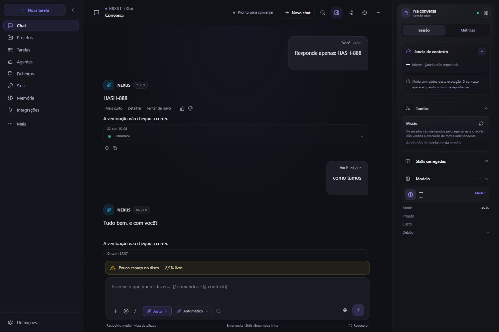
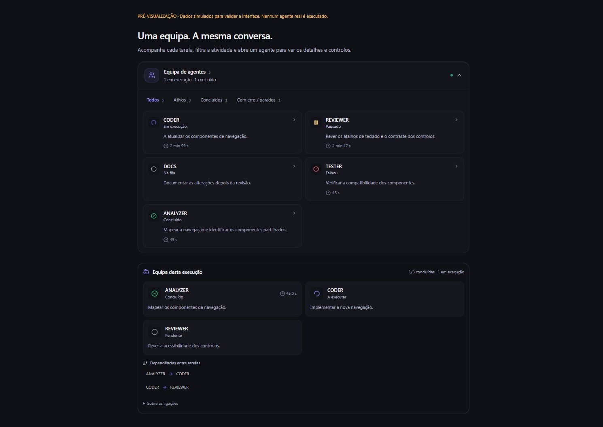
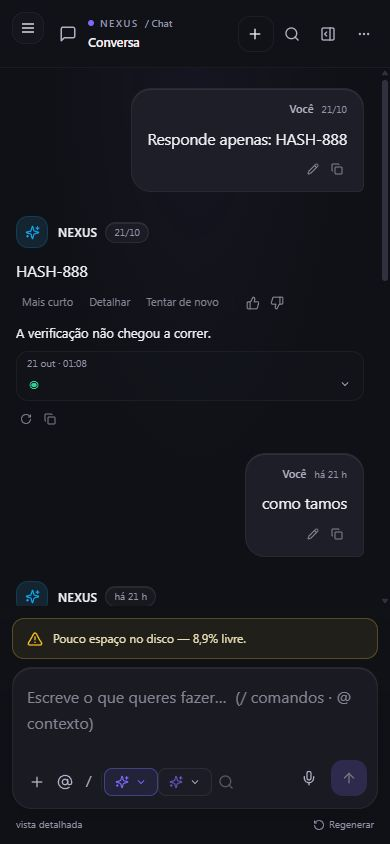

# NEXUS — reformulação do dashboard do chat

Data: 2026-10-25 · Europe/Lisbon.

## Resultado

Interface implementada no frontend existente, com a conversa como superfície principal, atividade de agentes dentro da área de mensagens, contexto adaptado a desktop e telemóvel e controlos de navegação mais acessíveis. Foram mantidos os tokens do tema e os contratos de eventos, persistência, modelos e ações do backend.

O checkout já continha numerosas alterações anteriores. Não foram revertidas alterações do utilizador, apagados ficheiros, criados commits, enviados commits ou alteradas branches.

## Observações da captura inicial

1. Duas barras no topo competiam pelo espaço da conversa.
2. Os seletores de modo e modelo apareciam tanto no cabeçalho como no compositor.
3. O painel de contexto misturava tarefas da sessão com métricas do sistema numa lista longa.
4. A atividade de subagentes estava dentro da área fixa de escrita, podendo reduzir o espaço disponível para conversar.
5. O botão flutuante Infinity sobrepunha-se aos controlos do compositor em ecrãs pequenos.
6. Na sessão de validação, uma falha inicial de ligação deixara o seletor de modos vazio, sem conseguir recuperar ao reabrir.

## Alterações implementadas

- Cabeçalho único, com o título da conversa, nova conversa, pesquisa, contexto, partilha, foco e menu de opções.
- Seletores de modo e modelo concentrados no compositor.
- Estado vazio com ações iniciais descritivas, foco na caixa de escrita após escolher uma sugestão e conversas recentes que excluem a sessão atual.
- Mensagens com largura de leitura controlada, superfícies neutras e identificação do assistente com avatar discreto.
- Compositor responsivo, com botão de enviar mantido no ecrã mesmo a 320 px.
- Menus de modo e modelo posicionados dentro da área visível; reposicionamento em resize/scroll e quando muda a área da janela no telemóvel.
- Contexto com separadores Sessão e Métricas, incluindo navegação por setas, Home e End.
- Contexto móvel num dialog nativo, com contenção de foco, Escape e restituição do foco ao botão de abertura.
- Histórico de sessões com foco inicial na pesquisa, contenção de Tab, Escape, restituição do foco e fecho após selecionar uma conversa.
- Foco sincronizado entre a página, o cabeçalho e o atalho, eliminando os dois mecanismos concorrentes de Ctrl/Cmd+Shift+F.
- Infinity Suite acessível no menu do chat, sem o botão flutuante sobre os controlos; o botão flutuante continua disponível nas restantes páginas.

### Subagentes

- Painel recolhível dentro da área de mensagens, preservando o espaço fixo do compositor.
- Cartões com nome, estado, tarefa atual/objetivo e tempo quando existem dados para o calcular.
- Agentes ativos primeiro; suporte também aos estados pendente e em espera.
- Filtros Todos, Ativos, Concluídos e Com erro / parados, com contagens derivadas dos estados recebidos.
- Inspector com os campos efetivamente recebidos, erro concreto e ações de pausa, retoma e paragem confirmadas pelo backend.
- Grafo apresentado com cartões, estados, duração quando reportada e dependências de tarefas. IDs e detalhes ficam no inspector; não são inventadas relações pai-filho.
- Correção da deteção de conclusões simultâneas: o antigo `some()` interrompia a atualização de estados no primeiro agente concluído, deixando outros sem registo e repetindo callbacks em refreshes seguintes. Um ciclo completo passa a registar todos os estados antes de notificar.
- Tempos terminais sem data final deixaram de aparecer como contadores que continuam a crescer.

## Percurso verificado

| Passo | Superfície | Resultado e limites |
| --- | --- | --- |
| 1 | Conversa existente em desktop | Verificada com a mesma conversa da captura inicial, desde o início; cabeçalho, mensagens e contexto sem sobreposição. |
| 2 | Nova conversa | Criação pela interface e apresentação do estado vazio verificadas; foi criada uma sessão vazia de teste. Nenhum pedido ao modelo foi enviado. |
| 3 | Modo e modelo | Recuperação da lista de modos após falha de arranque verificada na aplicação real; catálogo de modelos carregado. Menus contidos num viewport de 390 × 844. Listagem não comprova inferência dos modelos. |
| 4 | Histórico e pesquisa | Abertura, foco na pesquisa de sessões, Escape, seleção de conversa e fecho do painel verificados. A pesquisa real por `HASH-888` encontrou as duas mensagens correspondentes, além da cobertura pelos testes de regressão. |
| 5 | Contexto | Separadores verificados em desktop. Dialog móvel verificado com Escape e restituição de foco ao acionador. |
| 6 | Foco | Atalho de entrada e Escape de saída verificados na aplicação real. |
| 7 | Subagentes | Cartões, filtros, inspector, pausa, retoma e dependências verificados numa pré-visualização isolada com dados simulados. As ações não executaram agentes reais. Testes de regressão verificam isolamento entre sessões, confirmação de ações e conclusões simultâneas. |
| 8 | Responsividade | Verificados 320 × 740, 390 × 844 e 1500 × 1000. A 320 px não havia overflow horizontal e todos os botões visíveis do cabeçalho e o botão de enviar estavam dentro do viewport. |

## Validação automática

Com pnpm 10.34.8, a partir de `frontend/`:

- Suite completa: **99 ficheiros, 1.213 testes aprovados** na última execução.
- TypeScript: **sem erros**.
- ESLint: **sem erros, 21 avisos não bloqueantes**.
- Build de produção: **concluído**, incluindo validação de tipos e geração de 37 páginas estáticas.
- `git diff --check` no âmbito alterado: sem erros; apenas aviso de normalização CRLF/LF num ficheiro de testes.

Foram acrescentadas regressões para filtros de agentes, recolher/expandir com seleção preservada, múltiplas conclusões no mesmo refresh e recuperação do catálogo de modos depois de falhar a ligação inicial.

Alguns testes existentes continuam a emitir avisos React sobre `act()`; isso não alterou o resultado aprovado da suite.

## Evidência e limites

Capturas finais aceites:

- `01-before-desktop.png`: referência inicial, 1500 × 1000. Conteúdo JPEG recebido da ferramenta, preservado sem edição.
- `04-after-mobile-context.jpg`: dialog de contexto móvel.
- `05-after-agents-desktop-simulated.jpg`: componentes reais com ciclo de vida simulado, explicitamente identificado na imagem.
- `09-after-conversation-desktop-full.jpg`: comparação final da mesma conversa em desktop.
- `10-after-mobile-chat.jpg`: conversa final no telemóvel.
- `11-after-search-mobile.jpg`: pesquisa real da conversa com dois resultados.

Capturas intermédias foram preservadas na pasta. As imagens parciais ou com captura inadequada não substituem as finais listadas acima.

A pré-visualização dos agentes está em `frontend/tests/visual/chat-team/`, usa os componentes reais com uma API de teste em memória e não introduz rotas na aplicação. O servidor temporário de pré-visualização foi encerrado após a validação.

Frontend local na porta 3000 e API na porta 8000 mantidos disponíveis para inspeção. A API foi iniciada sem reload e com `NEXUS_BACKGROUND_SERVICES=off`, para não arrancar tarefas autónomas durante a revisão visual.

Não foram executados pedidos reais de geração, subagentes reais, testes backend ou validações prolongadas de autonomia. Este trabalho valida o frontend e os percursos descritos; não certifica prontidão global do NEXUS. A revisão visual foi feita no tema escuro e não constitui uma auditoria completa de acessibilidade. O aviso de espaço livre foi preservado por corresponder à telemetria real.
