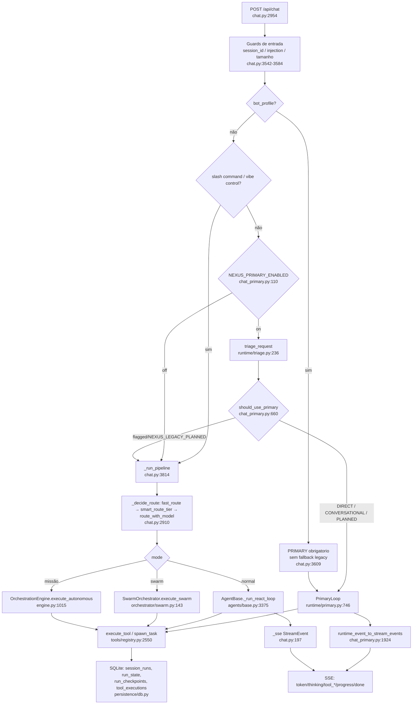

# INVENTÁRIO TÉCNICO — NEXUS IDE (closeout)

**Data:** 2026-11-12 · **Modo:** READ-ONLY (exceto criação de ficheiros em `docs/closeout/` e `artifacts/closeout/logs/`)
**Árvore primária:** `/mnt/c/Users/rodri/Desktop/nexus/nexus-ide`
**Raiz git canónica:** `/mnt/c/Users/rodri/Desktop/nexus` (a árvore primária **não** é raiz de repo; ver §0)

Todas as afirmações têm prova: saída de comando gravada em `artifacts/closeout/logs/`, ou `ficheiro:linha` efetivamente lido.
Itens não verificados em runtime estão marcados **UNVERIFIED** com o motivo.

---

## 0. Topologia de repositórios (pré-requisito)

| Caminho | O que é | Prova |
|---|---|---|
| `/mnt/c/Users/rodri/Desktop/nexus` | **raiz git** do projeto (`.git/`, `README.md`, `docs/`, `data/`, `.github/`) | `git rev-parse --show-toplevel` executado a partir de `nexus/` e de `nexus/nexus-ide/` devolve o mesmo caminho: `/mnt/c/Users/rodri/Desktop/nexus`. Gravado em `logs/git-state-outer.txt`, `logs/git-state-parent.txt`. O parent **não** é um repo separado do primário — é o repo que contém o primário. |
| `/mnt/c/Users/rodri/Desktop/nexus/nexus-ide` | **sub-directório de projeto** (código backend + frontend + config) | mesmo output de `--show-toplevel`; `nexus-ide/` não tem `.git` próprio |
| `/mnt/c/Users/rodri/Desktop/nexus/nexus-ide/nexus/nexus-ide` | **não é árvore divergente** — contém 1 ficheiro | `find nexus -type f` → 1 ficheiro: `nexus/nexus-ide/__init__.py`, cuja primeira linha é `# Make the directory a package so cache can be imported`. Zero divergência de código a comparar. |

**Nota:** o parent e o primário partilham o histórico git; `HEAD` = `e12c214 docs: rewrite the READMEs around the current UI`. `docs/closeout/D-15-CANONICAL-ROOT.md` (já existente) regista a mesma conclusão.
**Risco de duplicação de árvore:** inexistente ao nível de código. Existe, sim, acumulação de executáveis/artefactos na raiz (`backend-*.log` ≈ 2.4 MB, `node_modules/` em `nexus/` e em `nexus-ide/`).

---

## 1. Mapa de entrypoints de execução

### 1.1 Superfície HTTP total

`app = FastAPI(...)` em `backend/orchestrator/main.py:978`. A app arranca (prova executada: `logs/routes-probe.txt`, linha `APP OK: NEXUS IDE Orchestrator | version: 0.1.0`) e expõe:

- **369 paths OpenAPI** (`logs/routes-probe.txt`: `OPENAPI PATHS: 369`), 401 operações (`POST 149`, `GET 234`, `PUT 6`, `DELETE 10`, `PATCH 2`).
- **60+ prefixes `/api/*`**; maiores: `/api/workspace` 22, `/api/analytics` 16, `/api/tasks` 15, `/api/metrics` 13, `/api/swarm` 13, `/api/advanced-modes` 13, `/api/agents` 12, `/api/evolution` 12.
- Guardas de entrada verificadas em runtime (`logs/route-guard-probe.txt`): `POST /api/chat` → **401 Authentication required** sem token; `GET /health` → 200; `GET /api/ready` → 200 `{"status":"ready",...}`.

**Entrada alternativa (MORTA):** `backend/orchestrator/main_enhanced.py:142` cria uma segunda FastAPI app com 12 routers. Está **quebrada em importação** — prova executada em `logs/alt-entrypoints-probe.txt`:
`IMPORT/RUN FAIL: ImportError cannot import name 'MemoryItem' from 'backend.memory.advanced_memory'`.
Causa-raiz: `backend/memory/__init__.py:11` importa `MemoryItem` de `backend.memory.advanced_memory`, onde essa classe **não existe** (as classes reais são `MemoryFragment`, `MemoryEpisode`, `EpisodicMemory` — verificado em `backend/memory/advanced_memory.py:55,182,308`). Consequência: `backend.memory`, `backend.memory.memory_dashboard` e `backend.memory.cross_session_memory` são **inimportáveis** (prova: `logs/import-probe.txt` + reexecução dirigida). Isto mata `main_enhanced.py:30` (import de `memory_dashboard`) e portanto todo o entrypoint "enhanced".

### 1.2 Caminhos de execução classificados

| # | Caminho | Entry route | Site de decisão ("quem age a seguir") | Agent loop | Ferramentas | Persistência | Eventos SSE |
|---|---|---|---|---|---|---|---|
| **1** | **PRIMARY** (rota principal) | `POST /api/chat` (`backend/orchestrator/routes/chat.py:2954` → `_select_pipeline` `chat.py:3524`) | **Triagem determinística**: `triage_request()` (`backend/runtime/triage.py:236`) chamada por `plan_turn()` (`chat_primary.py:155`); depois `should_use_primary()` (`chat_primary.py:660`) escolhe PRIMARY vs legacy. `_decide_route()` (`chat.py:2910`) só corre no legacy | **`PrimaryLoop`** (`backend/runtime/primary.py:630`, `run()` em `:746`) — ciclo `OBSERVE → ACT → TOOL → TEST → REPORT` | `execute_tool` (`backend/tools/registry.py:2550`); subagentes via `_make_subagent_runner` (`chat_primary.py:3111`) → `spawn_task` | `RunLifecycle`/`RunCoordinator` (`runtime/run_coordinator.py`), `upsert_session_run` (`persistence/db.py:1884`), `create_subagent_execution` (`db.py:1266`), journal em disco (`runtime/events.py`) | `token`, `thinking`, `tool_call`, `tool_result`, `progress`, `agent_started`, `metric`, `done` via `runtime_event_to_stream_events` (`chat_primary.py:1924`) |
| **2** | **Legacy pipeline** (adapter) | mesmo `POST /api/chat`, ramo `legacy()` em `chat.py:3534` → `_run_pipeline` (`chat.py:3814`) | `_decide_route` (`chat.py:2910`): **3 níveis** — `fast_route` determinista → `smart_route_tier` heurístico → `route_with_model` LLM; scores 0.9/0.8/— | **`AgentBase._run_react_loop`** (`backend/agents/base.py:3375`, orçamento `NEXUS_REACT_MAX_ITERATIONS` default **24**, `base.py:3383`) | mesmas ferramentas + `consult_agent`, `spawn_task` | `create_session`/`add_message` (`db.py`), `_checkpoint` local em `chat.py:3863`, `SessionRun` | `routing`, `agent_started`, `token`, `agent_finished`, `tool_*`, `done` |
| **3** | **Multi-agent chat** | `POST /api/chat/multi` (`backend/orchestrator/routes/multi_agent_chat.py:83`) | **Não montada na app principal.** Prova: `POST /api/chat/multi` → **404 Not Found** em `logs/route-guard-probe.txt`; grep por `multi_agent_chat` em `main.py`/`main_enhanced.py` = zero resultados | nenhum (loop externo sequencial) | nenhuma | nenhuma (só EventBus) | `routing`, `agent_started`, `token`, `agent_message`, `synthesis`, `done` |
| **4** | **Bot groups (sala + file run)** | `POST /api/bot-groups/{group_id}/messages` (`bot_groups.py:361`) e `POST /api/bot-groups/{group_id}/runs` (`bot_groups.py:238`) | ordem de menções por regex `_mentioned_turn_order` (`bot_groups.py:290`); no file-run a ordem é a dos membros do grupo | **loop próprio** `_execute_run` (`bot_groups.py:135`) — turnos sequenciais com deadline, sem ReAct | **só `read_file`** (`bot_groups.py:150`), via `read_file(path, project_path, owner=run_id)` | `bot_group_runs.set_run/set_task/record` (`persistence/bot_group_runs.py:40-56`), `bot_group_messages` | `POST` devolve `run_id`; o progresso é lido por polling `GET /{group_id}/runs` (`bot_groups.py:127`) — **não é SSE** |
| **5** | **Mission engine** | `POST /api/missions` (`routes/mission.py`) + arranque dentro do chat autónomo em `chat.py:2160` (`start_mission`) | `Coordinator.decide` só no swarm novo; na missão clássica o `OrchestrationEngine` planeia (`engine.py:1137 create_plan(auto_approve=True)`) | `OrchestrationEngine._run_autonomous_cycle` (`engine.py:1121`) `PLAN → EXECUTE → VERIFY → REVIEW` | ferramentas dos agentes da wave | `mission_control.py`, `run_state`/`run_checkpoints` (ver §persistência) | `mission_brief`, `mission_plan`, `mission_wave`, `mission_agent`, `mission_verification`, `mission_completed` (`models/api.py:78-88`) |
| **6** | **Scheduler** | `backend/runtime/scheduler.py:136` (`RuntimeScheduler`) + `backend/tasks/autonomous_tasks.py:1296` (`AutonomousTaskManager`), exposto em `/api/tasks/*` (`routes/autonomous_tasks.py:170`) | `TaskScheduler` (`autonomous_tasks.py:225`) — dependências + prioridade; `_assert_acyclic` (`scheduler.py:421`) | herda o loop do agente da tarefa | conforme `HandlerRegistry` (`tasks/handler_registry.py:41`) | `scheduled_tasks` (6 973 linhas — `logs/db-inventory.txt`) | `GET /api/tasks/stream` (`routes/tasks.py:326`) |
| **7** | **SWARM (novo)** | `POST /api/swarm/run` (`backend/swarm/api/routes.py:341`) | `Coordinator.decide(objective, explicit_mode)` (`swarm/core/coordinator.py:198`, chamado em `swarm/core/orchestrator.py:213`) | `SwarmOrchestrator.run` (`swarm/core/orchestrator.py:181`) — modo+estratégia coordenada | RAG/index, skills, workflows; agentes do enum do modo | `_save_run(payload)` em `routes.py:359`; `ShortTermMemory.add` | HTTP síncrono (não SSE) |
| **8** | **SWARM (legacy, dentro do chat)** | ramo `mode in ("swarm","auto_swarm")` do legacy pipeline (`chat.py:5144`) | `_select_strategy` (`backend/orchestrator/swarm.py:641`) | `execute_swarm` (`swarm.py:143`) com estratégias `_divide_and_conquer`/`_ensemble`/`_pipeline`/`_debate` | agentes do registry | `messages` + memória semântica | `agent_started`/`token` por subagente + fila viva `live_queue` (`chat.py:5058`) |
| **9** | **Advanced modes / Infinity** | `POST /api/advanced-modes/{mode_id}/activate` (`routes/advanced_modes.py:188`); barramento por slash-commands em `chat.py:3646` (`resolve_command`, `parse_vibe_control`) | `AdvancedModeOrchestrator` (`advanced_modes.py:757`) + `build_active_execution_profile` | herda PRIMARY/legacy | allowlist por modo (`apply_advanced_mode_tool_allowlist`, `advanced_modes.py:341`) | `.nexus/advanced-modes/` | `execution_state`, `execution_error`, `execution_completed` |
| **10** | **Autonomous tasks / background** | lifespan em `main.py:516` + `/api/tasks` (POST) | `NEXUS_BACKGROUND_SERVICES` e 12 flags `NEXUS_ENABLE_*` (`main.py:524-537`) | conforme handler | conforme handler | `scheduled_tasks` | via EventBus/WebSocket |

**Fluxo completo (mermaid):**

**Decision sites (resumo):** 3 nos caminhos ativos —
1. `should_use_primary` (`chat_primary.py:660`) — escolha de lane;
2. `triage_request` (`runtime/triage.py:236`) — classe de pedido (CONVERSATIONAL/DIRECT/PLANNED) dentro do PRIMARY;
3. `_decide_route` (`chat.py:2910`) — escolha de agente no legacy (3 níveis).
No swarm novo existe um 4.º (`Coordinator.decide`), e no scheduler um 5.º (dependências/prioridade).

---

## 2. Estado por subsistema

Legenda: **COMPLETO** = implementado e exercitável · **PARCIAL** = implementado com faltas provadas · **STUB** = esqueleto sem execução real · **MORTO** = não alcançável · **DUPLICADO** = segunda implementação da mesma coisa · **SIMULADO** = finge funcionar (provado).

| Subsistema | Estado | Prova |
|---|---|---|
| **backend/orchestrator** | **PARCIAL** (com parte MORTA) | 153 ficheiros, 369 rotas montadas e guardas verificadas em runtime (`logs/routes-probe.txt`, `logs/route-guard-probe.txt`). Morta: `main_enhanced.py` (ImportError `MemoryItem`, `logs/alt-entrypoints-probe.txt`), `routes/multi_agent_chat.py` (404, não montada). 18 marcadores TODO/FIXME (`logs/subsystem-marker-counts.txt`), 10 só em `mission_control.py`. |
| **backend/runtime** | **COMPLETO** (núcleo) | 15 ficheiros; `PrimaryLoop` 3 093 linhas com ciclo observe→act→tool→test→report (`primary.py:746-960`), scheduler com DAG acíclico (`scheduler.py:421`), triagem determinística (`triage.py:236`), run coordinator com DoD (`run_coordinator.py:982`). **0** marcadores TODO/FIXME. |
| **backend/agents** | **COMPLETO** | 78 ficheiros; ReAct loop real em `base.py:3375`; 26 classes de agente instanciadas com sucesso em runtime (`logs/agent-probe.txt`: `classes: 26`, `resolved OK: 29`). |
| **backend/tools** | **PARCIAL** | 148 ferramentas registadas, 137 ativas; 11 inutilizáveis por dependência opcional ausente (`logs/tool-probe.txt`). Testes unitários locais: `todo_list`, `list_dir`, `read_file`, `execute_shell`, `web_search`, `get_system_health`, `recall_context`, `get_budget_report` → OK; `git_status`/`todo_write` → `invalid_args`; `run_tests` → timeout 240 s real (`logs/tool-exec-probe.txt`). |
| **backend/llm** | **PARCIAL** com **SIMULADO** controlado | 21 ficheiros, 12 provedores. `MockProvider` (`factory.py:244`, `simulation = True`) e `DevProvider` (`dev_provider.py:20`) são simulações **explícitas**. Prova de que não passam por reais: `ResilientLLMProvider` recusa simuladores em métodos de resposta (`factory.py:556-571`) e `MultiLLMManager` devolve `category="simulation"` (`multi_llm_manager.py:496`). |
| **backend/persistence** | **COMPLETO** | 45 tabelas em `nexus.db`; 21 461 checkpoints, 108 runs, 50 side-effects, 693 execuções de ferramentas, 1 580 memórias persistentes (`logs/db-inventory.txt`). |
| **backend/swarm** | **PARCIAL / DUPLICADO** | Há **dois** swarms: `backend/swarm/` (novo, coordenador+RAG+quality, 13 rotas) e `backend/orchestrator/swarm.py` (legacy, usado pelo chat `chat.py:5144`). Nenhum stub, mas a duplicação é real. |
| **backend/knowledge** | **PARCIAL** | `knowledge/memory.py:236` (`MemoryStore`) é real, mas **in-memory com persistência opcional** (o docstring admite "For production, swap with a full vector DB backend"). Backends `qdrant`/`elasticsearch` são opcionais e ausentes: `QDRANT_AVAILABLE: False` (`logs/dependency-probe.txt`, fim do ficheiro). **0** TODO. |
| **backend/evolution** | **PARCIAL / SIMULADO (limitado)** | `evolution/arena.py:248 _simulate_experiment` é simulação **opt-in**: só sem benchmark runner e exige `allow_simulation=True` (`arena.py:109-114`); `regression_guard.py:276` rejeita resultados `simulated`. Ou seja: simulação existe mas é recusada por código. |
| **backend/core** | **PARCIAL** | 36 ficheiros (workspace FS, shell, disk guard, agent bus, background workers). Não otimizado para o closeout: `background_workers.py` tem `subprocess` + `shutil` em módulo de arranque por omissão (ver §6). |
| **backend/tasks** | **PARCIAL** | 2 ficheiros; `TaskScheduler` + `AutonomousTaskManager` reais, 6 973 tarefas agendadas na BD. Não é stub. |
| **frontend (app/hooks/lib)** | **PARCIAL** | 232 ficheiros TS/TSX, 56 949 linhas. SSE real (`useSSE`/`useAgentStream`, `lib/api.ts:127` POST `/api/chat`). Lacuna provada: `/api/chat/multi` está documentado como feature e dá **404**. |
| **config** | **COMPLETO** | 15 ficheiros; 73 ações → 72 ferramentas distintas em `agent_actions.yaml`; `models.yaml` com 15 tiers + 4 preços; `modes-advanced.yaml` com 14 modos + 11 grupos. |
| **docker** | **PARCIAL** | `docker/docker-compose.yml` completo (backend+frontend+redis, healthchecks), mas **não é o caminho de arranque real**: o projeto corre em Windows nativo (`Makefile:89`, `STARTUP.md`), e falta `alert_rules` (as `rule_files` estão comentadas em `config/prometheus.yml`). |
| **observability** | **PARCIAL** | `prometheus_client`, `event_bus`, `structured_logger`, `health.py` presentes; mas `structured_logs` tem **0 linhas** na BD e **OpenTelemetry está ausente** (`opentelemetry` MISS em `logs/dependency-probe.txt`), ao contrário do que `ARCHITECTURE.md:107` afirma. |

**Contagem de estados:** COMPLETO 4 · PARCIAL 8 · MORTO 2 (main_enhanced, multi_agent_chat) · DUPLICADO 1 (swarm) · SIMULADO 2 (Mock/DevProvider — deliberados e bloqueados; arena — opt-in e bloqueado) · STUB 0.

**Simulados explicitamente caçados (prova):** `factory.py:244` `MockProvider.simulation = True`; `dev_provider.py:23` `simulation = True`; `arena.py:248` `_simulate_experiment`; recusa em `factory.py:571`, `multi_llm_manager.py:496`, `regression_guard.py:276`. **Nenhum mock/stub foi encontrado em caminhos de execução ativos sem ser recusado por código.**

---

## 3. Registo de ferramentas vs executabilidade real

Probe executado com o Python **3.13.14** do venv do projeto + `site-packages` do `.venv` (`logs/tool-probe.txt`, `logs/tool-exec-probe.txt`).

- **148 ferramentas registadas** (`TOTAL REGISTERED: 148`)
- **137 ativas** (`ENABLED+AVAILABLE: 137`)
- **46/46 módulos de ferramentas importáveis** (`MODULES OK: 46 FAILED: 0`)
- Disponíveis: 108 · Requerem confirmação: 29 · **Dependência ausente: 11**

| Classe | Ferramentas | Motivo |
|---|---|---|
| **MISSING_DEP** (7) | `browser_navigate`, `browser_click`, `browser_fill`, `browser_extract_text`, `browser_screenshot`, `browser_get_links`, `browser_close` | `playwright` não instalado (`uv sync --extra browser`) |
| **MISSING_DEP** (4) | `db_query`, `db_schema`, `db_tables`, `db_execute` | `aiosqlite` não instalado |
| **OK** (verificado por execução real) | `todo_list`, `list_dir`, `read_file`, `execute_shell`, `web_search`, `get_system_health`, `recall_context`, `get_budget_report` | retornaram `ok: true` em `logs/tool-exec-probe.txt` |
| **BROKEN** (arg-schema) | `git_status`, `todo_write` | `error_category: invalid_args` com os args usados no probe — precisam de args diferentes (não é necessariamente defeito) |
| **BROKEN** (tempo real) | `run_tests` | `timeout` ao fim de 240 s (`exit_code 124`) ao correr `backend/tests` |
| **UNAUTHORIZED** | 0 (nenhuma ferramenta bloqueada por política neste ambiente) | `write_file_absolute` devolveu `confirmation_required` — comportamento correto, não falta de autorização |

Nada destrutivo ou com rede externa foi executado. `agent_actions.yaml` declara 73 ações → 72 ferramentas distintas (diferença de 76 face ao registo real: ações e ferramentas não são 1:1).

---

## 4. Provedores configurados vs ativos

Fonte: `backend/config/settings.py:296` (`free_only: bool = Field(default=True, validation_alias="NEXUS_FREE_ONLY")`), `backend/llm/factory.py`.

- **`NEXUS_FREE_ONLY` está ON por omissão.** Dupla prova: default do campo (`settings.py:296`) e `_free_only_enabled` (`factory.py:199-207`) que devolve `True` quando não há override. Verificado em runtime: `free_only resolved (default settings): True` (`logs/provider-probe.txt`).
- **Nomes de chaves presentes no ambiente (sem valores):** `KILO_API_KEY`, `NVIDIA_API_KEY`, `OPENROUTER_API_KEY`, `OPENROUTER_API_KEY_2` estão *set* (só nomes, gravados em `logs/provider-probe.txt`). `.env` define `LLM_PROVIDER=lmstudio`, `DEFAULT_PROVIDER=ollama`, `FALLBACK_PROVIDER=ollama`, `NEXUS_ENABLE_OLLAMA=true`, `OPENCODE_GO_BASE_URL=https://opencode.ai/zen/go/v1`.
- **Provedor ativo em runtime:** apenas **`openrouter`** fica registado no manager (`providers registered: ['openrouter']`, `policy_candidates: 475`). `KiloProvider` **não** é registado com `free_only=true` — código explícito em `factory.py:1250-1258` ("Kilo is a PAID gateway... key present AND free-only disabled"), e `factory.py:1514` recusa `kilo` no caminho de provider único.
- **Cadeia de fallback e terminação em MockProvider:**
  - `free_only=true` (`logs/provider-probe.txt`): primary=openrouter → `[LMStudioProvider]`; primary=ollama → `[OpenRouterProvider]`; primary=lmstudio → `[OpenRouterProvider]`. **Nenhuma termina em MockProvider** — a política livre fecha a cadeia em provedores locais/OpenRouter validados.
  - **Modo pago** (`free_only=false`): `PAID chain: [OpenRouterProvider, MockProvider]` — **termina em `MockProvider` (`simulation=True`)**, e esse é também o comportamento quando `NEXUS_TEST_DISABLE_REMOTE_FALLBACKS` está ligado (`factory.py:1043-1046`).
  - Nota: `MockProvider` é o último recurso **sempre adicionado** no caminho pago (`factory.py:1159-1161`), mas o `ResilientLLMProvider` recusa-o para métodos de resposta (`factory.py:556-571`) e devolve `category="simulation"`.
- **Reforço da política na API:** `free_only` é operator-only — `routes/settings.py:81 OPERATOR_CONTROLLED_KEYS = frozenset({"free_only"})`; só o enfraquecimento é recusado.
- **UNVERIFIED:** quota real, validade das chaves e preços atuais dos modelos — não foram feitas chamadas de rede (missão read-only, sem custo). O probe de embedding no log mostra exatamente esse bloqueio em ação: `OpenRouter model '...' is not confirmed free and available` → falha sem chamada paga.

---

## 5. Agentes registados vs invocáveis

- **`AgentName` (Enum de API):** 29 nomes (`backend/models/api.py:16-47`) — inclui `ROUTER`, `SWARM`, `ORCHESTRATOR`, que **não têm classe própria**.
- **Classes registadas no registry:** 26 (`backend/orchestrator/registry.py:60-87`), todas importadas e instanciadas em runtime: `logs/agent-probe.txt` → `classes: 26`, `resolved OK: 29`, zero falhas.
- **`resolve()` faz fallback para `CODER`** quando o nome não tem classe ou não tem `run` (`registry.py:123-137`). Consequência medida em runtime:
  - `ROUTER` → `CoderAgent` · `SWARM` → `CoderAgent` · `ORCHESTRATOR` → `CoderAgent` · `GUARDIAN` → `CoderAgent` (o `NexusGuardianAgent` não tem `run` — é um monitor `start()/get_status()`, `guardian.py:51-72`).
- **Bots persistidos:** 8 perfis vivos em `bot_profiles` (2 grupos), `logs/bots-and-db.txt`. Todos invocáveis: sessão de bot é resolvida por `bot_for_session` (`persistence/bots.py:115`) e corre **forçado no PRIMARY** com política sem ferramentas (`chat.py:3609-3640`).

| Classe | Contagem |
|---|---|
| **OK** (classe + `run()` + caminho de código que a executa) | **26** agentes especialistas + 8 bots persistidos |
| **NAME-ONLY** (nome no enum, sem classe própria, resolve para CODER) | **4** — `ROUTER`, `SWARM`, `ORCHESTRATOR`, `GUARDIAN` |
| **UNREACHABLE** | 0 agentes especialistas. (`GUARDIAN` tem loop próprio em `guardian.py` mas não é invocável por nome de agente.) |

**Documentação:** `ARCHITECTURE.md:22` afirma "24 registered specialist agents" e lista 9 em §3 — o código tem 26 classes + 4 name-only. A lista da doc está desatualizada/incompleta (ver §7).

---

## 6. Flags, variáveis de ambiente e defaults

Defaults lidos em código (não inferidos). Lista completa de nomes `NEXUS_*` no backend: `logs/env-nexus-backend.txt` (137 nomes).

| Variável | Default | Onde é lida |
|---|---|---|
| `NEXUS_FREE_ONLY` | **true** (fail-closed) | `backend/config/settings.py:296` |
| `NEXUS_PRIMARY_ENABLED` | **1** (ligado) | `chat_primary.py:110-113`; revert para legacy quando `0` |
| `NEXUS_LEGACY_PLANNED` | vazio (PLANNED vai ao PRIMARY) | `chat_primary.py:672-678` |
| `NEXUS_RUN_LIFECYCLE` | **1** | `runtime/primary.py:2458-2461` |
| `NEXUS_PRIMARY_MAX_CYCLES` | **2** (`.env` linha 186 tem comentário `=2`) | `chat_primary.py:1218` |
| `NEXUS_PRIMARY_SIGNAL_TIMEOUT` | **900** | `chat_primary.py:1238` |
| `NEXUS_TOOL_TIMEOUT` | **240** s | `tools/registry.py:79` |
| `NEXUS_TOOL_MAX_FAILURES` | **3** | `tools/registry.py:82`; `.env:177` confirma `=3` |
| `NEXUS_REACT_MAX_ITERATIONS` | **24** (a doc diz 7!) | `agents/base.py:3383` |
| `NEXUS_MAX_PARALLEL_WORKERS` | **3** | `chat_primary.py:2710` |
| `NEXUS_BACKGROUND_SERVICES` | vazio = **ON** (todos os 12 serviços) | `main.py:304`, `main.py:518` |
| `NEXUS_ENABLE_<SERVIÇO>` (12) | **true** cada | `main.py:524-537` |
| `NEXUS_AUTO_APPLY` | **false** (`.env:136`) | política conservadora de auto-aplicação |
| `NEXUS_AUTO_APPLY_DRY_RUN` | **true** (`.env:141`) | dry-run por omissão |
| `NEXUS_EVENT_JOURNAL` | **1** (`.env:193`) | `chat_primary.py:1253` |
| `NEXUS_REASONING_VISIBILITY` | **full** (`.env:201`) | `run_reasoning.py` / política em `chat_primary.py:1969` |
| `NEXUS_ENABLE_OLLAMA` | **false** no schema; `.env:32` força `true` | `settings.py:305` |
| `NEXUS_DB_PATH` | `<repo>/data/nexus.db` | `persistence/db.py:63-66` |
| `NEXUS_TEST_DISABLE_REMOTE_FALLBACKS` | false | `factory.py:198` (só usado em testes) |

**Contagem total:** 137 nomes `NEXUS_*` referenciados no backend (`logs/env-nexus-backend.txt`); 65 chaves definidas no `.env` (`logs/env-keys-set.txt`, apenas nomes).

---

## 7. Dívida documental (afirmações verificadas e contraditas)

| Documento | Afirmação | Realidade | Prova |
|---|---|---|---|
| `ARCHITECTURE.md:22` | "24 registered specialist agents" | **26** classes registadas (+4 nomes sem classe) | `logs/agent-probe.txt`: `classes: 26` |
| `ARCHITECTURE.md:74` | ReAct "max 7 iterations, configurable" | default real é **24** | `agents/base.py:3383` |
| `ARCHITECTURE.md:41-50` | diagrama de provedores com `Ollama (local)` como fallback do OpenCode Go; "OpenCode Go is the primary cloud provider" | provedor ativo em runtime é **openrouter**; Kilo é recusado em `free_only`; Ollama só entra se `NEXUS_ENABLE_OLLAMA` | `logs/provider-probe.txt`; `factory.py:1250`, `factory.py:1514` |
| `ARCHITECTURE.md:107` | "OpenTelemetry traces end-to-end" | `opentelemetry` **não está instalado** | `logs/dependency-probe.txt`: `MISS opentelemetry` |
| `ARCHITECTURE.md:104` | "ChromaDB/Qdrant ready for production" | `qdrant_client` **não instalado**; `QDRANT_AVAILABLE: False` | `logs/dependency-probe.txt` |
| `ARCHITECTURE.md:107` | "Redis for queue/cache" | Redis **não está a correr** neste ambiente; o sistema degrada sozinho (`Redis unreachable ... cache disabled`) | `logs/tool-exec-probe.txt`; `ps-listeners.txt` |
| `STARTUP.md:7` | "Python 3.12.10 installed" | ambiente real do venv = **3.13.14**; `Makefile`/`docker` usam 3.12; `pyproject` exige ≥3.12 | `logs/tool-probe.txt`: `python: 3.13.14`; `.venv/pyvenv.cfg` `version_info = 3.13` |
| `STARTUP.md` (inteiro) | descreve arranque manual como **o** caminho | ignora `INICIAR_NEXUS.bat`, os dois perfis de porta 8000/3000 vs 8001/3001 e o branch `closeout` vivo | `README.md:136-150` |
| `README.md` (Features) | lista **Bot groups**, `/api/chat/multi` implícito na arquitetura SSE | `POST /api/chat/multi` devolve **404** — rota não montada | `logs/route-guard-probe.txt` |
| `README.md:180` | tabela de env com `NEXUS_FREE_ONLY` como configurável | `free_only` é **operator-only** na API; enfraquecer é recusado | `routes/settings.py:71-81` |
| `docs/STATUS.md` | "Testes E2E retoma de run: **NOT_VERIFIED**" | mantém-se **NOT_VERIFIED**; o teste em causa é lento e depende de subprocesso | `docs/STATUS.md`; `logs/baseline-tests.txt` |

---

## 8. Riscos para o closeout

1. **Entrypoint alternativo quebrado por import.** `backend/memory/__init__.py:11` importa `MemoryItem`, que não existe em `advanced_memory.py`. Isto mata `main_enhanced.py`, `memory_dashboard` e `cross_session_memory`. Qualquer trabalho que toque `backend/memory/` ou arranque o "enhanced" falha até ser corrigido. **Não corrigido nesta missão (read-only).**
2. **`/api/chat/multi` é 404.** Documentado como feature de chat multi-agente, não montado. Se o closeout tratar "multi-agent chat" como entregue, a evidência contradiz.
3. **Provedor ativo depende de rede.** O único provedor registado é OpenRouter e está em `free_only`. Qualquer validação end-to-end real precisa de rede e chave; sem elas, a cadeia cai em `LMStudio`/`Ollama` locais e aí em `category="simulation"`.
4. **Bases de dados grandes e com estado real.** `data/` = **286 MB**; `nexus.db` 51 MB com **21 461 checkpoints** e `agent_bus.db` **210 MB** com 28 512 mensagens. Testes que toquem estas bases são lentos e alteram estado.
5. **`run_tests` timeouts a 240 s.** A suíte completa não cabe no orçamento por ferramenta (`logs/tool-exec-probe.txt`, `logs/baseline-tests.txt`); é preciso correr em fatias.
6. **Redis e OpenTelemetry ausentes.** Observabilidade e cache distribuído degradam silenciosamente (logs com `Redis unreachable ... cache disabled`).
7. **Serviços de background ON por omissão** (`main.py:518`, 12 flags). Um arranque de backend no closeout inicia guardian, auto-correction, self-improvement, session GC, etc. Usar `NEXUS_BACKGROUND_SERVICES=off` para validações controladas.
8. **Duplicação de árvore de trabalho.** `nexus/nexus-ide/` (1 ficheiro) é inofensiva, mas a raiz git tem worktrees/artefactos pesados (`node_modules/` duplicado, ~40 ficheiros `backend-*.log`) que inflam backups e diffs.
9. **`fixes` de configuração em aberto:** `validate_configuration()` falha **no ambiente atual** com `Self-registration cannot be enabled when BACKEND_HOST is not loopback` porque `.env:92` tem `BACKEND_HOST=0.0.0.0` (`logs/config-validation.txt`). A app **não arranca** assim; é preciso `ALLOW_SELF_REGISTRATION=false` ou host loopback.

---

## 9. Ficheiros de evidência

Todos em `artifacts/closeout/logs/`:
`routes-probe.txt` (369 paths) · `route-guard-probe.txt` (401/404/200 verificados) · `tool-probe.txt` (148 ferramentas) · `tool-exec-probe.txt` (execuções seguras) · `provider-probe.txt` (free_only, cadeias) · `agent-probe.txt` (26 classes) · `import-probe.txt` (46 módulos, 1 falha) · `alt-entrypoints-probe.txt` (main_enhanced quebrado) · `dependency-probe.txt` (39 pacotes) · `config-validation.txt` · `db-inventory.txt` · `bots-and-db.txt` · `subsystem-marker-counts.txt` · `env-nexus-backend.txt` · `env-keys-set.txt` · `file-counts.txt` · `git-state-outer.txt` · `git-state-parent.txt`.
